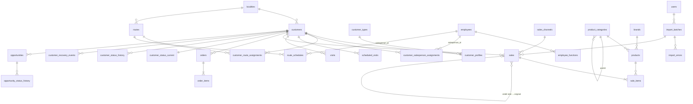

# DATA_MODEL — DistriCom

> v0.2 · 2026-10-03 · Propuesta. Las tablas se crean por migraciones Alembic en la fase indicada.
> v0.2: modelo revisado para la **plataforma modular** (ADR 006): ownership por plataforma/módulo, `employees` + `employee_functions` en lugar de `salespeople`, identidad de clientes en plataforma, tipos de import y de mapping extensibles, `suppliers` diferido.
> v0.3 · 2026-10-04: módulo **Rendiciones** (schema `settlements`, ADR 007); `employees` + `employee_functions` y `user_module_roles` adelantados a R0; modelo conceptual de Rendiciones en §13.

## 0. Ownership y schemas

Una sola base PostgreSQL. **Plataforma** (DistriCom Core) en el schema `public`; cada **módulo** en su propio schema: **Inteligencia Comercial** (`commercial`) y **Rendiciones** (`settlements`).

| Dueño | Schema | Tablas |
|---|---|---|
| Plataforma | `public` | `users`, `user_sessions`, `app_settings`, `audit_events`, `source_systems` (Fase 0) · `employees`, `employee_functions`, `user_module_roles` (R0) · `customers`, `localities`, `external_entity_mappings`, `import_batches`, `import_files`, `import_column_mappings`, `import_errors`, `import_staging_rows` (Fase 1) |
| Inteligencia Comercial | `commercial` | `customer_profiles`, `customer_types`, `routes`, `route_schedules`, `customer_route_assignments`, `customer_salesperson_assignments`, `product_categories`, `brands`, `products`, `sales_channels`, `sales`, `sale_items`, `orders`, `order_items`, `scheduled_visits`, `visits` (Fase 1) · `customer_status_*`, `customer_recovery_events`, `opportunities`, `opportunity_status_history`, `cross_sell_rules`, `commercial_goals`, `incentives` (Fases 4–8) |
| Rendiciones | `settlements` | Schema vacío en R0. Tablas por fase desde R1 (§13). |

Reglas:
- Una tabla tiene **un solo dueño**, que la define, la migra y es el único que escribe en ella. Un módulo escribe en tablas de plataforma solo a través de servicios de plataforma.
- **Claves foráneas:** módulo → plataforma, sí. Plataforma → módulo, **nunca**. Módulo → otro módulo, solo si esa dependencia está declarada en ARCHITECTURE.md (hoy no hay ninguna).
- Los nombres de tabla no llevan prefijo de módulo: el schema ya lo indica. En consultas y migraciones las tablas de módulo se califican (`commercial.sales`).
- **Única fuente de verdad:** un dato compartido (persona, cliente, localidad, sistema fuente, identidad externa) existe una sola vez, en plataforma. Los módulos guardan solo sus relaciones y atributos propios, referenciando la fila de plataforma.
- Las columnas que referencian a un empleado en un rol usan el nombre del rol (`salesperson_id → public.employees.id`).

## 1. Convenciones

- **PK**: `id BIGINT GENERATED ALWAYS AS IDENTITY`. Nunca CUIT, DNI, nombre ni código externo como PK.
- **IDs externos**: columnas `external_axum_id`, `external_store_id` (texto, nullable) con **unique parcial** `WHERE … IS NOT NULL`. Para casos ambiguos o múltiples IDs, `external_entity_mappings`.
- **Fechas de negocio**: `DATE` en zona horaria de negocio (`BUSINESS_TIMEZONE`, default `America/Argentina/Buenos_Aires`). Instantes: `TIMESTAMPTZ` (UTC).
- **Dinero**: `NUMERIC(14,2)`. Moneda en `app_settings.currency` (default `ARS`); nunca símbolo en datos.
- **Cantidades**: `NUMERIC(12,3)`.
- **Enums**: `TEXT` + `CHECK` (más fácil de migrar que `ENUM` de Postgres).
- **Auditoría estándar**: `created_at`, `updated_at` (`TIMESTAMPTZ NOT NULL DEFAULT now()`).
- **Trazabilidad**: toda fila importada lleva `import_batch_id` (FK) → responde "¿de qué importación salió este dato?".
- **Historización**: tablas de vigencia `valid_from DATE NOT NULL`, `valid_to DATE NULL` (NULL = vigente) con **exclusion constraint** (`btree_gist`) que impide solapamientos por entidad.
- Nombres en inglés, `snake_case`, tablas en plural.

## 2. ERD (resumen)

> Las entidades de plataforma (`employees`, `customers`, `localities`, `import_batches`) viven en `public`; el resto en `commercial` (ver §0).

## 3. Plataforma (Fase 0)

### users
| Columna | Tipo | Notas |
|---|---|---|
| id | bigint PK | |
| email | citext UNIQUE NOT NULL | |
| password_hash | text NULL | Argon2id; NULL si identidad externa futura |
| full_name | text NOT NULL | |
| role | text NOT NULL CHECK (`admin`,`viewer`) | **Rol de plataforma.** `admin` = administrador de plataforma (usuarios, empleados, configuración general) con `admin` en todos los módulos. El acceso de los demás usuarios a cada módulo está en `user_module_roles` (R0, ARCHITECTURE.md §8). |
| active | bool NOT NULL DEFAULT true | |
| last_login_at | timestamptz | |

### user_sessions
`id`, `user_id` FK, `token_hash` (bytea UNIQUE), `created_at`, `last_seen_at`, `expires_at`, `revoked_at`, `ip`, `user_agent`. Índice `(user_id)`.

### app_settings
Parámetros de negocio editables. `key text PK`, `value jsonb NOT NULL`, `description`, `updated_by` FK users, `updated_at`. Las claves llevan el **scope** como prefijo: `platform.*` (globales) y `<módulo>.*` (`commercial.*`). Los defaults viven en código junto a su dueño (`app/platform/settings/` y `app/modules/<módulo>/settings.py`) y la tabla solo guarda overrides; así un parámetro siempre tiene valor seguro. Cambios auditados. La zona horaria de negocio **no** es un parámetro: es la variable de entorno `BUSINESS_TIMEZONE`.

### audit_events
`id`, `occurred_at`, `user_id` NULL, `event_type` (`auth.login`, `platform.setting_changed`, `platform.import.completed`, `commercial.goal.created`, `commercial.incentive.approved`, … — prefijo = dueño; los eventos existentes de Fase 0 se renombran al adoptar la convención, P1), `entity_type`, `entity_id`, `payload jsonb` (sin PII), `request_id`. Índice `(event_type, occurred_at)`.

### source_systems
`id`, `code` UNIQUE (`AXUM`, `STORE_SYS`, `MANUAL`, `DEMO`), `name`.

### user_module_roles (R0)
Rol de un usuario en un módulo (Etapa 1 de ARCHITECTURE.md §8).
| Columna | Notas |
|---|---|
| id | PK |
| user_id | FK `users` NOT NULL, `ON DELETE CASCADE` |
| module_key | text NOT NULL — key del módulo (`commercial`, `settlements`); validado contra los módulos instalados por el servicio (sin CHECK en la base) |
| role | text NOT NULL CHECK (`viewer`, `operator`, `admin`) |
| granted_by | FK `users` NULL |
| timestamps | |

`UNIQUE (user_id, module_key)`. Sin fila = sin acceso (salvo administradores de plataforma). La migración que la crea da `viewer` en `commercial` a los usuarios `viewer` existentes, para que nadie pierda acceso. Altas, cambios y bajas se auditan (`platform.module_role.*`).

## 4. Maestros (R0 y Fase 1)

### 4.1 Plataforma (`public`)

> `employees` y `employee_functions` se implementan en R0 (ADR 007), con alta manual e independientes de los imports. `localities` y `customers` siguen en Fase 1.

#### localities
`id`, `name`, `province`, `zone` (texto, para segmentar), `normalized_name` UNIQUE.

#### employees (R0)
Identidad **única** de cada persona que trabaja en la empresa, sea cual sea su función o módulo. Solo identidad: los datos propios de cada función viven en el módulo que la usa. Baja **lógica** (`active = false`); nunca se borra una fila.
| Columna | Notas |
|---|---|
| id | PK |
| full_name | text NOT NULL |
| external_axum_id, external_store_id | text, unique parcial `WHERE … IS NOT NULL`. Vacíos en las altas manuales; los completa la vinculación de Fase 1. |
| active | bool NOT NULL DEFAULT true |
| hire_date | date NULL |
| phone | text NULL — PII |
| timestamps | |

#### employee_functions (R0)
Funciones del empleado con historia. Una persona puede tener varias funciones a la vez o cambiar de función sin duplicarse.
| Columna | Notas |
|---|---|
| id | PK |
| employee_id | FK `employees` NOT NULL |
| function_code | text NOT NULL — código registrado en código por el módulo dueño de la función (`ModuleSpec.employee_functions`), validado por el servicio (sin CHECK en la base). Hoy: `commercial.salesperson` (Preventista) y `settlements.delivery_driver` (Repartidor). |
| valid_from | date NOT NULL |
| valid_to | date NULL — NULL = vigente; inclusive; CHECK `valid_to >= valid_from` |
| source | `AXUM`, `STORE_SYS`, `MANUAL` (R0: siempre `MANUAL`) |
| import_batch_id | FK NULL — se agrega en Fase 1, cuando exista `import_batches` |
| created_by | FK users NULL |
| timestamps | |

- Exclusion constraint: `(employee_id, function_code, daterange(valid_from, valid_to, '[]'))` sin solapamientos.
- Un cambio de función cierra la vigente (`valid_to`) y abre otra; la única modificación permitida de una fila es cerrar su vigencia. Nunca UPDATE in place de código ni fechas de inicio.
- Dar de baja a un empleado cierra sus funciones vigentes en la fecha de baja.
- Que un `salesperson_id` de una tabla comercial sea preventista **en esa fecha** lo valida el servicio comercial contra esta tabla (no es una FK).

#### customers
Identidad **única** del cliente para toda la plataforma. Asignaciones, segmentación y derivados comerciales viven en `commercial` (§4.2).
| Columna | Tipo | Notas |
|---|---|---|
| id | bigint PK | |
| external_axum_id | text | unique parcial |
| external_store_id | text | unique parcial |
| code | text | código visible |
| legal_name | text | |
| trade_name | text | nombre de fantasía |
| tax_id | text | CUIT/DNI **normalizado**, no único (puede repetirse en sucursales) |
| phone, address | text | PII |
| locality_id | FK localities | |
| active_in_source | bool | |
| is_generic | bool NOT NULL DEFAULT false | "Consumidor final" / mostrador. Excluido de universos de clientes (PLAN R9) |
| registered_at | date | alta en sistema fuente, si existe |
| timestamps | | |

> Ruta y preventista **no** son columnas de `customers`: viven en tablas de asignación del módulo comercial (§5).

### 4.2 Inteligencia Comercial (`commercial`)

#### customer_types
`id`, `code` UNIQUE (`KIOSCO`, `ALMACEN`, `SUPERMERCADO`, `BAR`, `RESTAURANTE`, `MAYORISTA`, `AUTOSERVICIO`, `OTRO`), `name`, `sort_order`. Segmentación comercial. Corrección manual permitida.

#### customer_profiles
Atributos y derivados comerciales del cliente (1:1 con `public.customers`).
`customer_id` PK/FK `public.customers`, `customer_type_id` FK NULL, `source_customer_type_raw` (valor original del archivo), `first_purchase_date` (derivado, mantenido por el pipeline), `updated_at`.

#### routes
**Rutas de preventa** (AXUM). No representan recorridos de reparto ni ningún otro concepto operativo: si en el futuro existen, serán otra entidad en su propio módulo.
`id`, `external_id`, `code` UNIQUE, `name`, `locality_id` FK `public.localities`, `active`, `description`, timestamps.

#### route_schedules
Frecuencia planificada por ruta de preventa.
`id`, `route_id` FK, `weekday` smallint (1=lunes … 7=domingo), `salesperson_id` FK `public.employees` (función `commercial.salesperson`), `recurrence` (`WEEKLY`, `BIWEEKLY`), `valid_from`, `valid_to`.
Ruta 2×semana = 2 filas; 1×semana = 1 fila. Exclusion constraint sobre `(route_id, weekday, daterange(valid_from, valid_to))`.

#### product_categories
`id`, `code` UNIQUE, `name`, `parent_id` FK self NULL, `sort_order`, `active`. Jerarquía de 2 niveles en V1 (categoría → subcategoría). Las métricas "categorías por cliente" usan el **nivel 1** por defecto (configurable).

#### brands
`id`, `name`, `normalized_name` UNIQUE.

> **Proveedores:** no se crea un catálogo `suppliers` en Fase 1. Un proveedor de producto no es necesariamente lo mismo que un beneficiario de pagos; la entidad se define cuando haya un caso real que la necesite. Si los exports traen proveedor, se guarda como texto en `products.supplier_name_raw`.

#### products
| Columna | Notas |
|---|---|
| id, external_store_id (unique parcial), sku (UNIQUE), barcode | |
| name, category_id FK, brand_id FK, supplier_name_raw text NULL | |
| presentation (texto original), volume_ml numeric NULL, package_type (`LATA`, `BOTELLA_VIDRIO`, `PET`, `BARRIL`, `CAJA`, `OTRO`) NULL | útiles para cross‑selling |
| units_per_pack int NULL | |
| active bool | |
| premium_flag bool NULL | NULL = sin clasificar; se setea manualmente o por regla configurable |
| is_returnable bool NULL | |

#### sales_channels
`id`, `code` UNIQUE (`PREVENTA`, `BOCA_EXPENDIO`, `OTRO`), `name`. Es el **canal de venta** para el análisis comercial.

## 5. Asignaciones con historia (Fase 1, `commercial`)

### customer_route_assignments / customer_salesperson_assignments
| Columna | Notas |
|---|---|
| id | |
| customer_id FK | |
| route_id FK / salesperson_id FK `public.employees` | |
| valid_from DATE NOT NULL | |
| valid_to DATE NULL | NULL = vigente |
| source | `AXUM`, `STORE_SYS`, `MANUAL` |
| import_batch_id FK NULL | |
| created_by FK users NULL | |

- Exclusion constraint: un cliente no puede tener dos asignaciones solapadas.
- `is_current` del prompt se **deriva** (`valid_to IS NULL`) en lugar de guardarse, para evitar inconsistencias.
- Cuando un import trae una asignación distinta a la vigente: se cierra la vigente (`valid_to = fecha_efectiva - 1`) y se abre una nueva. Nunca UPDATE in place.
- Vista `customer_current_assignment(customer_id, route_id, salesperson_id)`.
- Función `assignment_at(customer_id, date)` para atribución histórica.

## 6. Transacciones (Fase 1, `commercial`)

### sales (encabezado de comprobante)
Comprobantes de STORE SYS, propiedad del módulo comercial.
| Columna | Tipo / Notas |
|---|---|
| id | PK |
| source_system_id | FK |
| document_type | `INVOICE`, `CREDIT_NOTE`, `DEBIT_NOTE` |
| external_document_id | text — ID oficial del documento si existe |
| invoice_number | text — formato original (ej. `A-0003-00012345`) |
| point_of_sale | text NULL |
| business_date | date NOT NULL |
| issued_at | timestamptz NULL — **solo** si la fuente trae hora (boca de expendio, PLAN R12) |
| customer_id | FK NULL — NULL solo mientras está en revisión; no entra en métricas por cliente |
| salesperson_id | FK NULL — atribución resuelta |
| route_id | FK NULL — atribución resuelta |
| attribution_source | `DOCUMENT`, `ASSIGNMENT_AT_DATE`, `UNKNOWN` |
| sales_channel_id | FK NOT NULL |
| gross_amount | numeric(14,2) — con signo |
| discount_amount | numeric(14,2) — con signo |
| net_amount | numeric(14,2) — con signo; **sin impuestos** (PLAN D4) |
| tax_amount | numeric(14,2) NULL |
| status | `VALID`, `CANCELLED` |
| original_sale_id | FK sales NULL — NC → factura original si la fuente lo informa |
| import_batch_id | FK NOT NULL |
| source_row_hash | bytea — hash de los campos de negocio, para detectar cambios en reimport |

**Unicidad (business key)**:
- `UNIQUE (source_system_id, external_document_id) WHERE external_document_id IS NOT NULL`
- `UNIQUE (source_system_id, document_type, invoice_number)` como respaldo.

**Convención de signo**: `INVOICE` y `DEBIT_NOTE` positivas; `CREDIT_NOTE` negativa. Así `SUM(net_amount)` es directamente la venta neta y no hay lógica de signo repartida en queries. Las devoluciones se modelan como `CREDIT_NOTE` (si STORE SYS tiene un documento de devolución distinto se mapea a `CREDIT_NOTE` con `return_flag=true`, columna a agregar si los datos lo requieren).

**Transacción válida**: `status = 'VALID'`. Un comprobante anulado (`CANCELLED`) no cuenta en ninguna métrica.

### sale_items
`id`, `sale_id` FK ON DELETE CASCADE, `line_number` int, `product_id` FK NULL (NULL si en revisión), `quantity` numeric (con signo igual al documento), `unit_price`, `discount_amount`, `line_net_amount` (con signo), `unit_cost` NULL.
`UNIQUE (sale_id, line_number)` → defensa de idempotencia a nivel línea.

### orders / order_items (AXUM)
`orders`: `id`, `external_axum_id` UNIQUE, `business_date`, `customer_id`, `salesperson_id`, `route_id`, `visit_id` FK NULL, `status` (`TAKEN`, `CANCELLED`), `total_amount` NULL, `import_batch_id`.
`order_items`: `id`, `order_id`, `line_number`, `product_id`, `quantity`, `unit_price` NULL. `UNIQUE (order_id, line_number)`.
Separados de `sales`. Análisis pedido → factura queda para fases posteriores.

### scheduled_visits
Clientes programados por día. Es la base de los denominadores de cumplimiento de visitas (pares cliente‑día) y de cobertura (clientes únicos); ver METRICS.md.
`id`, `business_date`, `customer_id`, `route_id`, `salesperson_id`, `source` (`AXUM` = programación exportada, `DERIVED` = generada desde `route_schedules` + asignaciones), `import_batch_id` NULL.
`UNIQUE (business_date, customer_id, route_id)`.
Si AXUM exporta programación, `DERIVED` no se genera para esas fechas. Las métricas de cumplimiento y cobertura exponen el `source` usado.

### visits
`id`, `external_axum_id` UNIQUE parcial, `business_date`, `visited_at` timestamptz NULL, `customer_id`, `route_id`, `salesperson_id`, `scheduled_visit_id` FK NULL, `scheduled` bool, `visited` bool, `outcome` (`PURCHASE`, `NO_PURCHASE`, `NOT_VISITED`, `CLOSED`, `OTHER`), `no_purchase_reason` text NULL, `had_order` bool NULL, `notes`, `import_batch_id`.
`visited = false` con `outcome = NOT_VISITED` cuando AXUM informa la no‑visita.

## 7. Importaciones y mappings (Fase 1, plataforma)

El **framework** de importación es de plataforma: lote, archivo, staging, errores, plantillas y lectores por formato. Los **tipos de import y sus adaptadores** son de cada módulo y se registran en código; la base no lista tipos con CHECK.

### import_batches
`id`, `source_system_id`, `import_type` (texto con prefijo del dueño, validado por el registro de tipos: `commercial.customers`, `commercial.products`, `commercial.sales`, `commercial.visits`, `commercial.scheduled_visits`, `commercial.orders`, `commercial.routes`, `commercial.salespeople`), `status` (`UPLOADED`, `MAPPED`, `VALIDATED`, `IMPORTING`, `COMPLETED`, `FAILED`, `REJECTED_DUPLICATE`), `user_id`, `mapping_template_id` NULL, `started_at`, `finished_at`, `duration_ms`, `rows_read`, `rows_valid`, `rows_rejected`, `rows_inserted`, `rows_updated`, `rows_duplicate`, `rows_unchanged`, `error_count`, `warning_count`, `reprocess_of_batch_id` NULL, `notes`.

### import_files
`id`, `import_batch_id`, `original_filename` (sanitizado), `stored_path`, `size_bytes`, `mime_type`, `sha256` (índice), `sheet_name`.
Duplicado exacto: mismo `sha256` + mismo `import_type` con batch `COMPLETED` → `REJECTED_DUPLICATE`, salvo reproceso explícito por admin (queda `reprocess_of_batch_id` y auditoría).

### import_column_mappings
Plantillas: `id`, `source_system_id`, `import_type`, `name`, `mapping jsonb` (`{"customer_name": "Razón Social", …}`), `header_signature` (hash de encabezados para auto‑detección), `created_by`, timestamps.

### import_errors
`id`, `import_batch_id`, `row_number`, `column_name`, `error_code` (`MISSING_COLUMN`, `INVALID_DATE`, `INVALID_AMOUNT`, `UNKNOWN_CUSTOMER`, `UNKNOWN_PRODUCT`, `AMBIGUOUS_ID`, `DUPLICATE_ROW`, …), `severity` (`ERROR`, `WARNING`), `message`, `raw_value` (truncado; **sin** PII sensible).

### import_staging_rows
`id`, `import_batch_id`, `row_number`, `raw jsonb`, `normalized jsonb`, `status`. Se conserva N días (`staging_retention_days`, default 90) para depuración; luego se purga.

### external_entity_mappings
Resolución de identidad entre sistemas.
| Columna | Notas |
|---|---|
| id | |
| entity_type | texto validado por registro: entidades de plataforma `customer`, `employee`; de módulo con prefijo `commercial.product`, `commercial.route` |
| source_system_id | |
| external_id | |
| external_label | nombre tal como vino |
| entity_id | ID interno en la tabla del dueño del `entity_type`, NULL si pendiente |
| status | `AUTO_MATCHED`, `PENDING_REVIEW`, `CONFIRMED`, `REJECTED` |
| match_method | `EXACT_EXTERNAL_ID`, `EXACT_TAX_ID`, `MANUAL`, `SUGGESTED_NAME` (solo sugerencia, nunca auto) |
| decided_by, decided_at | |

`UNIQUE (entity_type, source_system_id, external_id)`. Historial de decisiones en `audit_events`.

## 8. Estado del cliente (Fase 4, `commercial`)

### customer_status_current
Una fila por cliente no genérico (para queries rápidas).
`customer_id` PK/FK, `health_status` (`NORMAL`, `ATTENTION`, `AT_RISK`, `DORMANT`, `LOST`, `NO_PURCHASES`), `frequency_segment` (`FREQUENT`, `REGULAR`, `OCCASIONAL`, `INSUFFICIENT_DATA`), `last_purchase_date`, `days_since_last_purchase`, `expected_interval_days` numeric, `interval_method` (`INDIVIDUAL`, `PEER_TYPE_ROUTE`, `PEER_TYPE`, `PEER_ROUTE`, `PORTFOLIO`, `DEFAULT_THRESHOLD`), `interval_observations` int, `overdue_ratio` numeric, `confidence` (`HIGH`, `MEDIUM`, `LOW`), `calculated_at`, `reference_date`, `calculation_version` (ej. `customer_status_v1`).

### customer_status_history (SCD‑2)
Mismas columnas de estado + `effective_from DATE`, `effective_to DATE NULL`. Solo se inserta fila cuando cambia `health_status` o `frequency_segment`. Exclusion constraint por cliente.

### customer_recovery_events
`id`, `customer_id`, `recovered_on` (date), `previous_status` (`DORMANT`/`LOST`), `previous_status_since`, `sale_id` FK, `amount`, `salesperson_id` (atribución de la venta), `calculation_version`. `UNIQUE (customer_id, sale_id)`.

## 9. Oportunidades, objetivos e incentivos (Fases 6–8, `commercial`)

### opportunities
Campos del prompt §28 más: `rule_id` + `rule_version` (reemplazan `source_rule`), `reasons jsonb` (lista estructurada `[{code, value, weight, points}]`), `dedup_key text`, `attribution_window_days`, `worked_source` (`MANUAL`, `INFERRED_VISIT`), `converted_sale_id`, `converted_amount`, `converted_quantity`, `days_to_conversion`.
Estados: `PENDING`, `COMMUNICATED`, `WORKED`, `CONVERTED`, `REJECTED`, `EXPIRED`.

**Deduplicación**: `dedup_key = type|customer_id|target_product_id|target_category_id`.
`UNIQUE (dedup_key) WHERE status IN ('PENDING','COMMUNICATED','WORKED')` → nunca dos oportunidades abiertas equivalentes. Si la regla vuelve a disparar con otro score, se **actualiza** la abierta (`score`, `reasons`, `updated_at`) y se registra en historia; no se crea otra.

### opportunity_status_history
`id`, `opportunity_id`, `from_status`, `to_status`, `changed_at`, `changed_by` NULL (sistema), `reason`, `score_at_change`.

### cross_sell_rules
`id`, `source_category_id`/`source_product_id` (uno de los dos), `target_category_id`/`target_product_id`, `weight`, `active`, `description`, `created_by`. CHECK de exactamente un source y un target.

### commercial_goals
Prompt §29 + `goal_type` CHECK (`REVENUE`, `COVERAGE`, `CONVERSION`, `RECOVERED_CUSTOMERS`, `NEW_CUSTOMERS`, `CATEGORY_PLACEMENTS`, `PRODUCT_PLACEMENTS`, `AVG_SKU`, `AVG_CATEGORIES`, `OPPORTUNITIES_CONVERTED`), `metric_id` (FK lógica al registro de métricas), `scope_filters jsonb`.

### incentives
Prompt §30. `status` (`SUGGESTED`, `APPROVED`, `ACTIVE`, `COMPLETED`, `CANCELLED`). `SUGGESTED → APPROVED` exige `approved_by` (CHECK) — nunca automático. `suggestion_inputs jsonb` (baseline, candidatos, tamaño de cartera) para explicar el target.

## 10. Reglas de deduplicación (resumen)

| Entidad | Clave |
|---|---|
| Archivo | `sha256` + `import_type` |
| Comprobante | `(source_system, external_document_id)` o `(source_system, document_type, invoice_number)` |
| Línea | `(sale_id, line_number)` |
| Visita | `external_axum_id`; si no existe: `(business_date, customer_id, salesperson_id)` |
| Programación | `(business_date, customer_id, route_id)` |
| Cliente/empleado/producto/ruta | ID externo por sistema vía `external_entity_mappings` |
| Oportunidad abierta | `dedup_key` con unique parcial |
| Recuperación | `(customer_id, sale_id)` |

Reimport de un comprobante existente: si `source_row_hash` igual → `unchanged`; si distinto → `updated` (las líneas se reemplazan dentro de la transacción) y queda registrado en el batch.

## 11. Índices iniciales

Diseñados desde las queries previstas; se revisan con `EXPLAIN ANALYZE` al implementar cada fase.

| Tabla | Índice | Query que lo usa |
|---|---|---|
| sales | `(business_date)` | todo KPI por período |
| sales | `(customer_id, business_date)` | frecuencia, cliente 360°, estados |
| sales | `(salesperson_id, business_date)`, `(route_id, business_date)` | breakdowns |
| sales | `(sales_channel_id, business_date)` | preventa vs boca |
| sale_items | `(sale_id)`, `(product_id)` | penetración, SKU por cliente |
| visits | `(business_date, route_id)`, `(customer_id, business_date)` | cumplimiento, cobertura, conversión |
| scheduled_visits | `(business_date, route_id)` | cumplimiento, cobertura |
| assignments | GiST `(customer_id, daterange)` | atribución histórica |
| opportunities | `(status, priority)`, `(customer_id)` | listados |
| customer_status_current | `(health_status)` | listas de riesgo |

## 12. Datos demo (estrategia)

Generador reproducible con seed fijo (`scripts/seed_demo_data.py --seed 42`) que **pasa por el pipeline de importación** (genera XLSX/CSV con formato AXUM/STORE SYS simulado), para probar el pipeline real además de poblar datos. Patrones inyectados y verificables (prompt §103): ruta con baja cobertura, preventista con cobertura alta y conversión baja, ruta con baja penetración de energizantes, dormidos, recuperados, mix chico, premium, categorías correlacionadas, estacionalidad semanal, pico de boca viernes 18–20 h. Cada patrón tiene un test que verifica que la métrica correspondiente lo detecta.

## 13. Rendiciones (`settlements`, R1–R8)

Modelo **conceptual** aprobado (ADR 007, *Informe Inicial — DistriCom Rendiciones*). Cada tabla se diseña en detalle y se crea en su fase: §13.1 existe desde R1‑1; el resto es conceptual. Convenciones de §1 (dinero `numeric(14,2)`, fechas de negocio `date`, enums `text + CHECK`).

### 13.1 Ledger (R1, implementado en R1‑1 · migración `0005`)
Decisiones en ADR 007 §8 y ADR 008. Signo de las entradas: positivo = el valor **entra** a la cuenta; negativo = **sale**. El saldo de una cuenta es siempre la suma de sus entradas; no hay columna de saldo.

**`settlements.accounts`** — dónde puede estar un valor. Pocas filas; no es un plan de cuentas.
| Columna | Tipo | Notas |
|---|---|---|
| id | bigint identity | PK |
| code | varchar(40) null | Código estable de las cuentas del sistema (único si existe); NULL en las que crea un admin |
| name | varchar(120) | Único |
| kind | varchar(30) | CHECK: `CASH_BOX`, `BANK`, `OWNER_EQUITY`, `OPENING_BALANCE`, `ADJUSTMENT` (crece por fase) |
| allow_negative | bool, default false | CHECK: una `CASH_BOX` nunca lo permite |
| active | bool, default true | |
| created_at / updated_at | timestamptz | |

Una sola cuenta de cada tipo técnico (`OPENING_BALANCE`, `ADJUSTMENT`: índice único parcial). Sembradas por la migración: `main_cash` Caja principal y `change_cash` Caja de cambio (`CASH_BOX`, sin negativo), `bank` Banco (`BANK`, sin negativo hasta confirmar un descubierto real), `opening_balance` Saldo inicial y `adjustment` Ajustes (contrapartidas técnicas, con negativo). Las cuentas de aportes de cada socio (`OWNER_EQUITY`, con negativo) las crea un admin; en R6 se vinculan a `counterparties`.

**`settlements.financial_operations`** — un hecho económico. Sin UPDATE ni DELETE (trigger).
| Columna | Tipo | Notas |
|---|---|---|
| id | bigint identity | PK |
| type | varchar(30) | CHECK: `OPENING_BALANCE`, `CASH_TRANSFER`, `BANK_DEPOSIT`, `BANK_WITHDRAWAL`, `OWNER_CONTRIBUTION`, `OWNER_WITHDRAWAL`, `ADJUSTMENT`, `REVERSAL` |
| business_date | date | Indexada; nunca futura (servicio) |
| description | text null | Obligatoria (no vacía) en `ADJUSTMENT` y `REVERSAL` (CHECK) |
| client_request_id | uuid | UNIQUE (idempotencia) |
| request_fingerprint | varchar(64) | SHA‑256 hex del comando (CHECK de formato) |
| source_type / source_id | varchar(40) / bigint, null | Documento origen desde R2; ambos o ninguno (CHECK) |
| reverses_operation_id | bigint null | FK a la operación revertida (RESTRICT); obligatorio sí y solo sí `type = REVERSAL` (CHECK); único (un reverso por operación) |
| created_by | bigint | FK `users` (RESTRICT) |
| created_at | timestamptz | |

**`settlements.ledger_entries`** — las patas. Sin UPDATE ni DELETE (trigger).
| Columna | Tipo | Notas |
|---|---|---|
| id | bigint identity | PK |
| operation_id | bigint | FK `financial_operations` (RESTRICT), indexada |
| account_id | bigint | FK `accounts` (RESTRICT); índice `(account_id, operation_id)` |
| amount | numeric(14,2) | Con signo; CHECK `<> 0` |

Las referencias opcionales de las patas (`cheque_id`, `pending_id`, `employee_id`, `counterparty_id`) se agregan en la fase que las usa.

**Invariantes en la base:** al commit, cada operación tiene al menos dos patas que suman cero; al commit, ninguna cuenta con `allow_negative = false` queda en negativo (la verificación bloquea la cuenta). Ver ADR 008.

### 13.2 Rendiciones y conteo (R2, R7)
`settlements` (tipo `DELIVERY`/`OUTLET`, fecha, `employee_id` o `outlet_id`, importe esperado, `expected_source` `MANUAL`/`STORE_SYS`, referencia externa, estado `OPEN`/`CLOSED`, `version`) · `settlement_items` (una tabla de líneas: `CASH`, `TRANSFER`, `CHEQUE`, `EXPENSE`, `PENDING`, con referencia a su detalle) · `cash_counts` + `cash_count_lines` (denominación × cantidad y "agregados") · `settlement_differences` + `difference_allocations` (faltante/sobrante histórico y su reparto entre empleados) · `outlets` (bocas de expendio, R7).

### 13.3 Pendientes, cheques, gastos (R3–R5)
`pending_collections` (cliente en texto + `customer_id` opcional, importe, motivo, responsable, rendición origen, estado, operación de acreditación) · `cheques` + `cheque_events` (cheque único, titular ≠ entregador, estados con historial, destinatario obligatorio si se entrega) · `expenses` + `expense_categories` (editables) · `fuel_loads` (detalle 1:1 de un gasto de combustible) · `vehicles`.

### 13.4 Pagos y terceros (R6)
`counterparties` (proveedores, beneficiarios, titulares, socios; `customer_id` opcional) · `payments` (los medios de pago son las entradas del ledger de su operación). Aportes, devoluciones y depósitos son operaciones, no tablas.

### 13.5 Empleados (R8)
`employee_pay_terms` (con vigencia) · `loans` + `loan_installments` · `payroll_runs` + `payroll_lines`. Consumos, adelantos y bonos son operaciones contra la cuenta interna del empleado.

**Clientes (ADR 007, C3):** hasta que exista `public.customers`, las tablas de Rendiciones guardan el nombre del cliente en texto y un `customer_id` opcional; no hay catálogo de clientes propio.
