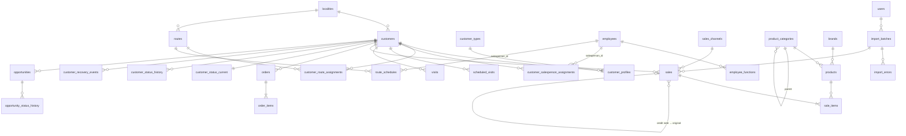

# DATA_MODEL — DistriCom

> v0.2 · 2026-10-03 · Propuesta. Las tablas se crean por migraciones Alembic en la fase indicada.
> v0.2: modelo revisado para la **plataforma modular** (ADR 006): ownership por plataforma/módulo, `employees` + `employee_functions` en lugar de `salespeople`, identidad de clientes en plataforma, tipos de import y de mapping extensibles, `suppliers` diferido.
> v0.3 · 2026-10-04: módulo **Rendiciones** (schema `settlements`, ADR 007); `employees` + `employee_functions` y `user_module_roles` adelantados a R0; modelo conceptual de Rendiciones en §13.

## 0. Ownership y schemas

Una sola base PostgreSQL. **Plataforma** (DistriCom Core) en el schema `public`; cada **módulo** en su propio schema: **Inteligencia Comercial** (`commercial`) y **Rendiciones** (`settlements`).

| Dueño | Schema | Tablas |
|---|---|---|
| Plataforma | `public` | `users`, `user_sessions`, `app_settings`, `audit_events`, `source_systems` (Fase 0) · `employees`, `employee_functions`, `user_module_roles` (R0) · `customers`, `localities`, `external_entity_mappings`, `import_batches`, `import_files`, `import_column_mappings`, `import_errors`, `import_staging_rows` (Fase 1) |
| Inteligencia Comercial | `commercial` | `customer_profiles`, `customer_types`, `routes`, `route_schedules`, `customer_route_assignments`, `customer_salesperson_assignments`, `product_categories`, `brands`, `products`, `sales_channels`, `sales`, `sale_items`, `orders`, `order_items`, `scheduled_visits`, `visits` (Fase 1) · `customer_status_*`, `customer_recovery_events`, `opportunities`, `opportunity_status_history`, `cross_sell_rules`, `commercial_goals`, `incentives` (Fases 4–8) |
| Rendiciones | `settlements` | Schema vacío en R0. Tablas por fase desde R1 (§13). |

Reglas:
- Una tabla tiene **un solo dueño**, que la define, la migra y es el único que escribe en ella. Un módulo escribe en tablas de plataforma solo a través de servicios de plataforma.
- **Claves foráneas:** módulo → plataforma, sí. Plataforma → módulo, **nunca**. Módulo → otro módulo, solo si esa dependencia está declarada en ARCHITECTURE.md (hoy no hay ninguna).
- Los nombres de tabla no llevan prefijo de módulo: el schema ya lo indica. En consultas y migraciones las tablas de módulo se califican (`commercial.sales`).
- **Única fuente de verdad:** un dato compartido (persona, cliente, localidad, sistema fuente, identidad externa) existe una sola vez, en plataforma. Los módulos guardan solo sus relaciones y atributos propios, referenciando la fila de plataforma.
- Las columnas que referencian a un empleado en un rol usan el nombre del rol (`salesperson_id → public.employees.id`).

## 1. Convenciones

- **PK**: `id BIGINT GENERATED ALWAYS AS IDENTITY`. Nunca CUIT, DNI, nombre ni código externo como PK.
- **IDs externos**: columnas `external_axum_id`, `external_store_id` (texto, nullable) con **unique parcial** `WHERE … IS NOT NULL`. Para casos ambiguos o múltiples IDs, `external_entity_mappings`.
- **Fechas de negocio**: `DATE` en zona horaria de negocio (`BUSINESS_TIMEZONE`, default `America/Argentina/Buenos_Aires`). Instantes: `TIMESTAMPTZ` (UTC).
- **Dinero**: `NUMERIC(14,2)`. Moneda en `app_settings.currency` (default `ARS`); nunca símbolo en datos.
- **Cantidades**: `NUMERIC(12,3)`.
- **Enums**: `TEXT` + `CHECK` (más fácil de migrar que `ENUM` de Postgres).
- **Auditoría estándar**: `created_at`, `updated_at` (`TIMESTAMPTZ NOT NULL DEFAULT now()`).
- **Trazabilidad**: toda fila importada lleva `import_batch_id` (FK) → responde "¿de qué importación salió este dato?".
- **Historización**: tablas de vigencia `valid_from DATE NOT NULL`, `valid_to DATE NULL` (NULL = vigente) con **exclusion constraint** (`btree_gist`) que impide solapamientos por entidad.
- Nombres en inglés, `snake_case`, tablas en plural.

## 2. ERD (resumen)

> Las entidades de plataforma (`employees`, `customers`, `localities`, `import_batches`) viven en `public`; el resto en `commercial` (ver §0).

## 3. Plataforma (Fase 0)

### users
| Columna | Tipo | Notas |
|---|---|---|
| id | bigint PK | |
| email | citext UNIQUE NOT NULL | |
| password_hash | text NULL | Argon2id; NULL si identidad externa futura |
| full_name | text NOT NULL | |
| role | text NOT NULL CHECK (`admin`,`viewer`) | **Rol de plataforma.** `admin` = administrador de plataforma (usuarios, empleados, configuración general) con `admin` en todos los módulos. El acceso de los demás usuarios a cada módulo está en `user_module_roles` (R0, ARCHITECTURE.md §8). |
| active | bool NOT NULL DEFAULT true | |
| last_login_at | timestamptz | |

### user_sessions
`id`, `user_id` FK, `token_hash` (bytea UNIQUE), `created_at`, `last_seen_at`, `expires_at`, `revoked_at`, `ip`, `user_agent`. Índice `(user_id)`.

### app_settings
Parámetros de negocio editables. `key text PK`, `value jsonb NOT NULL`, `description`, `updated_by` FK users, `updated_at`. Las claves llevan el **scope** como prefijo: `platform.*` (globales) y `<módulo>.*` (`commercial.*`). Los defaults viven en código junto a su dueño (`app/platform/settings/` y `app/modules/<módulo>/settings.py`) y la tabla solo guarda overrides; así un parámetro siempre tiene valor seguro. Cambios auditados. La zona horaria de negocio **no** es un parámetro: es la variable de entorno `BUSINESS_TIMEZONE`.

### audit_events
`id`, `occurred_at`, `user_id` NULL, `event_type` (`auth.login`, `platform.setting_changed`, `platform.import.completed`, `commercial.goal.created`, `commercial.incentive.approved`, … — prefijo = dueño; los eventos existentes de Fase 0 se renombran al adoptar la convención, P1), `entity_type`, `entity_id`, `payload jsonb` (sin PII), `request_id`. Índice `(event_type, occurred_at)`.

### source_systems
`id`, `code` UNIQUE (`AXUM`, `STORE_SYS`, `MANUAL`, `DEMO`), `name`.

### user_module_roles (R0)
Rol de un usuario en un módulo (Etapa 1 de ARCHITECTURE.md §8).
| Columna | Notas |
|---|---|
| id | PK |
| user_id | FK `users` NOT NULL, `ON DELETE CASCADE` |
| module_key | text NOT NULL — key del módulo (`commercial`, `settlements`); validado contra los módulos instalados por el servicio (sin CHECK en la base) |
| role | text NOT NULL CHECK (`viewer`, `operator`, `admin`) |
| granted_by | FK `users` NULL |
| timestamps | |

`UNIQUE (user_id, module_key)`. Sin fila = sin acceso (salvo administradores de plataforma). La migración que la crea da `viewer` en `commercial` a los usuarios `viewer` existentes, para que nadie pierda acceso. Altas, cambios y bajas se auditan (`platform.module_role.*`).

## 4. Maestros (R0 y Fase 1)

### 4.1 Plataforma (`public`)

> `employees` y `employee_functions` se implementan en R0 (ADR 007), con alta manual e independientes de los imports. `localities` y `customers` siguen en Fase 1.

#### localities
`id`, `name`, `province`, `zone` (texto, para segmentar), `normalized_name` UNIQUE.

#### employees (R0)
Identidad **única** de cada persona que trabaja en la empresa, sea cual sea su función o módulo. Solo identidad: los datos propios de cada función viven en el módulo que la usa. Baja **lógica** (`active = false`); nunca se borra una fila.
| Columna | Notas |
|---|---|
| id | PK |
| full_name | text NOT NULL |
| external_axum_id, external_store_id | text, unique parcial `WHERE … IS NOT NULL`. Vacíos en las altas manuales; los completa la vinculación de Fase 1. |
| active | bool NOT NULL DEFAULT true |
| hire_date | date NULL |
| phone | text NULL — PII |
| timestamps | |

#### employee_functions (R0)
Funciones del empleado con historia. Una persona puede tener varias funciones a la vez o cambiar de función sin duplicarse.
| Columna | Notas |
|---|---|
| id | PK |
| employee_id | FK `employees` NOT NULL |
| function_code | text NOT NULL — código registrado en código por el módulo dueño de la función (`ModuleSpec.employee_functions`), validado por el servicio (sin CHECK en la base). Hoy: `commercial.salesperson` (Preventista) y `settlements.delivery_driver` (Repartidor). |
| valid_from | date NOT NULL |
| valid_to | date NULL — NULL = vigente; inclusive; CHECK `valid_to >= valid_from` |
| source | `AXUM`, `STORE_SYS`, `MANUAL` (R0: siempre `MANUAL`) |
| import_batch_id | FK NULL — se agrega en Fase 1, cuando exista `import_batches` |
| created_by | FK users NULL |
| timestamps | |

- Exclusion constraint: `(employee_id, function_code, daterange(valid_from, valid_to, '[]'))` sin solapamientos.
- Un cambio de función cierra la vigente (`valid_to`) y abre otra; la única modificación permitida de una fila es cerrar su vigencia. Nunca UPDATE in place de código ni fechas de inicio.
- Dar de baja a un empleado cierra sus funciones vigentes en la fecha de baja.
- Que un `salesperson_id` de una tabla comercial sea preventista **en esa fecha** lo valida el servicio comercial contra esta tabla (no es una FK).

#### customers
Identidad **única** del cliente para toda la plataforma. Asignaciones, segmentación y derivados comerciales viven en `commercial` (§4.2).
| Columna | Tipo | Notas |
|---|---|---|
| id | bigint PK | |
| external_axum_id | text | unique parcial |
| external_store_id | text | unique parcial |
| code | text | código visible |
| legal_name | text | |
| trade_name | text | nombre de fantasía |
| tax_id | text | CUIT/DNI **normalizado**, no único (puede repetirse en sucursales) |
| phone, address | text | PII |
| locality_id | FK localities | |
| active_in_source | bool | |
| is_generic | bool NOT NULL DEFAULT false | "Consumidor final" / mostrador. Excluido de universos de clientes (PLAN R9) |
| registered_at | date | alta en sistema fuente, si existe |
| timestamps | | |

> Ruta y preventista **no** son columnas de `customers`: viven en tablas de asignación del módulo comercial (§5).

#### financial_institutions (R4‑1 · migración `0011`)
Catálogo **único** de entidades bancarias por código BCRA, para cualquier módulo (decisión D‑I de Enzo). Un cheque nombra su banco por FK, nunca con un código escrito en cada fila.
| Columna | Tipo | Notas |
|---|---|---|
| id | bigint identity | PK |
| bcra_code | integer UNIQUE | 1..99999. El código oficial es un entero (`7`, como lo da el BCRA): es la identidad. Mostrarlo con ceros (`007`) es formato de pantalla, nunca parte del valor |
| name | varchar(200) | Denominación oficial, textual (mayúsculas, espacios y acentos como los publica el BCRA) |
| source | varchar(10) | `BCRA` (sembrada por la migración) · `MANUAL` (agregada por un admin) |
| active | boolean | Un admin activa o desactiva; una desactivada no se elige en un alta nueva, pero lo cargado la sigue nombrando |
| created_by / manual_reason | null | Obligatorios sí y solo sí `MANUAL` (CHECK): quién la agregó y por qué |
| created_at / updated_at | timestamptz | |

Sin DELETE y sin cambios salvo `active` (triggers): un código oficial nunca se modifica en silencio, y un alta manual con un código existente es `bank_code_taken`. **Semilla de `0011`: snapshot oficial**, no una lista de memoria. Fuente: API de Cheques v1.0 del BCRA, `GET https://api.bcra.gob.ar/cheques/v1.0/entidades` (`codigoEntidad` → `bcra_code`, `denominacion` → `name`). Fecha de corte: 2026-10-07. **59 entidades**, contrastadas dos veces contra la respuesta. Sin sincronización automática: una entidad que falte la agrega un admin de plataforma como `MANUAL`, con motivo y auditada. API: `GET /api/v1/financial-institutions` (todo usuario), `POST` y `PATCH /{id}` (admin de plataforma, auditados).

#### vehicles (R5‑1 · migración `0014`)
Maestro **único** de vehículos de la empresa para cualquier módulo (decisión R5‑D4 y decisión 2 de Enzo). Lo administra el **admin de plataforma**, no el admin de un módulo; todo usuario autenticado lo consulta.
| Columna | Tipo | Notas |
|---|---|---|
| id | bigint identity | PK. Es la identidad: corregir la patente conserva la historia y lo que ya lo nombra |
| plate | varchar(10) | Patente **normalizada**: mayúsculas, sin espacios, puntos ni guiones; solo `A–Z` y `0–9`, de 5 a 10 caracteres (CHECK) |
| plate_key | varchar(10) UNIQUE | Clave de comparación (hoy, la patente normalizada): `AB 123 CD`, `AB-123-CD` y `ab.123.cd` son la misma |
| description | varchar(200) | Obligatoria (CHECK no vacía); espacios repetidos se colapsan |
| active | boolean | Uno inactivo no se elige para registros nuevos (`service.active` → 422 `invalid_vehicle`); lo ya registrado lo sigue nombrando |
| created_by / updated_by | bigint FK `users` (RESTRICT) | Quién lo dio de alta y quién lo cambió por última vez |
| created_at / updated_at | timestamptz | |

Sin marca, modelo ni año. El formato visual (`AB 123 CD` para Mercosur, `ABC 123` para el formato anterior, cualquier otra tal cual) se **calcula** en el backend (`plate_display`), nunca se guarda. Sin DELETE (trigger `forbid_vehicle_delete`) y `created_by`/`created_at` inmutables (trigger). Cada alta, corrección de patente, corrección de descripción, activación y desactivación es un `audit_event` `platform.vehicle.*` con usuario, antes, después e instante; la historia del vehículo son esos eventos. API: `GET /api/v1/vehicles` y `GET /{id}` (todo usuario; el detalle trae la historia), `POST` y `PATCH /{id}` (admin de plataforma). Duplicado: 409 `vehicle_plate_taken` con el vehículo que ya la tiene.

### 4.2 Inteligencia Comercial (`commercial`)

#### customer_types
`id`, `code` UNIQUE (`KIOSCO`, `ALMACEN`, `SUPERMERCADO`, `BAR`, `RESTAURANTE`, `MAYORISTA`, `AUTOSERVICIO`, `OTRO`), `name`, `sort_order`. Segmentación comercial. Corrección manual permitida.

#### customer_profiles
Atributos y derivados comerciales del cliente (1:1 con `public.customers`).
`customer_id` PK/FK `public.customers`, `customer_type_id` FK NULL, `source_customer_type_raw` (valor original del archivo), `first_purchase_date` (derivado, mantenido por el pipeline), `updated_at`.

#### routes
**Rutas de preventa** (AXUM). No representan recorridos de reparto ni ningún otro concepto operativo: si en el futuro existen, serán otra entidad en su propio módulo.
`id`, `external_id`, `code` UNIQUE, `name`, `locality_id` FK `public.localities`, `active`, `description`, timestamps.

#### route_schedules
Frecuencia planificada por ruta de preventa.
`id`, `route_id` FK, `weekday` smallint (1=lunes … 7=domingo), `salesperson_id` FK `public.employees` (función `commercial.salesperson`), `recurrence` (`WEEKLY`, `BIWEEKLY`), `valid_from`, `valid_to`.
Ruta 2×semana = 2 filas; 1×semana = 1 fila. Exclusion constraint sobre `(route_id, weekday, daterange(valid_from, valid_to))`.

#### product_categories
`id`, `code` UNIQUE, `name`, `parent_id` FK self NULL, `sort_order`, `active`. Jerarquía de 2 niveles en V1 (categoría → subcategoría). Las métricas "categorías por cliente" usan el **nivel 1** por defecto (configurable).

#### brands
`id`, `name`, `normalized_name` UNIQUE.

> **Proveedores:** no se crea un catálogo `suppliers` en Fase 1. Un proveedor de producto no es necesariamente lo mismo que un beneficiario de pagos; la entidad se define cuando haya un caso real que la necesite. Si los exports traen proveedor, se guarda como texto en `products.supplier_name_raw`.

#### products
| Columna | Notas |
|---|---|
| id, external_store_id (unique parcial), sku (UNIQUE), barcode | |
| name, category_id FK, brand_id FK, supplier_name_raw text NULL | |
| presentation (texto original), volume_ml numeric NULL, package_type (`LATA`, `BOTELLA_VIDRIO`, `PET`, `BARRIL`, `CAJA`, `OTRO`) NULL | útiles para cross‑selling |
| units_per_pack int NULL | |
| active bool | |
| premium_flag bool NULL | NULL = sin clasificar; se setea manualmente o por regla configurable |
| is_returnable bool NULL | |

#### sales_channels
`id`, `code` UNIQUE (`PREVENTA`, `BOCA_EXPENDIO`, `OTRO`), `name`. Es el **canal de venta** para el análisis comercial.

## 5. Asignaciones con historia (Fase 1, `commercial`)

### customer_route_assignments / customer_salesperson_assignments
| Columna | Notas |
|---|---|
| id | |
| customer_id FK | |
| route_id FK / salesperson_id FK `public.employees` | |
| valid_from DATE NOT NULL | |
| valid_to DATE NULL | NULL = vigente |
| source | `AXUM`, `STORE_SYS`, `MANUAL` |
| import_batch_id FK NULL | |
| created_by FK users NULL | |

- Exclusion constraint: un cliente no puede tener dos asignaciones solapadas.
- `is_current` del prompt se **deriva** (`valid_to IS NULL`) en lugar de guardarse, para evitar inconsistencias.
- Cuando un import trae una asignación distinta a la vigente: se cierra la vigente (`valid_to = fecha_efectiva - 1`) y se abre una nueva. Nunca UPDATE in place.
- Vista `customer_current_assignment(customer_id, route_id, salesperson_id)`.
- Función `assignment_at(customer_id, date)` para atribución histórica.

## 6. Transacciones (Fase 1, `commercial`)

### sales (encabezado de comprobante)
Comprobantes de STORE SYS, propiedad del módulo comercial.
| Columna | Tipo / Notas |
|---|---|
| id | PK |
| source_system_id | FK |
| document_type | `INVOICE`, `CREDIT_NOTE`, `DEBIT_NOTE` |
| external_document_id | text — ID oficial del documento si existe |
| invoice_number | text — formato original (ej. `A-0003-00012345`) |
| point_of_sale | text NULL |
| business_date | date NOT NULL |
| issued_at | timestamptz NULL — **solo** si la fuente trae hora (boca de expendio, PLAN R12) |
| customer_id | FK NULL — NULL solo mientras está en revisión; no entra en métricas por cliente |
| salesperson_id | FK NULL — atribución resuelta |
| route_id | FK NULL — atribución resuelta |
| attribution_source | `DOCUMENT`, `ASSIGNMENT_AT_DATE`, `UNKNOWN` |
| sales_channel_id | FK NOT NULL |
| gross_amount | numeric(14,2) — con signo |
| discount_amount | numeric(14,2) — con signo |
| net_amount | numeric(14,2) — con signo; **sin impuestos** (PLAN D4) |
| tax_amount | numeric(14,2) NULL |
| status | `VALID`, `CANCELLED` |
| original_sale_id | FK sales NULL — NC → factura original si la fuente lo informa |
| import_batch_id | FK NOT NULL |
| source_row_hash | bytea — hash de los campos de negocio, para detectar cambios en reimport |

**Unicidad (business key)**:
- `UNIQUE (source_system_id, external_document_id) WHERE external_document_id IS NOT NULL`
- `UNIQUE (source_system_id, document_type, invoice_number)` como respaldo.

**Convención de signo**: `INVOICE` y `DEBIT_NOTE` positivas; `CREDIT_NOTE` negativa. Así `SUM(net_amount)` es directamente la venta neta y no hay lógica de signo repartida en queries. Las devoluciones se modelan como `CREDIT_NOTE` (si STORE SYS tiene un documento de devolución distinto se mapea a `CREDIT_NOTE` con `return_flag=true`, columna a agregar si los datos lo requieren).

**Transacción válida**: `status = 'VALID'`. Un comprobante anulado (`CANCELLED`) no cuenta en ninguna métrica.

### sale_items
`id`, `sale_id` FK ON DELETE CASCADE, `line_number` int, `product_id` FK NULL (NULL si en revisión), `quantity` numeric (con signo igual al documento), `unit_price`, `discount_amount`, `line_net_amount` (con signo), `unit_cost` NULL.
`UNIQUE (sale_id, line_number)` → defensa de idempotencia a nivel línea.

### orders / order_items (AXUM)
`orders`: `id`, `external_axum_id` UNIQUE, `business_date`, `customer_id`, `salesperson_id`, `route_id`, `visit_id` FK NULL, `status` (`TAKEN`, `CANCELLED`), `total_amount` NULL, `import_batch_id`.
`order_items`: `id`, `order_id`, `line_number`, `product_id`, `quantity`, `unit_price` NULL. `UNIQUE (order_id, line_number)`.
Separados de `sales`. Análisis pedido → factura queda para fases posteriores.

### scheduled_visits
Clientes programados por día. Es la base de los denominadores de cumplimiento de visitas (pares cliente‑día) y de cobertura (clientes únicos); ver METRICS.md.
`id`, `business_date`, `customer_id`, `route_id`, `salesperson_id`, `source` (`AXUM` = programación exportada, `DERIVED` = generada desde `route_schedules` + asignaciones), `import_batch_id` NULL.
`UNIQUE (business_date, customer_id, route_id)`.
Si AXUM exporta programación, `DERIVED` no se genera para esas fechas. Las métricas de cumplimiento y cobertura exponen el `source` usado.

### visits
`id`, `external_axum_id` UNIQUE parcial, `business_date`, `visited_at` timestamptz NULL, `customer_id`, `route_id`, `salesperson_id`, `scheduled_visit_id` FK NULL, `scheduled` bool, `visited` bool, `outcome` (`PURCHASE`, `NO_PURCHASE`, `NOT_VISITED`, `CLOSED`, `OTHER`), `no_purchase_reason` text NULL, `had_order` bool NULL, `notes`, `import_batch_id`.
`visited = false` con `outcome = NOT_VISITED` cuando AXUM informa la no‑visita.

## 7. Importaciones y mappings (Fase 1, plataforma)

El **framework** de importación es de plataforma: lote, archivo, staging, errores, plantillas y lectores por formato. Los **tipos de import y sus adaptadores** son de cada módulo y se registran en código; la base no lista tipos con CHECK.

### import_batches
`id`, `source_system_id`, `import_type` (texto con prefijo del dueño, validado por el registro de tipos: `commercial.customers`, `commercial.products`, `commercial.sales`, `commercial.visits`, `commercial.scheduled_visits`, `commercial.orders`, `commercial.routes`, `commercial.salespeople`), `status` (`UPLOADED`, `MAPPED`, `VALIDATED`, `IMPORTING`, `COMPLETED`, `FAILED`, `REJECTED_DUPLICATE`), `user_id`, `mapping_template_id` NULL, `started_at`, `finished_at`, `duration_ms`, `rows_read`, `rows_valid`, `rows_rejected`, `rows_inserted`, `rows_updated`, `rows_duplicate`, `rows_unchanged`, `error_count`, `warning_count`, `reprocess_of_batch_id` NULL, `notes`.

### import_files
`id`, `import_batch_id`, `original_filename` (sanitizado), `stored_path`, `size_bytes`, `mime_type`, `sha256` (índice), `sheet_name`.
Duplicado exacto: mismo `sha256` + mismo `import_type` con batch `COMPLETED` → `REJECTED_DUPLICATE`, salvo reproceso explícito por admin (queda `reprocess_of_batch_id` y auditoría).

### import_column_mappings
Plantillas: `id`, `source_system_id`, `import_type`, `name`, `mapping jsonb` (`{"customer_name": "Razón Social", …}`), `header_signature` (hash de encabezados para auto‑detección), `created_by`, timestamps.

### import_errors
`id`, `import_batch_id`, `row_number`, `column_name`, `error_code` (`MISSING_COLUMN`, `INVALID_DATE`, `INVALID_AMOUNT`, `UNKNOWN_CUSTOMER`, `UNKNOWN_PRODUCT`, `AMBIGUOUS_ID`, `DUPLICATE_ROW`, …), `severity` (`ERROR`, `WARNING`), `message`, `raw_value` (truncado; **sin** PII sensible).

### import_staging_rows
`id`, `import_batch_id`, `row_number`, `raw jsonb`, `normalized jsonb`, `status`. Se conserva N días (`staging_retention_days`, default 90) para depuración; luego se purga.

### external_entity_mappings
Resolución de identidad entre sistemas.
| Columna | Notas |
|---|---|
| id | |
| entity_type | texto validado por registro: entidades de plataforma `customer`, `employee`; de módulo con prefijo `commercial.product`, `commercial.route` |
| source_system_id | |
| external_id | |
| external_label | nombre tal como vino |
| entity_id | ID interno en la tabla del dueño del `entity_type`, NULL si pendiente |
| status | `AUTO_MATCHED`, `PENDING_REVIEW`, `CONFIRMED`, `REJECTED` |
| match_method | `EXACT_EXTERNAL_ID`, `EXACT_TAX_ID`, `MANUAL`, `SUGGESTED_NAME` (solo sugerencia, nunca auto) |
| decided_by, decided_at | |

`UNIQUE (entity_type, source_system_id, external_id)`. Historial de decisiones en `audit_events`.

## 8. Estado del cliente (Fase 4, `commercial`)

### customer_status_current
Una fila por cliente no genérico (para queries rápidas).
`customer_id` PK/FK, `health_status` (`NORMAL`, `ATTENTION`, `AT_RISK`, `DORMANT`, `LOST`, `NO_PURCHASES`), `frequency_segment` (`FREQUENT`, `REGULAR`, `OCCASIONAL`, `INSUFFICIENT_DATA`), `last_purchase_date`, `days_since_last_purchase`, `expected_interval_days` numeric, `interval_method` (`INDIVIDUAL`, `PEER_TYPE_ROUTE`, `PEER_TYPE`, `PEER_ROUTE`, `PORTFOLIO`, `DEFAULT_THRESHOLD`), `interval_observations` int, `overdue_ratio` numeric, `confidence` (`HIGH`, `MEDIUM`, `LOW`), `calculated_at`, `reference_date`, `calculation_version` (ej. `customer_status_v1`).

### customer_status_history (SCD‑2)
Mismas columnas de estado + `effective_from DATE`, `effective_to DATE NULL`. Solo se inserta fila cuando cambia `health_status` o `frequency_segment`. Exclusion constraint por cliente.

### customer_recovery_events
`id`, `customer_id`, `recovered_on` (date), `previous_status` (`DORMANT`/`LOST`), `previous_status_since`, `sale_id` FK, `amount`, `salesperson_id` (atribución de la venta), `calculation_version`. `UNIQUE (customer_id, sale_id)`.

## 9. Oportunidades, objetivos e incentivos (Fases 6–8, `commercial`)

### opportunities
Campos del prompt §28 más: `rule_id` + `rule_version` (reemplazan `source_rule`), `reasons jsonb` (lista estructurada `[{code, value, weight, points}]`), `dedup_key text`, `attribution_window_days`, `worked_source` (`MANUAL`, `INFERRED_VISIT`), `converted_sale_id`, `converted_amount`, `converted_quantity`, `days_to_conversion`.
Estados: `PENDING`, `COMMUNICATED`, `WORKED`, `CONVERTED`, `REJECTED`, `EXPIRED`.

**Deduplicación**: `dedup_key = type|customer_id|target_product_id|target_category_id`.
`UNIQUE (dedup_key) WHERE status IN ('PENDING','COMMUNICATED','WORKED')` → nunca dos oportunidades abiertas equivalentes. Si la regla vuelve a disparar con otro score, se **actualiza** la abierta (`score`, `reasons`, `updated_at`) y se registra en historia; no se crea otra.

### opportunity_status_history
`id`, `opportunity_id`, `from_status`, `to_status`, `changed_at`, `changed_by` NULL (sistema), `reason`, `score_at_change`.

### cross_sell_rules
`id`, `source_category_id`/`source_product_id` (uno de los dos), `target_category_id`/`target_product_id`, `weight`, `active`, `description`, `created_by`. CHECK de exactamente un source y un target.

### commercial_goals
Prompt §29 + `goal_type` CHECK (`REVENUE`, `COVERAGE`, `CONVERSION`, `RECOVERED_CUSTOMERS`, `NEW_CUSTOMERS`, `CATEGORY_PLACEMENTS`, `PRODUCT_PLACEMENTS`, `AVG_SKU`, `AVG_CATEGORIES`, `OPPORTUNITIES_CONVERTED`), `metric_id` (FK lógica al registro de métricas), `scope_filters jsonb`.

### incentives
Prompt §30. `status` (`SUGGESTED`, `APPROVED`, `ACTIVE`, `COMPLETED`, `CANCELLED`). `SUGGESTED → APPROVED` exige `approved_by` (CHECK) — nunca automático. `suggestion_inputs jsonb` (baseline, candidatos, tamaño de cartera) para explicar el target.

## 10. Reglas de deduplicación (resumen)

| Entidad | Clave |
|---|---|
| Archivo | `sha256` + `import_type` |
| Comprobante | `(source_system, external_document_id)` o `(source_system, document_type, invoice_number)` |
| Línea | `(sale_id, line_number)` |
| Visita | `external_axum_id`; si no existe: `(business_date, customer_id, salesperson_id)` |
| Programación | `(business_date, customer_id, route_id)` |
| Cliente/empleado/producto/ruta | ID externo por sistema vía `external_entity_mappings` |
| Oportunidad abierta | `dedup_key` con unique parcial |
| Recuperación | `(customer_id, sale_id)` |

Reimport de un comprobante existente: si `source_row_hash` igual → `unchanged`; si distinto → `updated` (las líneas se reemplazan dentro de la transacción) y queda registrado en el batch.

## 11. Índices iniciales

Diseñados desde las queries previstas; se revisan con `EXPLAIN ANALYZE` al implementar cada fase.

| Tabla | Índice | Query que lo usa |
|---|---|---|
| sales | `(business_date)` | todo KPI por período |
| sales | `(customer_id, business_date)` | frecuencia, cliente 360°, estados |
| sales | `(salesperson_id, business_date)`, `(route_id, business_date)` | breakdowns |
| sales | `(sales_channel_id, business_date)` | preventa vs boca |
| sale_items | `(sale_id)`, `(product_id)` | penetración, SKU por cliente |
| visits | `(business_date, route_id)`, `(customer_id, business_date)` | cumplimiento, cobertura, conversión |
| scheduled_visits | `(business_date, route_id)` | cumplimiento, cobertura |
| assignments | GiST `(customer_id, daterange)` | atribución histórica |
| opportunities | `(status, priority)`, `(customer_id)` | listados |
| customer_status_current | `(health_status)` | listas de riesgo |

## 12. Datos demo (estrategia)

Generador reproducible con seed fijo (`scripts/seed_demo_data.py --seed 42`) que **pasa por el pipeline de importación** (genera XLSX/CSV con formato AXUM/STORE SYS simulado), para probar el pipeline real además de poblar datos. Patrones inyectados y verificables (prompt §103): ruta con baja cobertura, preventista con cobertura alta y conversión baja, ruta con baja penetración de energizantes, dormidos, recuperados, mix chico, premium, categorías correlacionadas, estacionalidad semanal, pico de boca viernes 18–20 h. Cada patrón tiene un test que verifica que la métrica correspondiente lo detecta.

## 13. Rendiciones (`settlements`, R1–R8)

Modelo **conceptual** aprobado (ADR 007, *Informe Inicial — DistriCom Rendiciones*). Cada tabla se diseña en detalle y se crea en su fase: §13.1 existe desde R1‑1 y §13.2 desde R2‑1; el resto es conceptual. Convenciones de §1 (dinero `numeric(14,2)`, fechas de negocio `date`, enums `text + CHECK`).

### 13.1 Ledger (R1 y R2‑2 · migraciones `0005`, `0006` y `0008`)
Decisiones en ADR 007 §8 y ADR 008. Signo de las entradas: positivo = el valor **entra** a la cuenta; negativo = **sale**. El saldo de una cuenta es siempre la suma de sus entradas; no hay columna de saldo.

**`settlements.accounts`** — dónde puede estar un valor. Pocas filas; no es un plan de cuentas.
| Columna | Tipo | Notas |
|---|---|---|
| id | bigint identity | PK |
| code | varchar(40) null | Código estable de las cuentas del sistema (único si existe); NULL en las que crea un admin |
| name | varchar(120) | Único |
| name_key | varchar(120) | Único (`0006`). El nombre en minúsculas, sin acentos y con un solo espacio: evita dos cuentas equivalentes para el mismo socio, activas o de baja |
| kind | varchar(30) | CHECK: `CASH_BOX`, `BANK`, `OWNER_EQUITY`, `OPENING_BALANCE`, `ADJUSTMENT`, desde `0008` `DELIVERY_COLLECTIONS`, `EXPENSE`, `SETTLEMENT_DIFFERENCE`, `EMPLOYEE`, y desde `0009` `PENDING_COLLECTIONS` (crece por fase) |
| employee_id | bigint null | `0008`. FK `employees` (RESTRICT). Presente sí y solo sí `kind = EMPLOYEE` (CHECK); único (una cuenta interna por empleado) |
| allow_negative | bool, default false | CHECK: una `CASH_BOX` nunca lo permite |
| active | bool, default true | |
| created_at / updated_at | timestamptz | |

Una sola cuenta de cada tipo técnico (`OPENING_BALANCE`, `ADJUSTMENT`, `DELIVERY_COLLECTIONS`, `EXPENSE`, `SETTLEMENT_DIFFERENCE`, `PENDING_COLLECTIONS`: índice único parcial). Sembradas por la migración: `main_cash` Caja principal y `change_cash` Caja de cambio (`CASH_BOX`, sin negativo), `bank` Banco (`BANK`, sin negativo hasta confirmar un descubierto real), `opening_balance` Saldo inicial y `adjustment` Ajustes (contrapartidas técnicas, con negativo). Las cuentas de aportes de cada socio (`OWNER_EQUITY`, con negativo) las crea un admin desde la API (`POST /api/v1/settlements/accounts`); en R6 se vinculan a `counterparties`.

Desde `0008` (R2‑2), contrapartidas técnicas del cierre de rendición: `delivery_collections` Cobranzas de reparto, `expense` Gastos operativos y `settlement_difference` Diferencias de rendición (con negativo). Las cuentas internas de empleados (`EMPLOYEE`, «Cuenta interna de Nombre (#id)», con negativo) se crean la primera vez que una diferencia se asigna a ese empleado, nunca por adelantado. **Saldo positivo: el empleado le debe a la empresa; negativo: la empresa le debe al empleado.** En R2 solo las mueven las diferencias; sueldos, préstamos y liquidación llegan en R8.

Desde `0009` (R3‑1): `pending_collections` Pendientes de cobro (`PENDING_COLLECTIONS`, **sin negativo**). Es lo que los clientes todavía deben de rendiciones cerradas; su saldo es la suma de los saldos vigentes de los pendientes (§13.3). Como las demás técnicas, no aparece como disponibilidad en el tablero de Cajas.

Desde `0010` (R3‑2): `uncollectible` Incobrables (`UNCOLLECTIBLE`, **sin negativo**): lo que la empresa resolvió no cobrar. Separada de Diferencias de rendición y fuera del tablero de Cajas.

**`settlements.financial_operations`** — un hecho económico. Sin UPDATE ni DELETE (trigger).
| Columna | Tipo | Notas |
|---|---|---|
| id | bigint identity | PK |
| type | varchar(30) | CHECK: `OPENING_BALANCE`, `CASH_TRANSFER`, `BANK_DEPOSIT`, `BANK_WITHDRAWAL`, `OWNER_CONTRIBUTION`, `OWNER_WITHDRAWAL`, `ADJUSTMENT`, `REVERSAL`, `SETTLEMENT_CLOSE` (`0008`), `PENDING_COLLECTION` y `PENDING_WRITE_OFF` (`0010`) |
| business_date | date | Indexada; nunca futura (servicio) |
| description | text null | Obligatoria (no vacía) en `ADJUSTMENT`, `REVERSAL` y `PENDING_WRITE_OFF` (CHECK) |
| client_request_id | uuid | UNIQUE (idempotencia) |
| request_fingerprint | varchar(64) | SHA‑256 hex del comando (CHECK de formato) |
| source_type / source_id | varchar(40) / bigint, null | Documento origen desde R2; ambos o ninguno (CHECK) |
| reverses_operation_id | bigint null | FK a la operación revertida (RESTRICT); obligatorio sí y solo sí `type = REVERSAL` (CHECK); único (un reverso por operación) |
| created_by | bigint | FK `users` (RESTRICT) |
| created_at | timestamptz | |

**`settlements.ledger_entries`** — las patas. Sin UPDATE ni DELETE (trigger).
| Columna | Tipo | Notas |
|---|---|---|
| id | bigint identity | PK |
| operation_id | bigint | FK `financial_operations` (RESTRICT), indexada |
| account_id | bigint | FK `accounts` (RESTRICT); índice `(account_id, operation_id)` |
| amount | numeric(14,2) | Con signo; CHECK `<> 0` |

Las referencias opcionales de las patas (`cheque_id`, `pending_id`, `employee_id`, `counterparty_id`) se agregan en la fase que las usa.

**Invariantes en la base:** al commit, cada operación tiene al menos dos patas que suman cero; al commit, ninguna cuenta con `allow_negative = false` queda en negativo, ni hoy ni al cierre de ningún día de negocio anterior afectado por una operación retroactiva (la verificación bloquea la cuenta). Ver ADR 008. Desde `0008`: una rendición tiene a lo sumo un `SETTLEMENT_CLOSE` sin reverso, y el reverso del cierre vigente de una rendición `CLOSED` se rechaza (solo el flujo de la rendición lo reemplaza). Desde `0010`: no hay `PENDING_COLLECTION` ni `PENDING_WRITE_OFF` sin su fila de dominio, ni reverso de ellos sin su fila marcada revertida en el mismo commit (§13.3).

**Operaciones de documento** (`DOCUMENT_TYPES`): `SETTLEMENT_CLOSE`, `PENDING_COLLECTION`, `PENDING_WRITE_OFF`. Cajas no las revierte (`operation_owned_by_document`). El cierre se reemplaza con `replace_operation`; un cobro o una resolución se revierten con `reverse_document_operation`, que exige el documento correcto (`SourceRef`) y usa la fecha de negocio de la operación original.

### 13.2 Rendiciones de reparto (R2‑1 y R2‑2 · migraciones `0007` y `0008`)
Decisiones de Enzo R2‑D1 a R2‑D7 y R2‑P1 a R2‑P5 (`ROADMAP.md`). La carga no escribe el ledger: solo el cierre lo hace (R2‑2). Nada se borra (trigger): el conteo se reemplaza con auditoría, agregados y gastos se anulan con motivo, las decisiones sobre transferencias quedan en su historial.

**`settlements.settlements`** — una rendición de un repartidor en un día.
| Columna | Tipo | Notas |
|---|---|---|
| id | bigint identity | PK |
| type | varchar(20) | CHECK `DELIVERY` (`OUTLET` en R7) |
| business_date | date | Indexada; nunca futura (servicio) |
| employee_id | bigint | FK `employees` (RESTRICT). Debe tener `settlements.delivery_driver` vigente ese día y estar activo (servicio) |
| sequence_number | int | ≥ 1. Rendición 1, 2… del mismo repartidor y día, generada por el sistema |
| expected_amount | numeric(14,2) | > 0; editable mientras está `OPEN` |
| expected_source | varchar(20) | CHECK `MANUAL` (`STORE_SYS` cuando exista la integración) |
| external_reference / notes | varchar(100) / text, null | |
| status | varchar(20) | CHECK `OPEN` / `CLOSED`. Estado de **edición** |
| version | int, default 1 | Sube con cada reapertura (R2‑2) |
| current_close_operation_id | bigint null | `0008`. FK `financial_operations`: el `SETTLEMENT_CLOSE` **vigente en el ledger**. Obligatorio si `CLOSED` (CHECK); al commit debe ser un cierre sin reverso de esta misma rendición (trigger diferido). Una rendición reabierta lo conserva |
| closed_by / closed_at | null | `0008`. Último cierre |
| reopened_by / reopened_at / reopen_reason | null | `0008`. Última reapertura: los tres o ninguno, motivo no vacío (CHECK). Todas quedan en `settlement_reopenings` |
| client_request_id / request_fingerprint | uuid único / varchar(64) | Alta idempotente: un reintento nunca crea la Rendición 2 |
| created_by / created_at / updated_at | | |

UNIQUE (`type`, `employee_id`, `business_date`, `sequence_number`); **no** hay unicidad por repartidor y día. El número se calcula como `max + 1` bajo `pg_advisory_xact_lock` sobre (tipo, repartidor, día); la UNIQUE es la última barrera. Repartidor, fecha, número e id de solicitud no cambian nunca (trigger); con `status = CLOSED` tampoco el resto de los datos.

**`settlements.cash_count_lines`** — conteo por denominación: `settlement_id`, `denomination_code` y `denomination_value` (copiados de la configuración, no una FK), `quantity` > 0, `destination_account_id` (FK `accounts`, una caja activa elegida línea por línea), `created_by`, `created_at`. UNIQUE (`settlement_id`, `denomination_code`).

**`settlements.cash_additions`** — agregados: efectivo que aparece después del conteo o que se suma sin rehacerlo. `amount` > 0, `destination_account_id` (caja), `description` opcional, `created_by`, `created_at`, idempotencia, y `voided_by` / `voided_at` / `void_reason` (los tres o ninguno, motivo no vacío). La base solo permite el UPDATE que lo anula.

**`settlements.settlement_transfers`** — transferencias declaradas: `amount` > 0, `bank_account_id` (un `BANK`, Banco por defecto), `reference`, `payer_name` (cliente en texto, C3), `status` `DECLARED` / `VERIFIED` / `REJECTED` (rechazo con motivo, CHECK), `status_reason`, `status_changed_by` / `status_changed_at`, idempotencia. Solo `VERIFIED` justifica dinero; los datos se corrigen solo mientras está `DECLARED`.
**`settlements.transfer_status_events`** — historial inmutable de cada decisión: `from_status`, `to_status`, `reason`, `is_correction` (un admin cambió una decisión ya tomada), `changed_by`, `changed_at`.

**`settlements.expense_categories`** — `name`, `name_key` único (sin mayúsculas, acentos ni espacios repetidos), `active`. Las edita un admin; se desactivan, no se borran. Desde R5‑2 tienen `code` (estable, ver §13.5): la única categoría con comportamiento en código es la de `code = FUEL`; las demás no tienen código.
**`settlements.expenses`** — `settlement_id`, `category_id` (FK, RESTRICT), `amount` > 0, `description`, idempotencia, anulación con motivo como los agregados; se corrigen mientras la rendición está `OPEN`.

**Una rendición `CLOSED` no cambia** (trigger sobre las cuatro tablas de carga y sobre la propia rendición).

**Denominaciones** — parámetro `settlements.cash_denominations` (`app_settings`), lista de `{code, value, active, suggested_destination}`. El código es la identidad estable de la denominación (`ARS_20000`…), independiente de su posición y de su valor; un código no se borra ni cambia de valor, se desactiva. `suggested_destination` es el código de una caja (`main_cash`, `change_cash`) o null y es solo una sugerencia. Valor inicial: $20.000, $10.000, $2.000 y $1.000 sugeridos a Caja principal; $500, $200 y $100 a Caja de cambio. **La operación no usa monedas ni billetes de menos de $100**, así que no se configuran. Cambiar la configuración nunca altera conteos históricos (las líneas copian código y valor).

**Tablero** (calculado por el backend, `delivery/summary.py`): justificado = efectivo (conteo + agregados no anulados) + transferencias `VERIFIED` + cheques (R4, hoy 0) + pendientes de carga no anulados (R3‑1) + gastos no anulados; diferencia = justificado − esperado (negativa = faltante, positiva = sobrante).

**Estado financiero** (lo deriva la API, no es columna): `NOT_CLOSED` (abierta, nunca cerrada), `CLOSED` (cerrada, su cierre vigente), `BEING_CORRECTED` (reabierta: el último cierre **sigue vigente en Cajas** hasta confirmar el nuevo).

**`settlements.settlement_closings`** (`0008`) — cada cierre de cada versión: `settlement_id`, `settlement_version` (UNIQUE juntos), `operation_id` (el `SETTLEMENT_CLOSE`, único), `reversal_operation_id` (el reverso del cierre anterior publicado junto con este; null en el primero), `request_fingerprint` (huella de todo lo que significa el cierre), `closed_by`, `closed_at`. Sin UPDATE ni DELETE.

**`settlements.settlement_reopenings`** (`0008`) — una fila por reapertura real: `settlement_id`, `from_version`, `to_version` (= `from_version` + 1, CHECK; UNIQUE con la rendición y `from_version`), `close_operation_id` (el cierre que siguió vigente en Cajas mientras se corregía), `reason` (no vacío), `reopened_by`, `reopened_at`. Sin UPDATE ni DELETE. Con `settlement_closings` reconstruye la historia de la rendición sin depender de la auditoría.

**`settlements.settlement_differences`** (`0008`) — faltante o sobrante de una versión, solo si la diferencia no es cero: `kind` `SHORTAGE`/`SURPLUS`, `amount` > 0, `settlement_version` (UNIQUE con la rendición), `close_operation_id`, `created_by`/`created_at`, `superseded_at`/`superseded_by`. A lo sumo una vigente por rendición (índice parcial). No se borra; el único UPDATE posible es marcarla reemplazada, una vez (trigger).
**`settlements.difference_allocations`** (`0008`) — quién absorbe cada parte: `target` `EMPLOYEE` (con `employee_id`) o `COMPANY` (sin empleado y con `reason` no vacío), `amount` > 0, `reason`, `decided_by`, `decided_at`. Un empleado y la empresa aparecen a lo sumo una vez por diferencia (índices parciales). **La suma es exactamente la diferencia** (constraint trigger diferido). Sin UPDATE ni DELETE.

**Cierre** (`SETTLEMENT_CLOSE`, fecha de negocio = la de la rendición, origen `settlement:<id>`): Cobranzas de reparto −esperado · cada caja + su efectivo · cada banco + sus transferencias `VERIFIED` · Gastos operativos + gastos válidos · cuenta interna de cada empleado + su parte del faltante / − su parte del sobrante · Diferencias de rendición, la parte de la empresa con el mismo signo · Pendientes de cobro + pendientes no anulados (R3‑1). Suma cero.

Bocas de expendio (`outlets`) en R7.

### 13.3 Pendientes de cobro (R3‑1 y R3‑2 · migraciones `0009` y `0010`)
Propuesta R3 y decisiones de Enzo del 2026-10-05 (`ROADMAP.md`). El pendiente nace en una rendición y la justifica. **Su identidad es estable entre versiones de la rendición.** Se separan dos cosas: la **carga** (lo que publicará el próximo cierre) y el **importe financiero vigente** (lo que publicó el cierre vigente de su rendición).

**`settlements.pending_collections`** — la carga del pendiente.
| Columna | Tipo | Notas |
|---|---|---|
| id | bigint identity | PK; la misma en todas las versiones |
| settlement_id | bigint | FK `settlements` (RESTRICT): rendición de origen |
| customer_name | varchar(200) | No vacío (CHECK). Cliente en texto hasta que exista `public.customers`; entonces `customer_id` con FK real (decisión 1). Sin catálogo propio |
| amount | numeric(14,2) | > 0. Importe **de carga** |
| reason | text | No vacío |
| responsible_employee_id | bigint | FK `employees`. Por defecto el repartidor; el operador puede elegir cualquier empleado activo (R3‑D3) |
| expected_date | date null | Opcional; no anterior a la fecha de la rendición (servicio) |
| client_request_id / request_fingerprint | uuid único / varchar(64) | Alta idempotente |
| created_by / created_at / updated_by / updated_at | | |
| voided_by / voided_at / void_reason | null | Los tres o ninguno, motivo no vacío |

Sin DELETE (trigger). Solo cambia con la rendición `OPEN`, salvo el responsable, que un admin puede cambiar con la rendición cerrada (`0010`: ninguna otra columna cambia con ella); id de rendición, solicitud y autor no cambian; un pendiente anulado no cambia más.

**`settlements.settlement_closing_pendings`** — qué publicó cada cierre por pendiente. Append-only. `close_operation_id` (FK `financial_operations`), `settlement_id`, `settlement_version`, `pending_id`, `amount` > 0 y `customer_name` publicados, `created_at`; UNIQUE (`close_operation_id`, `pending_id`). **El importe vigente de un pendiente es su fila del `current_close_operation_id` de la rendición.** La base exige que la fila sea de un pendiente no anulado de la misma rendición y de un `SETTLEMENT_CLOSE` de ella, y, al commit, que las filas de un cierre sumen exactamente su pata en Pendientes de cobro.

**`settlements.pending_collection_events`** — historia de dominio, append-only (sin UPDATE ni DELETE). `pending_id`, `settlement_id`, `settlement_version` (la versión en la que ocurrió: v2 es «durante la primera corrección»), `event_type` (`CREATED`, `AMOUNT_CHANGED`, `CUSTOMER_CHANGED`, `RESPONSIBLE_CHANGED`, `REASON_CHANGED`, `EXPECTED_DATE_CHANGED`, `VOIDED`, `PUBLISHED`, `WITHDRAWN`; desde `0010` `RECEIPT_RECORDED`, `RECEIPT_REVERSED`, `RESOLVED`, `RESOLUTION_REVERSED`), `before` / `after` (jsonb, solo los campos del evento), `reason` (obligatorio en `VOIDED`), `close_operation_id` (sí y solo sí `PUBLISHED` / `WITHDRAWN`), `receipt_id` / `resolution_id` (sí y solo sí un evento de cobro / de resolución: el evento apunta a la fila y no duplica importes), `created_by`, `created_at`. Reconstruye el historial del pendiente sin `audit_events`, que sigue siendo la auditoría transversal.

**`settlements.pending_collection_receipts`** (R3‑2 · `0010`) — un cobro. `pending_id`, `amount` > 0, `business_date` (no anterior a la rendición ni futura), `method` (`CASH` | `TRANSFER`), `destination_account_id` (una caja si es efectivo, un banco si es transferencia), `operation_id` (único, su `PENDING_COLLECTION`), `client_request_id` / `request_fingerprint`, `created_by` / `created_at` y los campos de reverso `reversal_operation_id` (único), `reversed_by`, `reversed_at`, `reversal_reason`: los cuatro o ninguno, una sola vez. Sin DELETE; lo único que cambia es su reverso, que tiene que ser el `REVERSAL` de su propia operación. La base exige que la operación sea del pendiente, de la misma fecha, con −importe en Pendientes y +importe en el destino del tipo correcto.

**`settlements.pending_collection_resolutions`** + **`pending_resolution_allocations`** (R3‑2 · `0010`) — una resolución administrativa (admin, motivo obligatorio), total o parcial: `pending_id`, `amount`, `business_date`, `reason`, `operation_id` (su `PENDING_WRITE_OFF`), idempotencia, autor y los mismos campos de reverso. Sus partes: `target` (`COMPANY` | `EMPLOYEE`), `employee_id` (sí y solo sí `EMPLOYEE`), `amount` > 0; a lo sumo una de la empresa y una por empleado; append-only. Al commit, las partes suman exactamente la resolución y coinciden pata por pata con su operación (empresa → Incobrables, cada empleado → su cuenta interna).

**Al commit, lo aplicado** (cobros y resoluciones sin reverso) **nunca supera el importe vigente** del pendiente, ni se aplica nada a uno que no está vigente; se vuelve a verificar cuando cambia el cierre vigente de la rendición.

**Estado derivado** (no es columna, `pending/state.py`, y el mismo cálculo en SQL en `pending/listing.py`): `DRAFT` (no está en el cierre vigente ni anulado), `VOIDED` (anulado y fuera del cierre vigente), `OPEN`, `PARTIAL`, `COLLECTED`, `RESOLVED` (vigente, según lo cobrado y resuelto sin reverso). Saldo = importe vigente − aplicado. **Durante una corrección** la carga es solo la próxima versión: un pendiente vigente conserva su importe y su estado hasta el nuevo cierre, aunque se cambie su importe o se lo marque para quitar; la API lo muestra aparte (`load_change`: `ADDED`, `MODIFIED`, `MARKED_FOR_REMOVAL`).

**Cierre:** Pendientes de cobro + Σ pendientes no anulados; el cierre de una corrección lo reemplaza con efecto neto (de $100.000 a $70.000: −$30.000).

**Cobro y resolución en el ledger:** `PENDING_COLLECTION` Pendientes −X, Caja o Banco +X. `PENDING_WRITE_OFF` Pendientes −total, Incobrables +parte de la empresa, cada cuenta interna +parte del empleado. **Alertas** (al leer, sin scheduler): vigente, con saldo y registrado hace más de `settlements.pending_alert_hours` (24). «Fecha esperada vencida» es aparte.

### 13.4 Cheques (R4‑1 · migración `0012`)
Propuesta R4 y decisiones D‑A…D‑K de Enzo del 2026-10-07 (`ROADMAP.md`). Un cheque es **un instrumento**: dónde está (en cartera, depositado…) nunca se guarda en su fila, lo dice el ledger por las patas que lo nombran; lo que se guarda es lo que pasó (recepción, decisión de verificación de un ECHEQ, anulación) y su historia.

**`settlements.cheques`**
| Columna | Tipo | Notas |
|---|---|---|
| id | bigint identity | PK; la misma en todas las versiones de la rendición |
| kind | varchar(10) | `PHYSICAL` · `ECHEQ` |
| payment_type | varchar(10) | `COMMON` (pagadero desde la emisión) · `DEFERRED` (pago diferido), aparte de `kind` |
| amount | numeric(14,2) | > 0 |
| issuer_bank_id | bigint | FK `financial_institutions` (RESTRICT) |
| branch_code / account_ref / cheque_number | varchar | Solo dígitos (cuenta: `[0-9A-Z]`, admite CBU de 22 dígitos); ceros a la izquierda como se tipearon |
| echeq_external_id | varchar(64) null | Solo ECHEQ: identificador electrónico, cuando el banco lo muestra |
| instrument_key | varchar(200) null | Clave de identidad calculada (`cheques/identity.py`); null mientras no es identificable |
| issue_date / payment_date | date | `payment_date` sí y solo sí `DEFERRED`, y posterior a la emisión; emisión ≤ recepción |
| drawer_name / drawer_tax_id | varchar | «Titular / librador». CUIT de 11 dígitos, obligatorio en un ECHEQ |
| delivered_by_name | varchar(200) | Quién lo entregó (a quién se le reclama si rebota), separado del librador. En texto hasta que exista `public.customers` |
| origin_type | varchar(30) | `SETTLEMENT` · `OPENING_BALANCE` · `OWNER_CONTRIBUTION` |
| settlement_id | bigint null | Sí y solo sí `SETTLEMENT` |
| received_business_date / received_by_employee_id | | Fecha de negocio de la recepción (la de la rendición) y quién lo recibió (por defecto el repartidor) |
| physical_receipt_confirmed_by / _at | null | Sí y solo sí `PHYSICAL`: quién confirmó «Recibí el cheque físicamente» y cuándo |
| verification_status / _changed_by / _changed_at / _reason | null | Sí y solo sí `ECHEQ`: `DECLARED`, `VERIFIED`, `VERIFICATION_REJECTED` |
| notes | text null | |
| client_request_id / request_fingerprint | uuid único / varchar(64) | Alta idempotente |
| created_by / updated_by / voided_by / voided_at / void_reason | | Anulación: los tres o ninguno, con motivo |

Índices únicos parciales sobre `instrument_key` y `echeq_external_id` entre los cheques vivos (no anulados ni con verificación rechazada). Sin DELETE. La base exige: una fila de rendición se inserta con la rendición `OPEN`; origen, solicitud, recepción y confirmación física nunca cambian; un cheque anulado no cambia más; **con cualquier pata en el ledger (publicado) solo cambian los datos descriptivos** (librador, salvo el CUIT de un ECHEQ, y notas) y, durante una corrección, su anulación; antes de eso la carga cambia solo con la rendición `OPEN`.

**Identidad** (`cheques/identity.py`, encapsulada): físico = banco + cuenta + número (+ sucursal si la cuenta no es un CBU); ECHEQ = su identificador electrónico o, si el banco no lo muestra, banco + CBU + número + CUIT del librador, nunca banco + número. Con identidad completa un duplicado se rechaza (`cheque_duplicate`); incompleta, un cheque vivo del mismo banco y número es un posible duplicado que exige confirmación con motivo (queda en el evento `RECEIVED` o `CORRECTED`). Un ECHEQ puede declararse sin identidad verificable, pero no se verifica (`echeq_identity_required`) ni justifica ni entra a cartera hasta tenerla.

**Fechas** (`cheques/terms.py`): pagadero desde la emisión (`COMMON`) o desde `payment_date` (`DEFERRED`); son **reglas del instrumento, fijas en el código, no un setting** (ajuste 2 de Enzo): `COMMON` se presenta como máximo `issue_date + 30 días`; `DEFERRED` exige `issue_date < payment_date <= issue_date + 360 días` (`deferred_term_exceeded`; la base lo repite en `ck_cheques_payment_date_by_type`) y se presenta como máximo `payment_date + 30 días`. Un cheque vencido al recibirlo se rechaza (`cheque_presentation_expired`); ningún parámetro lo saltea.

**`settlements.cheque_events`** — historia de dominio, append-only e independiente de `audit_events`. `event_type`: `RECEIVED`, `CORRECTED`, `VERIFIED`, `VERIFICATION_REJECTED`, `VOIDED`, `PUBLISHED`, `WITHDRAWN`, `DESCRIPTIVE_CORRECTED`; `before` / `after` (solo lo que cambió), `reason` (obligatorio en anulación, rechazo de verificación y corrección descriptiva), `settlement_id` + `settlement_version` (juntos o ninguno), `close_operation_id` (solo `PUBLISHED` / `WITHDRAWN` de un cierre) u `operation_id` (el `PUBLISHED` de un saldo inicial o aporte): exactamente uno de los dos en esos eventos.

**`settlements.settlement_closing_cheques`** — qué puso en cartera cada cierre. Append-only. `close_operation_id`, `settlement_id`, `settlement_version`, `cheque_id`, `amount`; UNIQUE (cierre, cheque). La base exige que el cheque sea de esa rendición, vivo, que justifique y del mismo importe, y, al commit, que las filas de un cierre sean **exactamente** sus patas en Cartera de cheques, cheque por cheque.

**`settlements.ledger_entries.cheque_id`** (FK `cheques`, null): una pata nombra un cheque **sí y solo sí** su cuenta es `CHEQUE_PORTFOLIO` o `CHEQUES_IN_TRANSIT`, y mueve el cheque entero. Al commit, por cheque: en cada cuenta de cheques tiene 0 o su importe, está a lo sumo en una, y si está en alguna es un físico o un ECHEQ `VERIFIED`, no anulado. Así el saldo de Cartera es siempre la suma de los cheques que tiene, y nunca es negativo.

**Cuentas** (técnicas, sin negativo, «Valores», nunca dinero disponible ni en el tablero de Cajas): `cheque_portfolio` «Cartera de cheques» (`CHEQUE_PORTFOLIO`) y `cheques_in_transit` «Cheques depositados» (`CHEQUES_IN_TRANSIT`, preparada para R4‑2).

**Estado derivado** (`cheques/state.py`, nunca guardado): `DECLARED`, `VERIFICATION_REJECTED` («Verificación rechazada», distinto de anulado), `RECEIVED` («Recibido, sin publicar»), `IN_PORTFOLIO`, `DEPOSITED`, `CREDITED`, `REJECTED`, `RETURNED` (R4‑2, §13.4.1), `VOIDED`. Durante una corrección se muestra aparte lo que propone la carga (`load_change`: `ADDED`, `MARKED_FOR_REMOVAL`); un cheque agregado no está en cartera hasta el nuevo cierre y uno marcado para quitar sigue en cartera hasta entonces. Solo se quita un cheque que sigue en cartera desde el cierre (`cheque_has_activity`).

**Cierre:** una pata `+importe` en Cartera de cheques por cada cheque que justifica, con su `cheque_id`; un ECHEQ declarado bloquea el cierre (`settlement_has_unverified_echeqs`). El cierre de una corrección lo reemplaza con efecto neto (reverso con los mismos `cheque_id` + nuevo cierre).

**Altas administrativas** (admin, idempotentes): `CHEQUE_OPENING_BALANCE` (Saldo inicial −X, Cartera +X) y `CHEQUE_OWNER_CONTRIBUTION` (cuenta del socio −X, Cartera +X). Son el documento del cheque: su `source` es el cheque, su única pata de cheque es ese cheque y su origen coincide (la base lo exige); Cajas no las revierte.

#### 13.4.1 Ciclo financiero del cheque (R4‑2 · migración `0013`)
Decisiones de Enzo del 2026-10-07 (A: nunca se deposita un cheque vencido; B: una boleta es **una** operación). Cada paso del ciclo es un **documento** append‑only con exactamente una operación del ledger (UNIQUE parcial `uq_financial_operations_cheque_document` sobre `source_type, source_id` de los tipos del ciclo), y cambia solo para registrar su reverso (`reversal_operation_id` debe ser el reverso de su propia operación; `reversed_by/_at/reversal_reason` los cuatro o ninguno). Sin DELETE; los ítems nunca cambian. Alta idempotente por `client_request_id` + `request_fingerprint`.

| Tabla | Qué guarda | Operación (patas) |
|---|---|---|
| `cheque_deposits` + `cheque_deposit_items` | Boleta de depósito: cuenta bancaria, fecha, `slip_number`, un ítem por cheque (UNIQUE boleta+cheque) | `CHEQUE_DEPOSIT`: por cheque, Cartera −X / Cheques depositados +X, cada par con su `cheque_id` |
| `cheque_credits` + `cheque_credit_items` | Acreditación (también por lote); cada ítem apunta al ítem de depósito vigente y a la misma cuenta bancaria | `CHEQUE_CREDIT`: por cheque Depositados −X (con `cheque_id`), Banco +total |
| `cheque_rejections` | `stage` `IN_TRANSIT` (con `deposit_item_id`) o `AFTER_CREDIT` (además `credit_item_id` y `bank_account_id`), motivo obligatorio | `CHEQUE_REJECTION`: Depositados −X (en tránsito) o Banco −X (acreditado), Pendientes +X |
| `cheque_returns` | Devolución al cliente de un cheque en cartera (admin), motivo obligatorio | `CHEQUE_RETURN`: Cartera −X, Pendientes +X |

La base exige además: un depósito toma solo cheques físicos o ECHEQ `VERIFIED`, vivos, ya pagaderos y **no vencidos** a la fecha de la boleta (`presentation expired`, sin excepción de rol); fechas de cada documento ≥ las del documento anterior del cheque.

**Pendientes con origen en un cheque.** `pending_collections.origin_type` `SETTLEMENT` · `CHEQUE_REJECTION` · `CHEQUE_RETURN`, con FK reales `settlement_id` / `origin_cheque_rejection_id` / `origin_cheque_return_id`: **exactamente una** según el tipo (nunca se reutiliza la FK del rechazo para una devolución). Un pendiente nacido de un cheque se crea con su documento (mismo commit, misma operación por la pata de Pendientes), es siempre **nuevo** (no reabre el pendiente original), cambia solo de responsable y se anula únicamente con el reverso de su origen, y solo si no tiene actividad (`pending_has_activity`). Su importe es el del cheque; el de uno de rendición sigue saliendo del cierre vigente.

**Cobrar un pendiente con cheque.** `cheques.origin_type` suma `PENDING_RECEIPT` con `origin_pending_id`. Físico: alta + `PENDING_COLLECTION` (Pendientes −X, Cartera +X con `cheque_id`) + cobro en `pending_collection_receipts` (`method = CHEQUE`, `cheque_id`) en una transacción. ECHEQ: queda `DECLARED` y no baja nada (evento `ECHEQ_DECLARED`); al verificarlo se revalida fecha, vigencia y saldo del pendiente (`pending_amount_exceeds_balance`) y recién ahí se registra el cobro; sin aceptación parcial ni saldo a favor. Revertir ese cobro exige que el cheque siga en cartera y lo anula.

**Estados derivados** nuevos: `CREDITED`, `REJECTED`, `RETURNED` (prioridad RETURNED > REJECTED > CREDITED > DEPOSITED). `presentation_expired` se informa para un cheque en cartera vencido: sigue identificado como vencido y puede devolverse, nunca depositarse.

**Reversos** (admin, con motivo): de depósito, acreditación, rechazo y devolución. Se registran en la `business_date` del documento original, de forma atómica con la marca del documento (y la anulación del pendiente que creó), y solo si el cheque no tuvo actividad posterior (`cheque_has_activity`).

**Banco en descubierto (política exacta).** El Banco conserva `allow_negative = false`. Única excepción: una operación `CHEQUE_REJECTION` sobre una cuenta `BANK` (rechazo después de acreditar) puede crear o profundizar un saldo negativo (`rules.EXTERNAL_BANK_DEBITS`, no generalizable a otros débitos externos). Todo otro débito del Banco (extracción, pago, ajuste, aporte/retiro de socio, reverso) debe dejar **cada saldo de cierre de día desde su `business_date` en adelante ≥ 0**; por eso no puede crear un descubierto ni profundizarlo, ni siquiera con fecha retroactiva dentro de un período en descubierto. Los ingresos lo reducen sin restricción. El servicio lo valida bloqueando la cuenta (`FOR UPDATE`) y la base lo repite en `check_account_not_negative` (deferred, al commit): para cada cuenta tocada calcula el saldo acumulado por `business_date` desde la fecha más temprana de la operación y falla con `cannot have a negative balance` si alguno es < 0, salvo que la operación sea `CHEQUE_REJECTION` sobre una cuenta `BANK`. Las patas positivas (ingresos) no se validan nunca: un ingreso sobre un Banco en −100.000 se acepta aunque lo deje en −50.000, y uno retroactivo puede mejorar días negativos sin cancelarlos. Una pata negativa ordinaria baja en su importe todos los saldos diarios desde su fecha, así que exigir que después de ella ninguno quede < 0 equivale exactamente a «no crea un descubierto nuevo ni empeora uno existente»: un día que quedaría negativo, o ya lo era (lo empeora) o no (lo crea). Los días negativos anteriores a su fecha no la afectan. Tests directos contra PostgreSQL: `test_cheque_overdraft_db.py`. Cajas muestra `overdrawn = true` y «Banco en descubierto» cuando el saldo a la fecha es negativo.

### 13.5 Gastos (R5)
`expenses` + `expense_categories` (creadas en R2‑1, §13.2) · `fuel_loads` (detalle 1:1 de un gasto de combustible, R5‑2) · `public.vehicles` (maestro de plataforma, R5‑1, §4.1).

**R5‑2 · migración `0015` (combustible en rendición).**

- **`expense_categories.code`** — `varchar(40)` nulo, único, formato `^[A-Z][A-Z0-9_]{0,39}$`, **inmutable** (trigger `check_expense_category_code`). Ningún endpoint lo asigna ni lo edita; la API lo muestra. La migración asigna `FUEL`: si existía `name_key = 'combustible'` la reutiliza (mismo id, nombre, `active` e historia); si no, crea «Combustible» activa. El admin puede renombrarla o desactivarla: el comportamiento sigue al código, no al nombre; desactivada, no admite gastos nuevos (`invalid_expense_category`).
- **`expenses.origin`** — `varchar(20)`, default `SETTLEMENT`; el CHECK por ahora solo admite `SETTLEMENT` (R5‑3 sumará `DIRECT`).
- **`expenses.legacy_fuel_without_detail`** — boolean NOT NULL default false. **Solo nace en la migración 0015**, que lo pone en true en los gastos FUEL preexistentes (sin carga). Trigger `check_expense_legacy`: un INSERT con true falla; un UPDATE false→true falla; la única transición posterior es true→false, cuando el gasto recibe una carga válida. Mientras siga en true, un cambio descriptivo lo conserva y un cambio financiero (`amount` o `category_id`) falla; anularlo se permite.
- **`settlements.fuel_loads`** — 1:1 con `expenses` (`expense_id` único), `vehicle_id` → `public.vehicles`, `employee_id` → `employees` (quien cargó; por defecto el repartidor), `liters numeric(10,3) > 0`, `price_per_liter numeric(14,4) > 0`, `odometer_km` nulo o ≥ 0 (sin comparar con cargas anteriores), `created_*`/`updated_*`. Todas las FK `RESTRICT`. Sin DELETE (`forbid_delete`). Trigger `check_fuel_load`: `expense_id`, `created_by`, `created_at` inmutables; la rendición tiene que estar `OPEN`; vehículo y empleado activos al crear o al cambiarlos (un vehículo desactivado después sigue visible en cargas viejas). La anulación es la del gasto (no hay columnas de anulación en la carga).
- **Importe.** `expenses.amount = round_half_up(liters × price_per_liter, 2)`, calculado por el backend (`delivery/fuel.py`) y guardado solo en `expenses.amount`. Los triggers diferidos `trg_expenses_fuel`/`trg_fuel_loads_expense` (`check_fuel_expense`) verifican al commit: un gasto FUEL vigente tiene su carga salvo legacy; una carga solo pertenece a un gasto FUEL; un legacy no tiene carga; el importe es exactamente el producto redondeado.
- **Cierre.** Sin operación nueva: el combustible va en la pata `EXPENSE` como cualquier gasto. El token de la vista previa incluye, por carga, gasto, vehículo, empleado, litros, precio, odómetro e importe; cualquier cambio posterior da `settlement_preview_stale`. Reabrir no toca el ledger; el nuevo cierre usa `replace_operation`.
- **API.** `POST /deliveries/{id}/expenses` con categoría FUEL exige `fuel` y no acepta `amount` (`fuel_detail_required`, `fuel_amount_is_computed`); otra categoría con `fuel` da `fuel_detail_not_allowed`. `PATCH` corrige la carga (el importe se recalcula); cambiar entre FUEL y otra categoría da `fuel_category_change` (se anula y se registra uno nuevo). Un legacy acepta `fuel` completo y pasa a false; un cambio de importe sin carga da `fuel_load_required`. Auditoría: `settlements.expense.created/updated` con antes/después de vehículo, empleado, litros, precio y odómetro.

**R5‑3 · migración `0016` (gastos directos desde Caja/Banco).**

- **`expenses` generalizado.** `origin` ∈ {`SETTLEMENT`, `DIRECT`} (las filas existentes quedan `SETTLEMENT`); `settlement_id` pasa a nulo; columnas nuevas `paid_from_account_id` (→ `accounts`), `business_date` (`date`), `operation_id` (→ `financial_operations`, único) y `reversal_operation_id` (→ `financial_operations`, único). CHECK `ck_expenses_origin_fields`: un `SETTLEMENT` tiene rendición y ni cuenta, ni fecha, ni operación, ni reverso; un `DIRECT` no tiene rendición, tiene cuenta y fecha, y nunca es legacy. CHECK `ck_expenses_direct_reversal`: en un `DIRECT`, revertido ⇔ `voided_at` ⇔ `reversal_operation_id`. `operation_id` NOT NULL de un `DIRECT` lo verifica un trigger diferido y no el CHECK: la operación lleva como origen el id del gasto, así que el gasto nace primero y la operación se le asigna en la misma transacción.
- **`DIRECT_EXPENSE`** (tipo de operación nuevo, `ck_financial_operations_type`): patas exactas cuenta pagadora −X y `expense` («Gastos operativos») +X; un solo pagador, sin pagos mixtos. Origen `expense:<id>`; índice único `uq_financial_operations_direct_expense` (una operación por gasto). Es operación de documento (`DOCUMENT_TYPES`, `REVERSIBLE_DOCUMENT_TYPES`): Cajas no la revierte (`operation_owned_by_document`) y solo se revierte con `POST /expenses/{id}/reverse`, en la `business_date` original. Fondos: el débito ordinario de siempre; `check_account_not_negative` no la exime (la única excepción sigue siendo `CHEQUE_REJECTION` sobre `BANK`), así que ni deja una caja negativa ni crea o profundiza un Banco en descubierto, hoy ni en ningún día desde su fecha.
- **Cuenta pagadora.** Solo una `CASH_BOX` o un `BANK` activos (servicio: `invalid_payment_account`; base: `trg_expenses_direct` al insertar). Ninguna cuenta técnica, de empleado, de socio, de valores o de gastos.
- **Guardas (`check_direct_expense`, `trg_expenses_direct`).** El origen nunca cambia. En un `DIRECT` no cambian rendición, categoría, importe, cuenta, fecha, `client_request_id`, huella, autor, alta ni legacy («its money never changes; reverse it»); `operation_id` se asigna una vez; revertido, la fila no cambia más. Solo `description` cambia (corrección descriptiva). `trg_expenses_open` (rendición abierta) aplica solo a `SETTLEMENT`. Sin DELETE (como antes).
- **Carga de un `DIRECT` (`check_fuel_load` reemplazada).** Congelada salvo `odometer_km`; revertido el gasto, nada. Vehículo y empleado activos al crearla. En `SETTLEMENT` sigue exigiendo rendición abierta.
- **Correspondencia con el ledger (`verify_direct_expense`, triggers diferidos `trg_expenses_direct_operation` y `trg_financial_operations_direct_expense`).** Al commit: todo `DIRECT` tiene su operación `DIRECT_EXPENSE` con origen `expense:<id>` y su misma `business_date`; las patas son exactamente {cuenta pagadora −importe, `expense` +importe}; una operación `DIRECT_EXPENSE` sin gasto, o el reverso de una sin el suyo, falla; revertido ⇔ el reverso de su operación, en la misma fecha. El importe de un FUEL sigue verificándose con `check_fuel_expense` (R5‑2).
- **Reverso.** Admin con motivo: invierte la operación (fecha original, `created_at` real), marca `voided_*` y guarda `reversal_operation_id`, en una transacción. Un segundo pedido distinto da `expense_already_reversed`; el mismo `client_request_id` con el mismo cuerpo es idempotente.
- **Idempotencia.** `client_request_id` del gasto con huella de contenido (`idempotency_conflict` si cambia). El de la operación se deriva con `uuid5` del pedido, igual que en el ciclo de cheques; una carrera del mismo pedido la resuelve el único de `expenses.client_request_id`.
- **API.** `GET /expenses` (viewer; filtros `origin`, `category_id`, `date_from`, `date_to`, `account_id`, `state` = `IN_EFFECT`/`VOIDED`/`REVERSED`, paginado; un gasto de rendición se fecha por su rendición), `GET /expenses/{id}` (gasto, categoría, carga, cuenta, operación, reverso, usuario, fechas e historia), `POST /expenses` (operator; FUEL sin `amount` y con `fuel` completo con empleado explícito: `fuel_employee_required`), `POST /expenses/{id}/reverse` (admin), `POST /expenses/{id}/descriptive` (admin, motivo; solo `description` y `odometer_km`, auditado con antes/después, sin ledger).
- **Auditoría.** `settlements.expense.created`, `.reversed`, `.corrected` (antes/después y motivo).

**R5‑4 · migración `0017` (combustible publicado por cada cierre).** Sin tablas agregadas ni saldos: una foto por cierre, como `settlement_closing_pendings` (`0009`) y `settlement_closing_cheques` (`0012`).
- **Por qué.** Una carga de combustible se edita en el lugar mientras su rendición está abierta, también durante una corrección; el ledger solo guarda el total de gastos del cierre. Sin la foto, al reabrir se perderían los litros, el precio y el vehículo que publicó el cierre vigente, y el resumen cambiaría antes del nuevo cierre. Reconstruirlos desde la auditoría dependería de un registro que no es fuente de verdad.
- **`settlements.settlement_closing_fuel_loads`** — append-only (`forbid_delete` en UPDATE y DELETE). `close_operation_id`, `settlement_id`, `settlement_version`, `fuel_load_id`, `expense_id`, `vehicle_id`, `employee_id`, `liters` `numeric(10,3)`, `price_per_liter` `numeric(14,4)`, `amount` `numeric(14,2)` (> 0), `created_at`; UNIQUE (cierre, carga). La escribe `delivery/closing.close()` (`expenses.publish_fuel`) en la misma transacción que el cierre. La base exige que la carga sea de un gasto de esa rendición y que la operación sea un `SETTLEMENT_CLOSE` de ella, y, al commit (triggers diferidos), que las filas de un cierre sean **exactamente** las cargas de sus gastos no anulados, con sus valores.
- **Backfill.** Para cada rendición con cierre vigente, las cargas de los gastos vivos a ese cierre (`created_at ≤ closed_at` y no anulados antes). Una rendición que ya estaba en corrección al migrar toma los valores actuales de sus cargas (no hay otra fuente).
- **Historial (`GET /api/v1/settlements/fuel-loads`, solo lectura, viewer).** Una fila por carga real (un gasto `FUEL` legacy sin carga no genera fila). Estado: `REVERSED` (directo revertido), `PUBLISHED` (directo vigente, o carga en la foto del cierre vigente de una rendición cerrada), `VOIDED` (anulada fuera del cierre vigente), `OPEN_SETTLEMENT` (rendición nunca cerrada), `IN_CORRECTION` (rendición reabierta). Filtros `vehicle_id`, `employee_id`, `date_from`/`date_to` (fecha de negocio: la de la rendición o la del gasto directo), `origin`, `state`; paginado por el backend (`limit` 1–200, `offset`), orden fecha de negocio desc, id desc. Una fila en corrección aparece bajo el vehículo/empleado actual y bajo el del cierre vigente; trae `in_effect` (lo publicado) y `proposed_change`/`proposed_void`.
- **Resumen.** `liters` y `amount` vigentes y `weighted_price_per_liter = amount / liters` redondeado al centavo (nulo si no hay litros). Suma los directos vigentes y las filas de la foto del cierre vigente; nunca una rendición abierta, una carga anulada fuera de ese cierre, un directo revertido ni lo que propone una corrección. Con filtro de vehículo o empleado, una carga en corrección suma solo bajo el del cierre vigente.
- `GET /fuel-loads/employees`: quienes cargaron combustible, activos o no, para el filtro.

### 13.6 Pagos y terceros (R6)
`counterparties` (proveedores, beneficiarios, titulares, socios; `customer_id` opcional) · `payments` (los medios de pago son las entradas del ledger de su operación). Aportes, devoluciones y depósitos son operaciones, no tablas.

### 13.7 Empleados (R8)
`employee_pay_terms` (con vigencia) · `loans` + `loan_installments` · `payroll_runs` + `payroll_lines`. Consumos, adelantos y bonos son operaciones contra la cuenta interna del empleado.

**Clientes (ADR 007, C3):** hasta que exista `public.customers`, las tablas de Rendiciones guardan el nombre del cliente en texto y un `customer_id` opcional; no hay catálogo de clientes propio.
