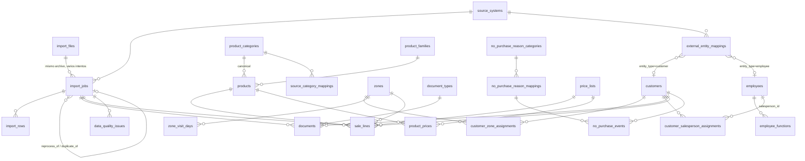

# DATA_MODEL — DistriCom

> v0.2 · 2026-10-03 · Propuesta. Las tablas se crean por migraciones Alembic en la fase indicada.
> v0.2: modelo revisado para la **plataforma modular** (ADR 006): ownership por plataforma/módulo, `employees` + `employee_functions` en lugar de `salespeople`, identidad de clientes en plataforma, tipos de import y de mapping extensibles, `suppliers` diferido.
> v0.3 · 2026-10-04: módulo **Rendiciones** (schema `settlements`, ADR 007); `employees` + `employee_functions` y `user_module_roles` adelantados a R0; modelo conceptual de Rendiciones en §13.
> v0.4 · 2026-10-30: **Fase 1 de Inteligencia Comercial rediseñada sobre las muestras reales de STORE SYS** (ADR 014, `docs/IMPORTS.md`): framework de importación con `import_jobs` / `import_rows` / `data_quality_issues`; vínculos externos solo en `external_entity_mappings`; zonas con días configurables en lugar de rutas de AXUM; comprobantes y líneas de venta como hechos separados; productos con campos fuente y canónicos, listas de precio y familias; visitas, programación y pedidos fuera de Fase 1.

## 0. Ownership y schemas

Una sola base PostgreSQL. **Plataforma** (DistriCom Core) en el schema `public`; cada **módulo** en su propio schema: **Inteligencia Comercial** (`commercial`) y **Rendiciones** (`settlements`).

| Dueño | Schema | Tablas |
|---|---|---|
| Plataforma | `public` | `users`, `user_sessions`, `app_settings`, `audit_events`, `source_systems` (Fase 0) · `employees`, `employee_functions`, `user_module_roles` (R0) · bancos, vehículos, terceros, bocas (R4–R7) · `customers`, `external_entity_mappings`, `import_files`, `import_jobs`, `import_rows`, `data_quality_issues` (Fase 1) |
| Inteligencia Comercial | `commercial` | Configuración: `zones`, `zone_visit_days`, `zone_classification_rules`, `price_lists`, `product_categories`, `source_category_mappings`, `document_types`, `no_purchase_reason_categories`, `no_purchase_reason_mappings` · Maestros: `products`, `product_families`, `product_prices`, `customer_zone_assignments`, `customer_salesperson_assignments` · Hechos: `documents`, `sale_lines`, `no_purchase_events` (Fase 1) · `customer_status_*`, `customer_recovery_events`, `opportunities`, `opportunity_status_history`, `cross_sell_rules`, `commercial_goals`, `incentives` (Fases 4–8) · **Futuras, sin fuente todavía:** `visits`, `scheduled_visits`, `orders`, `order_items`, `customer_types`, `customer_profiles`, `brands`, `localities` (§6.4) |
| Rendiciones | `settlements` | Schema vacío en R0. Tablas por fase desde R1 (§13). |

Reglas:
- Una tabla tiene **un solo dueño**, que la define, la migra y es el único que escribe en ella. Un módulo escribe en tablas de plataforma solo a través de servicios de plataforma.
- **Claves foráneas:** módulo → plataforma, sí. Plataforma → módulo, **nunca**. Módulo → otro módulo, solo si esa dependencia está declarada en ARCHITECTURE.md (hoy no hay ninguna).
- Los nombres de tabla no llevan prefijo de módulo: el schema ya lo indica. En consultas y migraciones las tablas de módulo se califican (`commercial.sales`).
- **Única fuente de verdad:** un dato compartido (persona, cliente, localidad, sistema fuente, identidad externa) existe una sola vez, en plataforma. Los módulos guardan solo sus relaciones y atributos propios, referenciando la fila de plataforma.
- Las columnas que referencian a un empleado en un rol usan el nombre del rol (`salesperson_id → public.employees.id`).

## 1. Convenciones

- **PK**: `id BIGINT GENERATED ALWAYS AS IDENTITY`. Nunca CUIT, DNI, nombre ni código externo como PK.
- **IDs externos**: desde la Fase 1, el vínculo de una entidad con un sistema fuente vive **solo** en `external_entity_mappings` (§7.4), con estado, método y auditoría; las tablas nuevas no llevan columnas `external_*`. Excepción histórica: `employees.external_axum_id` / `external_store_id` (R0), que se mantienen; `external_store_id` lo administra Rendiciones (ADR 011) y Comercial solo lo lee (ADR 014).
- **Fechas de negocio**: `DATE` en zona horaria de negocio (`BUSINESS_TIMEZONE`, default `America/Argentina/Buenos_Aires`). Instantes: `TIMESTAMPTZ` (UTC).
- **Dinero**: `NUMERIC(14,2)`. Moneda en `app_settings.currency` (default `ARS`); nunca símbolo en datos.
- **Cantidades**: `NUMERIC(12,3)`.
- **Enums**: `TEXT` + `CHECK` (más fácil de migrar que `ENUM` de Postgres).
- **Auditoría estándar**: `created_at`, `updated_at` (`TIMESTAMPTZ NOT NULL DEFAULT now()`).
- **Trazabilidad**: toda fila importada lleva `import_job_id` (FK `public.import_jobs`) → responde "¿de qué importación salió este dato?"; la fila cruda queda en `import_rows`.
- **Fuente vs. canónico**: el valor tal cual vino del sistema fuente se guarda en columnas `source_*` y nunca se sobrescribe con una normalización; lo que DistriCom decide (categoría, tipo, elegibilidad, familia, clase de comprobante) vive en columnas propias.
- **Historización**: tablas de vigencia `valid_from DATE NOT NULL`, `valid_to DATE NULL` (NULL = vigente) con **exclusion constraint** (`btree_gist`) que impide solapamientos por entidad.
- Nombres en inglés, `snake_case`, tablas en plural.

## 2. ERD (resumen)

> Entidades de plataforma (`employees`, `customers`, `import_*`, `external_entity_mappings`, `data_quality_issues`) en `public`; el resto en `commercial` (§0). Las fases 4–8 se agregan cuando se diseñen sobre este modelo.

## 3. Plataforma (Fase 0)

### users
| Columna | Tipo | Notas |
|---|---|---|
| id | bigint PK | |
| email | citext UNIQUE NOT NULL | |
| password_hash | text NULL | Argon2id; NULL si identidad externa futura |
| full_name | text NOT NULL | |
| role | text NOT NULL CHECK (`admin`,`viewer`) | **Rol de plataforma.** `admin` = administrador de plataforma (usuarios, empleados, configuración general) con `admin` en todos los módulos. El acceso de los demás usuarios a cada módulo está en `user_module_roles` (R0, ARCHITECTURE.md §8). |
| active | bool NOT NULL DEFAULT true | |
| last_login_at | timestamptz | |

### user_sessions
`id`, `user_id` FK, `token_hash` (bytea UNIQUE), `created_at`, `last_seen_at`, `expires_at`, `revoked_at`, `ip`, `user_agent`. Índice `(user_id)`.

### app_settings
Parámetros de negocio editables. `key text PK`, `value jsonb NOT NULL`, `description`, `updated_by` FK users, `updated_at`. Las claves llevan el **scope** como prefijo: `platform.*` (globales) y `<módulo>.*` (`commercial.*`). Los defaults viven en código junto a su dueño (`app/platform/settings/` y `app/modules/<módulo>/settings.py`) y la tabla solo guarda overrides; así un parámetro siempre tiene valor seguro. Cambios auditados. La zona horaria de negocio **no** es un parámetro: es la variable de entorno `BUSINESS_TIMEZONE`.

### audit_events
`id`, `occurred_at`, `user_id` NULL, `event_type` (`auth.login`, `platform.setting_changed`, `platform.import.completed`, `commercial.goal.created`, `commercial.incentive.approved`, … — prefijo = dueño; los eventos existentes de Fase 0 se renombran al adoptar la convención, P1), `entity_type`, `entity_id`, `payload jsonb` (sin PII), `request_id`. Índice `(event_type, occurred_at)`.

### source_systems
`id`, `code` UNIQUE (`AXUM`, `STORE_SYS`, `MANUAL`, `DEMO`), `name`.

### user_module_roles (R0)
Rol de un usuario en un módulo (Etapa 1 de ARCHITECTURE.md §8).
| Columna | Notas |
|---|---|
| id | PK |
| user_id | FK `users` NOT NULL, `ON DELETE CASCADE` |
| module_key | text NOT NULL — key del módulo (`commercial`, `settlements`); validado contra los módulos instalados por el servicio (sin CHECK en la base) |
| role | text NOT NULL CHECK (`viewer`, `operator`, `admin`) |
| granted_by | FK `users` NULL |
| timestamps | |

`UNIQUE (user_id, module_key)`. Sin fila = sin acceso (salvo administradores de plataforma). La migración que la crea da `viewer` en `commercial` a los usuarios `viewer` existentes, para que nadie pierda acceso. Altas, cambios y bajas se auditan (`platform.module_role.*`).

## 4. Maestros (R0 y Fase 1)

### 4.1 Plataforma (`public`)

> `employees` y `employee_functions` se implementan en R0 (ADR 007), con alta manual e independientes de los imports. `customers` llega en Fase 1 (ADR 014). `localities` queda **diferida**: ningún export real trae localidad separada de la dirección; la segmentación geográfica de Fase 1 es la **zona** comercial (§4.2).

#### employees (R0)
Identidad **única** de cada persona que trabaja en la empresa, sea cual sea su función o módulo. Solo identidad: los datos propios de cada función viven en el módulo que la usa. Baja **lógica** (`active = false`); nunca se borra una fila.
| Columna | Notas |
|---|---|
| id | PK |
| full_name | text NOT NULL |
| external_axum_id, external_store_id | text, unique parcial `WHERE … IS NOT NULL`. `external_store_id` lo administra Rendiciones › Integración Store Sys (ADR 011); `external_axum_id` no tiene escritor. **Comercial no escribe ninguno de los dos**: vincula vendedores de los exports con `external_entity_mappings` (`employee / STORE_SYS / seller`, ADR 014). |
| active | bool NOT NULL DEFAULT true |
| hire_date | date NULL |
| phone | text NULL — PII |
| timestamps | |

#### employee_functions (R0)
Funciones del empleado con historia. Una persona puede tener varias funciones a la vez o cambiar de función sin duplicarse.
| Columna | Notas |
|---|---|
| id | PK |
| employee_id | FK `employees` NOT NULL |
| function_code | text NOT NULL — código registrado en código por el módulo dueño de la función (`ModuleSpec.employee_functions`), validado por el servicio (sin CHECK en la base). Hoy: `commercial.salesperson` (Preventista) y `settlements.delivery_driver` (Repartidor). |
| valid_from | date NOT NULL |
| valid_to | date NULL — NULL = vigente; inclusive; CHECK `valid_to >= valid_from` |
| source | `AXUM`, `STORE_SYS`, `MANUAL` (R0: siempre `MANUAL`) |
| created_by | FK users NULL |
| timestamps | |

- Exclusion constraint: `(employee_id, function_code, daterange(valid_from, valid_to, '[]'))` sin solapamientos.
- Un cambio de función cierra la vigente (`valid_to`) y abre otra; la única modificación permitida de una fila es cerrar su vigencia. Nunca UPDATE in place de código ni fechas de inicio.
- Dar de baja a un empleado cierra sus funciones vigentes en la fecha de baja.
- Que un `salesperson_id` de una tabla comercial sea preventista **en esa fecha** lo valida el servicio comercial contra esta tabla (no es una FK).

#### customers (Fase 1, ADR 014)
Identidad **única** del cliente para toda la plataforma. Asignaciones y datos comerciales viven en `commercial` (§4.2, §5). Lo crea **solo** el import del maestro de clientes de STORE SYS (o un alta manual de admin); los demás imports nunca crean clientes.
| Columna | Tipo | Notas |
|---|---|---|
| id | bigint PK | |
| display_name | text NOT NULL | nombre de fantasía (`fantasia`) |
| legal_name | text NULL | razón social (`razons`) |
| tax_id | text NULL | CUIT normalizado a 11 dígitos con dígito verificador válido; **no único** (sucursales, errores de carga) |
| address, phone | text NULL | PII: nunca en logs ni auditoría |
| is_generic | bool NOT NULL DEFAULT false | Consumidor Final, Cliente Mayorista… Lo marca un admin o una regla configurable **por código**, nunca por nombre. Excluido de universos de clientes (PLAN R9) |
| active | bool NOT NULL DEFAULT true | estado en DistriCom (baja lógica, nunca DELETE) |
| first_seen_job_id, last_seen_job_id | FK `import_jobs` NULL | primera y última foto del maestro que lo trajo |
| last_seen_on | date NULL | fecha de esa última foto |
| timestamps | | |

> El código de STORE SYS, el de AXUM y cualquier otro identificador externo **no** son columnas: viven en `external_entity_mappings` (§7.4), que admite varios códigos por cliente y guarda estado y decisión. La API los expone igual.
> Zona y vendedor **no** son columnas de `customers`: viven en tablas de asignación con vigencia (§5).

#### financial_institutions (R4‑1 · migración `0011`)
Catálogo **único** de entidades bancarias por código BCRA, para cualquier módulo (decisión D‑I de Enzo). Un cheque nombra su banco por FK, nunca con un código escrito en cada fila.
| Columna | Tipo | Notas |
|---|---|---|
| id | bigint identity | PK |
| bcra_code | integer UNIQUE | 1..99999. El código oficial es un entero (`7`, como lo da el BCRA): es la identidad. Mostrarlo con ceros (`007`) es formato de pantalla, nunca parte del valor |
| name | varchar(200) | Denominación oficial, textual (mayúsculas, espacios y acentos como los publica el BCRA) |
| source | varchar(10) | `BCRA` (sembrada por la migración) · `MANUAL` (agregada por un admin) |
| active | boolean | Un admin activa o desactiva; una desactivada no se elige en un alta nueva, pero lo cargado la sigue nombrando |
| created_by / manual_reason | null | Obligatorios sí y solo sí `MANUAL` (CHECK): quién la agregó y por qué |
| created_at / updated_at | timestamptz | |

Sin DELETE y sin cambios salvo `active` (triggers): un código oficial nunca se modifica en silencio, y un alta manual con un código existente es `bank_code_taken`. **Semilla de `0011`: snapshot oficial**, no una lista de memoria. Fuente: API de Cheques v1.0 del BCRA, `GET https://api.bcra.gob.ar/cheques/v1.0/entidades` (`codigoEntidad` → `bcra_code`, `denominacion` → `name`). Fecha de corte: 2026-10-07. **59 entidades**, contrastadas dos veces contra la respuesta. Sin sincronización automática: una entidad que falte la agrega un admin de plataforma como `MANUAL`, con motivo y auditada. API: `GET /api/v1/financial-institutions` (todo usuario), `POST` y `PATCH /{id}` (admin de plataforma, auditados).

#### vehicles (R5‑1 · migración `0014`)
Maestro **único** de vehículos de la empresa para cualquier módulo (decisión R5‑D4 y decisión 2 de Enzo). Lo administra el **admin de plataforma**, no el admin de un módulo; todo usuario autenticado lo consulta.
| Columna | Tipo | Notas |
|---|---|---|
| id | bigint identity | PK. Es la identidad: corregir la patente conserva la historia y lo que ya lo nombra |
| plate | varchar(10) | Patente **normalizada**: mayúsculas, sin espacios, puntos ni guiones; solo `A–Z` y `0–9`, de 5 a 10 caracteres (CHECK) |
| plate_key | varchar(10) UNIQUE | Clave de comparación (hoy, la patente normalizada): `AB 123 CD`, `AB-123-CD` y `ab.123.cd` son la misma |
| description | varchar(200) | Obligatoria (CHECK no vacía); espacios repetidos se colapsan |
| active | boolean | Uno inactivo no se elige para registros nuevos (`service.active` → 422 `invalid_vehicle`); lo ya registrado lo sigue nombrando |
| created_by / updated_by | bigint FK `users` (RESTRICT) | Quién lo dio de alta y quién lo cambió por última vez |
| created_at / updated_at | timestamptz | |

Sin marca, modelo ni año. El formato visual (`AB 123 CD` para Mercosur, `ABC 123` para el formato anterior, cualquier otra tal cual) se **calcula** en el backend (`plate_display`), nunca se guarda. Sin DELETE (trigger `forbid_vehicle_delete`) y `created_by`/`created_at` inmutables (trigger). Cada alta, corrección de patente, corrección de descripción, activación y desactivación es un `audit_event` `platform.vehicle.*` con usuario, antes, después e instante; la historia del vehículo son esos eventos. API: `GET /api/v1/vehicles` y `GET /{id}` (todo usuario; el detalle trae la historia), `POST` y `PATCH /{id}` (admin de plataforma). Duplicado: 409 `vehicle_plate_taken` con el vehículo que ya la tiene.

#### third_parties (R6‑1 · migración `0018`)
Maestro **único** de terceros a quienes la empresa les paga (proveedores, fleteros, otros), para cualquier módulo (decisiones D2, D7 y D8 de Enzo). Lo administra el **admin de plataforma**; todo usuario autenticado lo consulta. Un operator o admin de Rendiciones puede dar de **alta rápida** un tercero mientras registra un pago (`POST /api/v1/settlements/third-parties`): queda igual en este maestro, auditado con `origin = settlements.payment`; no puede corregirlo, desactivarlo ni reactivarlo.
| Columna | Tipo | Notas |
|---|---|---|
| id | bigint identity | PK. Es la identidad: corregir nombre o CUIT conserva los pagos que lo nombran |
| name | varchar(200) | Obligatorio (CHECK no vacío); espacios repetidos se colapsan |
| name_key | varchar(200) | Clave de comparación (minúsculas, sin acentos ni puntuación, espacios colapsados). Indexada, **no única**: dos homónimos pueden existir si alguien confirma que son distintos |
| tax_id | varchar(11) nulo | CUIT opcional, guardado como sus 11 dígitos; CHECK `public.cuit_is_valid(tax_id)` (dígito verificador módulo 11). Índice único parcial `uq_third_parties_tax_id` (`WHERE tax_id IS NOT NULL`) |
| notes | text nulo | |
| active | boolean | Uno inactivo no recibe pagos nuevos (`third_party_inactive`); los pagos ya registrados lo siguen nombrando |
| created_by / updated_by | bigint FK `users` (RESTRICT) | |
| created_at / updated_at | timestamptz | |

- **CUIT.** Se escribe con o sin guiones, puntos, barras o espacios; se valida el dígito verificador en el backend (`tax_ids.normalize`, 422 `invalid_tax_id`) y en la base (`cuit_is_valid`). El formato `30-71234567-1` se **calcula** (`tax_id_display`). Nunca va a los logs (PII); la auditoría sí lo guarda, como el CUIT del librador de un cheque.
- **Duplicados.** Mismo CUIT: **bloqueo** (409 `third_party_tax_id_taken`, con el tercero que lo tiene y si está activo); la carrera de dos altas la decide el índice único. Mismo `name_key` cuando a uno de los dos le falta CUIT: **aviso** (409 `third_party_possible_duplicate` con los candidatos); seguir exige `confirm_not_duplicate = true` y un motivo (`reason_required`), que queda en la auditoría como `duplicate_confirmation` (candidatos y motivo). Con CUIT distintos en ambos, no hay aviso. **Nunca** se fusionan terceros. Un lock advisory por `name_key` serializa la verificación de homónimos.
- **Guardas.** Sin DELETE (trigger `forbid_third_party_delete`); `created_by`/`created_at` inmutables (`check_third_party_update`).
- **Auditoría.** `platform.third_party.created` (con `origin`), `.name_changed`, `.tax_id_changed`, `.notes_changed`, `.activated`, `.deactivated`, con usuario, antes, después e instante. Un PATCH sin cambios no registra nada.
- **Concurrencia.** Un pago toma el tercero `FOR SHARE` (servicio y trigger) hasta su commit: una desactivación en curso espera al pago, y un pago que empieza después de la desactivación la ve y se rechaza.
- API: `GET /api/v1/third-parties` (`include_inactive`, `q` por nombre o por ≥3 dígitos del CUIT), `GET /{id}` (con la historia), `POST` y `PATCH /{id}` (admin de plataforma). Sin DELETE.

#### outlets (R7‑1 · migración `0021`)
Maestro **único** de bocas de expendio (puntos de venta que rinden), para cualquier módulo (ADR 009). Lo administra el **admin de plataforma**; todo usuario autenticado lo consulta. Quién responde por cada boca es del módulo Rendiciones (§13.7).
| Columna | Tipo | Notas |
|---|---|---|
| id | bigint identity | PK |
| code | varchar(20) | Obligatorio, **único** (`uq_outlets_code`) e **inmutable** (trigger `check_outlet_update`). CHECK `^[A-Z0-9-]{2,20}$`. Se ingresa con o sin mayúsculas y espacios alrededor; cualquier otro carácter se rechaza (422 `invalid_outlet_code`), nunca se corrige. Es la identidad de la boca junto con el id; el nombre nunca lo es |
| name | varchar(100) | Obligatorio (CHECK no vacío); espacios repetidos se colapsan; se corrige |
| name_key | varchar(100) | Clave de comparación del nombre (la de terceros: minúsculas, sin acentos ni puntuación, espacios colapsados). **Única** (`uq_outlets_name_key`): no hay dos bocas con nombres operativamente iguales (409 `outlet_name_taken`). Relajarla exige consultar a Enzo |
| description | text nulo | Opcional; vacía se guarda nula |
| active | boolean | Una inactiva no abre rendiciones nuevas ni suma responsables; lo abierto se termina y su historia sigue visible |
| created_by / updated_by | bigint FK `users` (RESTRICT) | |
| created_at / updated_at | timestamptz | |

Sin dirección ni localidad. Sin DELETE (trigger `forbid_outlet_delete`); `code`, `created_by` y `created_at` inmutables. Auditoría `platform.outlet.created`, `.name_changed`, `.description_changed`, `.deactivated`, `.reactivated` con usuario, antes, después e instante; un PATCH sin cambios no registra nada. Código duplicado: 409 `outlet_code_taken` (la carrera de dos altas la decide el índice único). API: `GET /api/v1/outlets` (`include_inactive`), `GET /{id}` (con la historia), `POST` y `PATCH /{id}` (admin de plataforma; el PATCH no acepta `code`). Sin DELETE.

### 4.2 Inteligencia Comercial (`commercial`) — configuración

Tablas de configuración: se cargan con un **seed controlado** (`commercial seed-config`, idempotente) y las edita un admin del módulo con auditoría (`commercial.config.*`). Ninguna regla comercial vive en `if` dentro del código de analítica.

#### zones
Zona comercial de STORE SYS (`RUTA 01 - LUVI`, `RUTA 08 - BOCA DE EXPENDIO`…). Reemplaza a `routes` del diseño anterior (ADR 014 §2.8).
| Columna | Notas |
|---|---|
| id | PK |
| source_name | text NOT NULL — tal cual la escribe STORE SYS |
| name_key | text NOT NULL UNIQUE — mayúsculas, sin tildes, espacios colapsados |
| display_name | text NOT NULL |
| zone_type | `PRESALE`, `BANDERA`, `OUTLET`, `OTHER`, `UNCLASSIFIED` |
| requires_visit | bool NOT NULL |
| configuration_origin | `RULE` (propuesta por `zone_classification_rules` al crearse), `MANUAL` (definida por un admin) |
| active | bool |
| configured_by, configured_at | quién y cuándo fijó la configuración vigente |
| timestamps | |

- Una zona nueva que llega en un import se crea `UNCLASSIFIED`, se le aplica la primera regla activa que coincide y queda `configuration_origin = RULE`. Sin regla aplicable: issue `commercial.zone.unconfigured`.
- **Una regla nunca modifica una zona ya creada**; cambiar la configuración es una acción manual auditada (`MANUAL`).
- La zona «Boca de Expendio» (`OUTLET`, `requires_visit = false`) **no** se vincula con `public.outlets` en Fase 1 (D‑J).

#### zone_visit_days
Días programados de visita, con historia.
`id`, `zone_id` FK, `weekday` smallint (1 = lunes … 7 = domingo), `valid_from` date NOT NULL, `valid_to` date NULL, `created_by`, timestamps.
Exclusion constraint `(zone_id, weekday, daterange(valid_from, valid_to, '[]'))`. Cambiar los días cierra las vigencias y abre otras; nunca UPDATE in place. Una zona con `requires_visit = false` no tiene filas vigentes (lo verifica el servicio).

#### zone_classification_rules
Propuesta de configuración para zonas **nuevas**.
`id`, `priority` int, `match_type` (`CONTAINS`), `pattern` text (sobre `name_key`), `zone_type`, `requires_visit`, `weekdays` smallint[], `active`, `description`, timestamps.

| Patrón observado en STORE SYS | Regla de negocio (Enzo) | Estado |
|---|---|---|
| `LUVI` (`RUTA 01`, `RUTA 02`) | Lumivi: lunes, miércoles, viernes | alias inferido, **confirmar** antes de sembrar |
| `MAJU` (`RUTA 04`, `RUTA 06`) | Majusa: martes, jueves, viernes | alias inferido, **confirmar** |
| `BANDERA` (`RUTA 07 - TACAÑITAS/BANDERA`) | Bandera: jueves | confirmado por regla |
| `BOCA DE EXPENDIO` (`RUTA 08`) | sin visita (`OUTLET`) | confirmado por regla |
| `MISA` (`RUTA 03`, `RUTA 05`) | — | **sin regla**: entra `UNCLASSIFIED` hasta que Enzo defina días |

#### price_lists
Listas de precio de STORE SYS **con semántica**.
`id`, `list_number` smallint UNIQUE, `code` UNIQUE, `name`, `description`, `kind` (`PRESALE_OFFICIAL`, `OUTLET`, `PROMO_VOLUME`, `SPECIAL`, `BANDERA`, `UNASSIGNED`), `commercially_relevant` bool, `active`, timestamps.
Seed: 1 Precio oficial de preventa · 2 Boca de Expendio · 3 Promocional por 3 bultos o más · 4 Precios especiales · 5 Bandera · 6 y 7 `UNASSIGNED` (existen en el maestro, sin semántica definida). Una lista nueva se agrega como fila, sin tocar código.

#### product_categories
`id`, `code` UNIQUE, `name`, `default_product_kind`, `default_analytics_eligible` bool, `parent_id` FK self NULL (reservado; un nivel en Fase 1), `sort_order`, `active`. El listado inicial sale de los rubros reales (`GASEOSAS`, `VINOS`, `CERVEZAS`, `JUGOS`, `AGUAS`, `MERCADERIA`, `BEBIDAS BLANCAS` en la muestra) y se siembra con confirmación de Enzo.

#### source_category_mappings
Traducción explícita **rubro fuente → categoría canónica**.
`id`, `source_system_id`, `source_category` text (tal cual), `source_category_key` text (normalizado), `category_id` FK, `decided_by`, `decided_at`. `UNIQUE (source_system_id, source_category_key)`. Un rubro vacío **no** tiene mapping: el producto queda sin categoría.

#### document_types
Clasificación de los tipos de comprobante de STORE SYS.
| Columna | Notas |
|---|---|
| id | PK |
| source_name | text NOT NULL — tipo tal cual (`FACTURA A`, `RETIRO PR.`…) |
| source_name_key | text NOT NULL UNIQUE — normalizado |
| document_class | `INVOICE`, `CREDIT_NOTE`, `DEBIT_NOTE`, `RETURN`, `RECEIPT`, `INTERNAL_MOVEMENT`, `EMPLOYEE_VOUCHER`, `OTHER`, `UNCLASSIFIED` |
| sign | smallint CHECK (`-1`, `0`, `1`) — signo del neto canónico |
| commercial_universe | bool NOT NULL — **única** definición de "cuenta como actividad comercial" |
| active, decided_by, decided_at | |

- `RETIRO PR.` → `INTERNAL_MOVEMENT`, `commercial_universe = false` (regla confirmada).
- Un tipo nuevo entra `UNCLASSIFIED`, `commercial_universe = false`, con issue. La clasificación del resto de los tipos observados requiere confirmación de Enzo (`docs/IMPORTS.md §3.4`).

#### no_purchase_reason_categories / no_purchase_reason_mappings
`no_purchase_reason_categories`: `id`, `code` UNIQUE (`STOCK`, `NO_DISPONIBLE`, `OTRO_CANAL`, `RESTRICCION_FINANCIERA`, `OTRO`), `name`, `active`.
`no_purchase_reason_mappings`: `id`, `source_system_id`, `reason_source` (tal cual), `reason_key` (normalizado) UNIQUE por sistema, `category_id` FK NULL, `decided_by`, `decided_at`. Un motivo nuevo se agrega sin categoría (issue `commercial.no_purchase.unmapped_reason`). Seed con los ejemplos de Enzo: TIENE STOCK → STOCK · CERRADO, NO ESTA EL ENCARGADO, VACACIONES → NO_DISPONIBLE · COMPRA POR BEES → OTRO_CANAL · SIN DINERO → RESTRICCION_FINANCIERA (a ajustar con el CSV real).

### 4.3 Inteligencia Comercial — maestros

#### products
Un SKU de STORE SYS. Campos **fuente** (se actualizan en cada import del maestro) separados de los **canónicos** (decisión de DistriCom; un import nunca los pisa).
| Columna | Notas |
|---|---|
| id | PK |
| source_code | text NOT NULL UNIQUE — código STORE SYS (entero en texto) |
| source_description, source_category, source_line, source_capacity, source_pack, source_barcode | text NULL — tal cual |
| source_internal_tax, source_discount_cap, source_vat, source_weight | numeric NULL — tal cual (columnas exactas al ver la muestra del maestro) |
| source_extra | jsonb — el resto de columnas del maestro |
| source_row_hash | bytea — detecta cambios entre fotos |
| canonical_category_id | FK `product_categories` NULL |
| category_origin | `SOURCE_MAPPING`, `MANUAL`, `NONE` |
| product_kind | `PRODUCT`, `CONTAINER`, `CRATE`, `SERVICE`, `BONUS`, `COMBO`, `PROMO`, `MERCH`, `UNCLASSIFIED` |
| analytics_eligible | bool NOT NULL DEFAULT false |
| eligibility_origin | `CATEGORY_DEFAULT`, `MANUAL` |
| family_id | FK `product_families` NULL |
| active | bool — estado en DistriCom |
| first_seen_job_id, last_seen_job_id | FK `import_jobs` |
| timestamps | |

- **`analytics_eligible`** es la única marca que usará la analítica futura para excluir envases, esqueletos, servicios o bonificaciones: ningún KPI filtra códigos.
- Producto sin categoría y sin clasificación → `analytics_eligible = false` hasta clasificarlo (D‑D). Con categoría mapeada, hereda `default_analytics_eligible` salvo override manual.
- Ejemplo de trazabilidad: `source_category = NULL`, `canonical_category = CERVEZAS`, `category_origin = MANUAL`.

#### product_families
Agrupación **explícita** de SKUs que comercialmente son lo mismo (QUILMES 1L X12 y BOT QUILMES 1L → familia QUILMES 1L).
`id`, `code` UNIQUE, `name`, `description`, `active`, timestamps. La asignación es `products.family_id`, por API y auditada. **Nunca se infiere por similitud de texto.** Pantalla en la fase de portfolio (D‑K).

#### product_prices
`id`, `product_id` FK, `price_list_id` FK, `price` numeric(14,2), `valid_from` date NOT NULL, `valid_to` date NULL, `import_job_id` FK. Exclusion constraint `(product_id, price_list_id, daterange)`. Cada foto del maestro: precio igual → nada; distinto → cierre + alta.

## 5. Asignaciones con historia (Fase 1, `commercial`)

### customer_zone_assignments / customer_salesperson_assignments
| Columna | Notas |
|---|---|
| id | |
| customer_id | FK `public.customers` NOT NULL |
| zone_id | FK `zones` (solo zona) |
| salesperson_id | FK `public.employees` **NULL** mientras el vendedor fuente no está mapeado (solo vendedor) |
| source_seller_label | text — etiqueta tal cual (solo vendedor; también para pseudo‑vendedores `excluded`) |
| valid_from DATE NOT NULL | fecha de la foto que la abrió |
| valid_to DATE NULL | NULL = vigente |
| source | `STORE_SYS`, `AXUM`, `MANUAL` |
| import_job_id | FK NULL |
| created_by | FK users NULL |

- Exclusion constraint: un cliente no tiene dos asignaciones solapadas del mismo tipo.
- Cada import del maestro es una **foto** con fecha declarada: si la asignación cambió, se cierra la vigente en `foto - 1` y se abre otra; si viene vacía, se cierra y queda issue. Nunca UPDATE in place ni borrado.
- La foto no puede ser anterior a la última aplicada para ese cliente (se rechaza con mensaje; reordenar historia es reproceso de admin).
- Vista `customer_current_assignment(customer_id, zone_id, salesperson_id)` y función `assignment_at(customer_id, date)` para atribución histórica.

## 6. Hechos (Fase 1, `commercial`)

### 6.1 documents (Comprobantes emitidos de STORE SYS)
Un comprobante, **sin ítems** (la fuente no los trae).
| Columna | Notas |
|---|---|
| id | PK |
| document_type_id | FK `document_types` NOT NULL |
| source_type_name | text — tipo tal cual |
| letter | text NULL |
| point_of_sale | text NULL — `PPPP` |
| number | text — `NNNNNNNN` |
| document_key | text NOT NULL UNIQUE — tipo normalizado + letra + punto de venta + número |
| business_date | date NOT NULL (`fechas`) |
| issued_at | timestamptz NULL (`fechor`, trae hora) |
| customer_id | FK `public.customers` NULL — NULL si `codcli = 0` o sin mapping |
| source_customer_code, source_customer_name | text |
| net_amount | numeric(14,2) — `netosa` tal cual (sin signo en la fuente) |
| signed_net_amount | numeric(14,2) — `net_amount × document_types.sign` |
| total_amount | numeric(14,2) — `total` tal cual (con signo en la fuente) |
| discount_amount | numeric(14,2) |
| import_job_id | FK NOT NULL |
| source_row_hash | bytea |

- **Universo comercial** = `document_types.commercial_universe`; `RETIRO PR.` queda fuera por configuración, no por código.
- Reimport con el mismo `source_row_hash` → `duplicate`; con otro → fila rechazada + issue `document.changed` (nunca se pisa).
- La clase y el signo se leen siempre del tipo vigente: reclasificar un tipo (admin, auditado) cambia su interpretación sin reescribir comprobantes.

### 6.2 sale_lines (Ventas artículos/clientes de STORE SYS)
Unidades vendidas por cliente, producto y día. **Sin importe y sin vínculo a `documents`** (la fuente no trae número de comprobante).
| Columna | Notas |
|---|---|
| id | PK |
| business_date | date NOT NULL |
| customer_id | FK `public.customers` NULL — mapping por nombre pendiente |
| source_customer_name | text NOT NULL — la fuente trae nombre, no código |
| product_id | FK `products` NULL |
| source_product_code, source_product_description, source_category | text |
| quantity | numeric(12,3) — negativa = devolución |
| price_list_id | FK `price_lists` NULL · `source_price_list` text |
| salesperson_id | FK `public.employees` NULL · `source_seller` text |
| zone_id | FK `zones` NULL · `source_zone` text |
| status | `ACTIVE`, `SUPERSEDED` |
| superseded_by_job_id | FK `import_jobs` NULL |
| import_job_id | FK NOT NULL |
| occurrence | int — orden dentro del archivo; las filas idénticas se conservan |

- `source_seller` / `source_zone` coinciden con la asignación del maestro (no son atribución del documento); la atribución se resuelve con §5.
- Idempotencia: reemplazo por **período y scope** (`docs/IMPORTS.md §5.3`); las líneas reemplazadas quedan `SUPERSEDED`, nunca se borran.

### 6.3 no_purchase_events (AXUM No Compra)
`id`, `business_date`, `customer_id` FK NULL, `source_customer_code`, `source_customer_name`, `salesperson_id` FK NULL, `source_salesperson`, `reason_source` text NOT NULL (tal cual), `reason_mapping_id` FK `no_purchase_reason_mappings`, `import_job_id`, `occurrence`.
**Sin UNIQUE** sobre `fecha + cliente + preventista + motivo` (ajuste 1 de Enzo): puede haber varias visitas el mismo día. La estrategia de reimport se define con el CSV real (ADR 014 S6). Columnas exactas al recibir la muestra.

### 6.4 Futuras (no se crean en Fase 1)
Se crean solo cuando exista una fuente real que las alimente (D‑H). Hasta entonces **no** se infieren visitas, cobertura ni pedidos.
- `visits`: visita realizada (fecha, hora, cliente, preventista, zona, resultado, motivo, pedido). Podrá vincular `no_purchase_events.visit_id`.
- `scheduled_visits`: clientes programados por día; podría derivarse de `zone_visit_days` + asignaciones (`source = DERIVED`) solo con aprobación y exponiendo el origen.
- `orders` / `order_items`: pedidos AXUM con número.
- `customer_types` / `customer_profiles`, `brands`, `localities`, `sales_channels`: sin campo fuente hoy. Cómo distinguir preventa de boca (PLAN D6) se decide en la fase que lo use; candidatos observados en las muestras: `zone_type` de la zona del cliente, vendedor fuente «BOCA DE EXPENDIO», lista de precio 2 y clientes genéricos.

## 7. Importaciones, mappings y calidad (Fase 1, plataforma)

El **framework** es de plataforma; los **tipos de import, adaptadores y códigos de calidad** son de cada módulo y se registran en `ModuleSpec` (`import_types`, `quality_codes`). La base no lista tipos con CHECK. Detalle operativo: `docs/IMPORTS.md`.

### 7.1 import_files
`id`, `original_filename` (sanitizado, solo para mostrar), `storage_key` (UUID bajo `UPLOAD_DIR`), `size_bytes`, `detected_format` (`XLS`, `XLSX`, `CSV`), `content_type`, `sha256` (índice), `uploaded_by`, `uploaded_at`. El archivo nunca se modifica ni se borra desde la app.

### 7.2 import_jobs
| Columna | Notas |
|---|---|
| id | PK |
| source_system_id | FK `source_systems` |
| import_type | text namespaced (`commercial.store_sys.customers`, `.sales_lines`, `.documents`, `.products`, `commercial.axum.no_purchase`), validado por el registro |
| status | `pending`, `processing`, `completed`, `completed_with_warnings`, `failed`, `duplicate`, `cancelled` |
| file_id | FK `import_files` |
| parser_version | text — versión del adaptador |
| created_by, confirmed_by | FK users |
| started_at, analyzed_at, confirmed_at, finished_at | timestamptz |
| rows_detected, rows_processed, rows_valid, rows_rejected, rows_duplicate, rows_skipped, rows_pending_resolution | int |
| rows_inserted, rows_updated, rows_unchanged, rows_superseded | int (al confirmar) |
| warning_count, error_count | int |
| snapshot_date | date NULL — fecha de la foto (maestros) |
| period_from, period_to | date NULL — período cubierto (hechos) |
| scope | jsonb NULL — scope declarado (`FULL` / `FILTERED` + descripción) y dimensiones observadas (vendedores, zonas, días) |
| reprocess_of_job_id, duplicate_of_job_id | FK self NULL |
| metadata | jsonb — hoja, fila de encabezado, encoding, separador, firma de encabezados |
| failure_reason | text NULL |

Duplicado exacto: mismo `sha256` + `import_type` que un job `completed`/`completed_with_warnings` → `duplicate` sin escritura. Reproceso deliberado: solo admin, job nuevo con `reprocess_of_job_id`.

### 7.3 import_rows (staging)
`id`, `job_id` FK, `sheet`, `row_number` (fila real del archivo), `raw` jsonb (celdas tal cual), `normalized` jsonb (registro canónico propuesto y mapping aplicado), `business_key` text NULL, `row_hash` bytea, `status` (`valid`, `warning`, `rejected`, `duplicate`, `pending_resolution`, `skipped`), `outcome` (`inserted`, `updated`, `unchanged`, `superseded`, NULL), `entity_type`, `entity_id`, `messages` jsonb (código, columna, severidad, texto **sin PII**). `UNIQUE (job_id, sheet, row_number)`.
Sin purga por defecto (`platform.imports.row_retention_days`); habilita auditoría y reproceso.

### 7.4 external_entity_mappings
Única fuente de verdad del vínculo **entidad ↔ sistema fuente**.
| Columna | Notas |
|---|---|
| id | |
| entity_type | texto validado por registro: `customer`, `employee` (plataforma); `commercial.product`, `commercial.zone` (módulo) |
| source_system_id | FK |
| namespace | text — espacio de identificadores dentro del sistema (`customer`, `customer_name`, `seller`, `salesperson`, `product`, `zone`) |
| external_id | text — código normalizado, o etiqueta normalizada si la fuente solo trae nombre |
| external_label | text — tal cual vino (última vez) |
| entity_id | bigint NULL — id en la tabla del dueño; NULL si pendiente |
| status | `pending`, `confirmed`, `ambiguous`, `rejected`, `excluded` |
| method | `created_from_master`, `exact_external_id`, `rule`, `manual` |
| candidates | jsonb NULL — ids candidatos (propuesta o ambigüedad) |
| first_seen_job_id, last_seen_job_id | FK `import_jobs` |
| decided_by, decided_at, decision_reason | |

`UNIQUE (entity_type, source_system_id, namespace, external_id)`. Un import nunca cambia un mapping existente; cada decisión se audita (`platform.mapping.*`). Espacios: AXUM y STORE SYS son independientes (D‑B); el vendedor de STORE SYS es `employee / STORE_SYS / seller`, distinto de `employees.external_store_id` (D‑C).

### 7.5 data_quality_issues
`id`, `code` (registrado por módulo), `severity` (`error`, `warning`, `info`), `status` (`open`, `resolved`, `ignored`), `dedupe_key` text, `entity_type`, `entity_id`, `external_ref` jsonb (sistema + namespace + id cuando no hay entidad), `job_id` FK NULL, `row_id` FK NULL, `details` jsonb (sin PII), `occurrences` int, `first_seen_at`, `last_seen_at`, `resolved_by`, `resolved_at`, `resolution_note`.
`UNIQUE (code, dedupe_key) WHERE status = 'open'`. Códigos en `docs/IMPORTS.md §7`.

## 8. Estado del cliente (Fase 4, `commercial`)

> §8–§9 son el diseño original de fases posteriores. Sus referencias a `sales`/`sale_id` y `routes` se rediseñan sobre `documents`, `sale_lines` y `zones` (§6) cuando se planifique cada fase (ADR 014).

### customer_status_current
Una fila por cliente no genérico (para queries rápidas).
`customer_id` PK/FK, `health_status` (`NORMAL`, `ATTENTION`, `AT_RISK`, `DORMANT`, `LOST`, `NO_PURCHASES`), `frequency_segment` (`FREQUENT`, `REGULAR`, `OCCASIONAL`, `INSUFFICIENT_DATA`), `last_purchase_date`, `days_since_last_purchase`, `expected_interval_days` numeric, `interval_method` (`INDIVIDUAL`, `PEER_TYPE_ROUTE`, `PEER_TYPE`, `PEER_ROUTE`, `PORTFOLIO`, `DEFAULT_THRESHOLD`), `interval_observations` int, `overdue_ratio` numeric, `confidence` (`HIGH`, `MEDIUM`, `LOW`), `calculated_at`, `reference_date`, `calculation_version` (ej. `customer_status_v1`).

### customer_status_history (SCD‑2)
Mismas columnas de estado + `effective_from DATE`, `effective_to DATE NULL`. Solo se inserta fila cuando cambia `health_status` o `frequency_segment`. Exclusion constraint por cliente.

### customer_recovery_events
`id`, `customer_id`, `recovered_on` (date), `previous_status` (`DORMANT`/`LOST`), `previous_status_since`, `sale_id` FK, `amount`, `salesperson_id` (atribución de la venta), `calculation_version`. `UNIQUE (customer_id, sale_id)`.

## 9. Oportunidades, objetivos e incentivos (Fases 6–8, `commercial`)

### opportunities
Campos del prompt §28 más: `rule_id` + `rule_version` (reemplazan `source_rule`), `reasons jsonb` (lista estructurada `[{code, value, weight, points}]`), `dedup_key text`, `attribution_window_days`, `worked_source` (`MANUAL`, `INFERRED_VISIT`), `converted_sale_id`, `converted_amount`, `converted_quantity`, `days_to_conversion`.
Estados: `PENDING`, `COMMUNICATED`, `WORKED`, `CONVERTED`, `REJECTED`, `EXPIRED`.

**Deduplicación**: `dedup_key = type|customer_id|target_product_id|target_category_id`.
`UNIQUE (dedup_key) WHERE status IN ('PENDING','COMMUNICATED','WORKED')` → nunca dos oportunidades abiertas equivalentes. Si la regla vuelve a disparar con otro score, se **actualiza** la abierta (`score`, `reasons`, `updated_at`) y se registra en historia; no se crea otra.

### opportunity_status_history
`id`, `opportunity_id`, `from_status`, `to_status`, `changed_at`, `changed_by` NULL (sistema), `reason`, `score_at_change`.

### cross_sell_rules
`id`, `source_category_id`/`source_product_id` (uno de los dos), `target_category_id`/`target_product_id`, `weight`, `active`, `description`, `created_by`. CHECK de exactamente un source y un target.

### commercial_goals
Prompt §29 + `goal_type` CHECK (`REVENUE`, `COVERAGE`, `CONVERSION`, `RECOVERED_CUSTOMERS`, `NEW_CUSTOMERS`, `CATEGORY_PLACEMENTS`, `PRODUCT_PLACEMENTS`, `AVG_SKU`, `AVG_CATEGORIES`, `OPPORTUNITIES_CONVERTED`), `metric_id` (FK lógica al registro de métricas), `scope_filters jsonb`.

### incentives
Prompt §30. `status` (`SUGGESTED`, `APPROVED`, `ACTIVE`, `COMPLETED`, `CANCELLED`). `SUGGESTED → APPROVED` exige `approved_by` (CHECK) — nunca automático. `suggestion_inputs jsonb` (baseline, candidatos, tamaño de cartera) para explicar el target.

## 10. Reglas de deduplicación (resumen)

Detalle en `docs/IMPORTS.md §5`.

| Entidad | Clave | Si ya existe |
|---|---|---|
| Archivo | `sha256` + `import_type` | job `duplicate`, sin escritura |
| Cliente | mapping `customer / STORE_SYS / customer` (código) | `unchanged` / `updated` |
| Asignación zona / vendedor | vigente del cliente | igual: nada · distinta: cierre + alta |
| Producto | `source_code` | `unchanged` / se actualizan solo `source_*` |
| Precio | `(product_id, price_list_id)` vigente | igual: nada · distinto: cierre + alta |
| Comprobante | `document_key` | mismo hash: `duplicate` · distinto: rechazo + issue (nunca se pisa) |
| Línea de venta | sin clave natural segura | reemplazo por **período + scope**; si no es demostrable, la confirmación se detiene |
| No‑compra | sin UNIQUE (ocurrencias legítimas) | estrategia a definir con el CSV real |
| Identidad externa | `(entity_type, source_system, namespace, external_id)` | se reutiliza el mapping; nunca se cambia desde un import |
| Issue de calidad | `(code, dedupe_key)` abierto | suma ocurrencias |
| Oportunidad abierta (Fase 6) | `dedup_key` con unique parcial | — |

## 11. Índices iniciales

Diseñados desde las queries previstas; se revisan con `EXPLAIN ANALYZE` al implementar cada subfase.

| Tabla | Índice | Uso |
|---|---|---|
| import_files | `(sha256)` | duplicado exacto |
| import_jobs | `(import_type, status)`, `(created_at)` | lista de imports, duplicados |
| import_rows | `UNIQUE (job_id, sheet, row_number)`, `(job_id, status)` | detalle y filas rechazadas |
| external_entity_mappings | `UNIQUE (entity_type, source_system_id, namespace, external_id)`, `(status)`, `(entity_type, entity_id)` | resolución, pendientes |
| data_quality_issues | `UNIQUE (code, dedupe_key) WHERE status='open'`, `(status, code)` | pantalla de calidad |
| documents | `UNIQUE (document_key)`, `(business_date)`, `(customer_id, business_date)`, `(document_type_id, business_date)` | KPIs futuros por período, cliente y tipo |
| sale_lines | `(business_date) WHERE status='ACTIVE'`, `(customer_id, business_date)`, `(product_id, business_date)`, `(import_job_id)` | reemplazo por período, futuras métricas |
| assignments | GiST `(customer_id, daterange)` | atribución histórica |
| product_prices / zone_visit_days | GiST de la exclusión | vigencia |

## 12. Datos de prueba y demo (estrategia)

- **Fixtures de tests:** archivos **sintéticos** con la estructura exacta de los exports reales (BIFF7 cp1252, encabezados crudos, placeholders de CUIT, filas repetidas, tipos de comprobante). Se generan con un script reproducible (`xlwt` solo en desarrollo) y se versionan en `backend/tests/fixtures/imports/`. **Nunca** datos reales de clientes.
- **Demo:** el generador de datos ficticios (`scripts/seed_demo_data.py --seed 42`) **pasa por el pipeline de importación** generando esos mismos formatos. Los patrones para métricas se definen cuando se diseñen las fases de analítica.
- **Producción:** DistriCom empieza su historia el día de la puesta en marcha; la carga histórica es una decisión aparte (ADR 014 §2.13).

## 13. Rendiciones (`settlements`, R1–R9)

Modelo **conceptual** aprobado (ADR 007, *Informe Inicial — DistriCom Rendiciones*). Cada tabla se diseña en detalle y se crea en su fase: §13.1 existe desde R1‑1 y §13.2 desde R2‑1; el resto es conceptual. Convenciones de §1 (dinero `numeric(14,2)`, fechas de negocio `date`, enums `text + CHECK`).

### 13.1 Ledger (R1 y R2‑2 · migraciones `0005`, `0006` y `0008`)
Decisiones en ADR 007 §8 y ADR 008. Signo de las entradas: positivo = el valor **entra** a la cuenta; negativo = **sale**. El saldo de una cuenta es siempre la suma de sus entradas; no hay columna de saldo.

**`settlements.accounts`** — dónde puede estar un valor. Pocas filas; no es un plan de cuentas.
| Columna | Tipo | Notas |
|---|---|---|
| id | bigint identity | PK |
| code | varchar(40) null | Código estable de las cuentas del sistema (único si existe); NULL en las que crea un admin |
| name | varchar(120) | Único |
| name_key | varchar(120) | Único (`0006`). El nombre en minúsculas, sin acentos y con un solo espacio: evita dos cuentas equivalentes para el mismo socio, activas o de baja |
| kind | varchar(30) | CHECK: `CASH_BOX`, `BANK`, `OWNER_EQUITY`, `OPENING_BALANCE`, `ADJUSTMENT`, desde `0008` `DELIVERY_COLLECTIONS`, `EXPENSE`, `SETTLEMENT_DIFFERENCE`, `EMPLOYEE`, y desde `0009` `PENDING_COLLECTIONS` (crece por fase) |
| employee_id | bigint null | `0008`. FK `employees` (RESTRICT). Presente sí y solo sí `kind = EMPLOYEE` (CHECK); único (una cuenta interna por empleado) |
| allow_negative | bool, default false | CHECK: una `CASH_BOX` nunca lo permite |
| active | bool, default true | |
| created_at / updated_at | timestamptz | |

Una sola cuenta de cada tipo técnico (`OPENING_BALANCE`, `ADJUSTMENT`, `DELIVERY_COLLECTIONS`, `EXPENSE`, `SETTLEMENT_DIFFERENCE`, `PENDING_COLLECTIONS`: índice único parcial). Sembradas por la migración: `main_cash` Caja principal y `change_cash` Caja de cambio (`CASH_BOX`, sin negativo), `bank` Banco (`BANK`, sin negativo hasta confirmar un descubierto real), `opening_balance` Saldo inicial y `adjustment` Ajustes (contrapartidas técnicas, con negativo). Las cuentas de aportes de cada socio (`OWNER_EQUITY`, con negativo) las crea un admin desde la API (`POST /api/v1/settlements/accounts`); en R6 se vinculan a `counterparties`.

Desde `0008` (R2‑2), contrapartidas técnicas del cierre de rendición: `delivery_collections` Cobranzas de reparto, `expense` Gastos operativos y `settlement_difference` Diferencias de rendición (con negativo). Las cuentas internas de empleados (`EMPLOYEE`, «Cuenta interna de Nombre (#id)», con negativo) se crean la primera vez que una diferencia se asigna a ese empleado, nunca por adelantado. **Saldo positivo: el empleado le debe a la empresa; negativo: la empresa le debe al empleado.** En R2 solo las mueven las diferencias; sueldos, préstamos y liquidación llegan en R8. Desde R8‑1 solo se leen con el área protegida `settlements.employee_finance` (§13.8).

Desde `0009` (R3‑1): `pending_collections` Pendientes de cobro (`PENDING_COLLECTIONS`, **sin negativo**). Es lo que los clientes todavía deben de rendiciones cerradas; su saldo es la suma de los saldos vigentes de los pendientes (§13.3). Como las demás técnicas, no aparece como disponibilidad en el tablero de Cajas.

Desde `0010` (R3‑2): `uncollectible` Incobrables (`UNCOLLECTIBLE`, **sin negativo**): lo que la empresa resolvió no cobrar. Separada de Diferencias de rendición y fuera del tablero de Cajas.

**`settlements.financial_operations`** — un hecho económico. Sin UPDATE ni DELETE (trigger).
| Columna | Tipo | Notas |
|---|---|---|
| id | bigint identity | PK |
| type | varchar(30) | CHECK: `OPENING_BALANCE`, `CASH_TRANSFER`, `BANK_DEPOSIT`, `BANK_WITHDRAWAL`, `OWNER_CONTRIBUTION`, `OWNER_WITHDRAWAL`, `ADJUSTMENT`, `REVERSAL`, `SETTLEMENT_CLOSE` (`0008`), `PENDING_COLLECTION` y `PENDING_WRITE_OFF` (`0010`) |
| business_date | date | Indexada; nunca futura (servicio) |
| description | text null | Obligatoria (no vacía) en `ADJUSTMENT`, `REVERSAL` y `PENDING_WRITE_OFF` (CHECK) |
| client_request_id | uuid | UNIQUE (idempotencia) |
| request_fingerprint | varchar(64) | SHA‑256 hex del comando (CHECK de formato) |
| source_type / source_id | varchar(40) / bigint, null | Documento origen desde R2; ambos o ninguno (CHECK) |
| reverses_operation_id | bigint null | FK a la operación revertida (RESTRICT); obligatorio sí y solo sí `type = REVERSAL` (CHECK); único (un reverso por operación) |
| created_by | bigint | FK `users` (RESTRICT) |
| created_at | timestamptz | |

**`settlements.ledger_entries`** — las patas. Sin UPDATE ni DELETE (trigger).
| Columna | Tipo | Notas |
|---|---|---|
| id | bigint identity | PK |
| operation_id | bigint | FK `financial_operations` (RESTRICT), indexada |
| account_id | bigint | FK `accounts` (RESTRICT); índice `(account_id, operation_id)` |
| amount | numeric(14,2) | Con signo; CHECK `<> 0` |

Las referencias opcionales de las patas (`cheque_id`, `pending_id`, `employee_id`, `counterparty_id`) se agregan en la fase que las usa.

**Invariantes en la base:** al commit, cada operación tiene al menos dos patas que suman cero; al commit, ninguna cuenta con `allow_negative = false` queda en negativo, ni hoy ni al cierre de ningún día de negocio anterior afectado por una operación retroactiva (la verificación bloquea la cuenta). Ver ADR 008. Desde `0008`: una rendición tiene a lo sumo un `SETTLEMENT_CLOSE` sin reverso, y el reverso del cierre vigente de una rendición `CLOSED` se rechaza (solo el flujo de la rendición lo reemplaza). Desde `0010`: no hay `PENDING_COLLECTION` ni `PENDING_WRITE_OFF` sin su fila de dominio, ni reverso de ellos sin su fila marcada revertida en el mismo commit (§13.3).

**Operaciones de documento** (`DOCUMENT_TYPES`): `SETTLEMENT_CLOSE`, `PENDING_COLLECTION`, `PENDING_WRITE_OFF`. Cajas no las revierte (`operation_owned_by_document`). El cierre se reemplaza con `replace_operation`; un cobro o una resolución se revierten con `reverse_document_operation`, que exige el documento correcto (`SourceRef`) y usa la fecha de negocio de la operación original.

### 13.2 Rendiciones de reparto (R2‑1 y R2‑2 · migraciones `0007` y `0008`)
Decisiones de Enzo R2‑D1 a R2‑D7 y R2‑P1 a R2‑P5 (`ROADMAP.md`). La carga no escribe el ledger: solo el cierre lo hace (R2‑2). Nada se borra (trigger): el conteo se reemplaza con auditoría, agregados y gastos se anulan con motivo, las decisiones sobre transferencias quedan en su historial.

**`settlements.settlements`** — una rendición de un repartidor en un día.
| Columna | Tipo | Notas |
|---|---|---|
| id | bigint identity | PK |
| type | varchar(20) | CHECK `DELIVERY` (`OUTLET` en R7) |
| business_date | date | Indexada; nunca futura (servicio) |
| employee_id | bigint | FK `employees` (RESTRICT). Debe tener `settlements.delivery_driver` vigente ese día y estar activo (servicio) |
| sequence_number | int | ≥ 1. Rendición 1, 2… del mismo repartidor y día, generada por el sistema |
| expected_amount | numeric(14,2) | > 0; editable mientras está `OPEN`. Desde `0030` (R9‑1) puede ser nulo al abrir; cerrar lo exige (§13.9) |
| expected_source | varchar(20) | CHECK `MANUAL` / `STORE_SYS` (`STORE_SYS` desde `0030`, §13.9) |
| external_reference / notes | varchar(100) / text, null | |
| status | varchar(20) | CHECK `OPEN` / `CLOSED`. Estado de **edición** |
| version | int, default 1 | Sube con cada reapertura (R2‑2) |
| current_close_operation_id | bigint null | `0008`. FK `financial_operations`: el `SETTLEMENT_CLOSE` **vigente en el ledger**. Obligatorio si `CLOSED` (CHECK); al commit debe ser un cierre sin reverso de esta misma rendición (trigger diferido). Una rendición reabierta lo conserva |
| closed_by / closed_at | null | `0008`. Último cierre |
| reopened_by / reopened_at / reopen_reason | null | `0008`. Última reapertura: los tres o ninguno, motivo no vacío (CHECK). Todas quedan en `settlement_reopenings` |
| client_request_id / request_fingerprint | uuid único / varchar(64) | Alta idempotente: un reintento nunca crea la Rendición 2 |
| created_by / created_at / updated_at | | |

UNIQUE (`type`, `employee_id`, `business_date`, `sequence_number`); **no** hay unicidad por repartidor y día. El número se calcula como `max + 1` bajo `pg_advisory_xact_lock` sobre (tipo, repartidor, día); la UNIQUE es la última barrera. Repartidor, fecha, número e id de solicitud no cambian nunca (trigger); con `status = CLOSED` tampoco el resto de los datos.

**`settlements.cash_count_lines`** — conteo por denominación: `settlement_id`, `denomination_code` y `denomination_value` (copiados de la configuración, no una FK), `quantity` > 0, `destination_account_id` (FK `accounts`, una caja activa elegida línea por línea), `created_by`, `created_at`. UNIQUE (`settlement_id`, `denomination_code`).

**`settlements.cash_additions`** — agregados: efectivo que aparece después del conteo o que se suma sin rehacerlo. `amount` > 0, `destination_account_id` (caja), `description` opcional, `created_by`, `created_at`, idempotencia, y `voided_by` / `voided_at` / `void_reason` (los tres o ninguno, motivo no vacío). La base solo permite el UPDATE que lo anula.

**`settlements.settlement_transfers`** — transferencias declaradas: `amount` > 0, `bank_account_id` (un `BANK`, Banco por defecto), `reference`, `payer_name` (cliente en texto, C3), `status` `DECLARED` / `VERIFIED` / `REJECTED` (rechazo con motivo, CHECK), `status_reason`, `status_changed_by` / `status_changed_at`, idempotencia. Solo `VERIFIED` justifica dinero; los datos se corrigen solo mientras está `DECLARED`.
**`settlements.transfer_status_events`** — historial inmutable de cada decisión: `from_status`, `to_status`, `reason`, `is_correction` (un admin cambió una decisión ya tomada), `changed_by`, `changed_at`.

**`settlements.expense_categories`** — `name`, `name_key` único (sin mayúsculas, acentos ni espacios repetidos), `active`. Las edita un admin; se desactivan, no se borran. Desde R5‑2 tienen `code` (estable, ver §13.5): la única categoría con comportamiento en código es la de `code = FUEL`; las demás no tienen código.
**`settlements.expenses`** — `settlement_id`, `category_id` (FK, RESTRICT), `amount` > 0, `description`, idempotencia, anulación con motivo como los agregados; se corrigen mientras la rendición está `OPEN`.

**Una rendición `CLOSED` no cambia** (trigger sobre las cuatro tablas de carga y sobre la propia rendición).

**Denominaciones** — parámetro `settlements.cash_denominations` (`app_settings`), lista de `{code, value, active, suggested_destination}`. El código es la identidad estable de la denominación (`ARS_20000`…), independiente de su posición y de su valor; un código no se borra ni cambia de valor, se desactiva. `suggested_destination` es el código de una caja (`main_cash`, `change_cash`) o null y es solo una sugerencia. Valor inicial: $20.000, $10.000, $2.000 y $1.000 sugeridos a Caja principal; $500, $200 y $100 a Caja de cambio. **La operación no usa monedas ni billetes de menos de $100**, así que no se configuran. Cambiar la configuración nunca altera conteos históricos (las líneas copian código y valor).

**Tablero** (calculado por el backend, `delivery/summary.py`): justificado = efectivo (conteo + agregados no anulados) + transferencias `VERIFIED` + cheques (R4, hoy 0) + pendientes de carga no anulados (R3‑1) + gastos no anulados; diferencia = justificado − esperado (negativa = faltante, positiva = sobrante).

**Estado financiero** (lo deriva la API, no es columna): `NOT_CLOSED` (abierta, nunca cerrada), `CLOSED` (cerrada, su cierre vigente), `BEING_CORRECTED` (reabierta: el último cierre **sigue vigente en Cajas** hasta confirmar el nuevo).

**`settlements.settlement_closings`** (`0008`) — cada cierre de cada versión: `settlement_id`, `settlement_version` (UNIQUE juntos), `operation_id` (el `SETTLEMENT_CLOSE`, único), `reversal_operation_id` (el reverso del cierre anterior publicado junto con este; null en el primero), `request_fingerprint` (huella de todo lo que significa el cierre), `closed_by`, `closed_at`. Sin UPDATE ni DELETE.

**`settlements.settlement_reopenings`** (`0008`) — una fila por reapertura real: `settlement_id`, `from_version`, `to_version` (= `from_version` + 1, CHECK; UNIQUE con la rendición y `from_version`), `close_operation_id` (el cierre que siguió vigente en Cajas mientras se corregía), `reason` (no vacío), `reopened_by`, `reopened_at`. Sin UPDATE ni DELETE. Con `settlement_closings` reconstruye la historia de la rendición sin depender de la auditoría.

**`settlements.settlement_differences`** (`0008`) — faltante o sobrante de una versión, solo si la diferencia no es cero: `kind` `SHORTAGE`/`SURPLUS`, `amount` > 0, `settlement_version` (UNIQUE con la rendición), `close_operation_id`, `created_by`/`created_at`, `superseded_at`/`superseded_by`. A lo sumo una vigente por rendición (índice parcial). No se borra; el único UPDATE posible es marcarla reemplazada, una vez (trigger).
**`settlements.difference_allocations`** (`0008`) — quién absorbe cada parte: `target` `EMPLOYEE` (con `employee_id`) o `COMPANY` (sin empleado y con `reason` no vacío), `amount` > 0, `reason`, `decided_by`, `decided_at`. Un empleado y la empresa aparecen a lo sumo una vez por diferencia (índices parciales). **La suma es exactamente la diferencia** (constraint trigger diferido). Sin UPDATE ni DELETE.

**Cierre** (`SETTLEMENT_CLOSE`, fecha de negocio = la de la rendición, origen `settlement:<id>`): Cobranzas de reparto −esperado · cada caja + su efectivo · cada banco + sus transferencias `VERIFIED` · Gastos operativos + gastos válidos · cuenta interna de cada empleado + su parte del faltante / − su parte del sobrante · Diferencias de rendición, la parte de la empresa con el mismo signo · Pendientes de cobro + pendientes no anulados (R3‑1). Suma cero.

Bocas de expendio (`outlets`) en R7.

### 13.3 Pendientes de cobro (R3‑1 y R3‑2 · migraciones `0009` y `0010`)
Propuesta R3 y decisiones de Enzo del 2026-10-05 (`ROADMAP.md`). El pendiente nace en una rendición y la justifica. **Su identidad es estable entre versiones de la rendición.** Se separan dos cosas: la **carga** (lo que publicará el próximo cierre) y el **importe financiero vigente** (lo que publicó el cierre vigente de su rendición).

**`settlements.pending_collections`** — la carga del pendiente.
| Columna | Tipo | Notas |
|---|---|---|
| id | bigint identity | PK; la misma en todas las versiones |
| settlement_id | bigint | FK `settlements` (RESTRICT): rendición de origen |
| customer_name | varchar(200) | No vacío (CHECK). Cliente en texto hasta que exista `public.customers`; entonces `customer_id` con FK real (decisión 1). Sin catálogo propio |
| amount | numeric(14,2) | > 0. Importe **de carga** |
| reason | text | No vacío |
| responsible_employee_id | bigint | FK `employees`. Por defecto el repartidor; el operador puede elegir cualquier empleado activo (R3‑D3) |
| expected_date | date null | Opcional; no anterior a la fecha de la rendición (servicio) |
| client_request_id / request_fingerprint | uuid único / varchar(64) | Alta idempotente |
| created_by / created_at / updated_by / updated_at | | |
| voided_by / voided_at / void_reason | null | Los tres o ninguno, motivo no vacío |

Sin DELETE (trigger). Solo cambia con la rendición `OPEN`, salvo el responsable, que un admin puede cambiar con la rendición cerrada (`0010`: ninguna otra columna cambia con ella); id de rendición, solicitud y autor no cambian; un pendiente anulado no cambia más.

**`settlements.settlement_closing_pendings`** — qué publicó cada cierre por pendiente. Append-only. `close_operation_id` (FK `financial_operations`), `settlement_id`, `settlement_version`, `pending_id`, `amount` > 0 y `customer_name` publicados, `created_at`; UNIQUE (`close_operation_id`, `pending_id`). **El importe vigente de un pendiente es su fila del `current_close_operation_id` de la rendición.** La base exige que la fila sea de un pendiente no anulado de la misma rendición y de un `SETTLEMENT_CLOSE` de ella, y, al commit, que las filas de un cierre sumen exactamente su pata en Pendientes de cobro.

**`settlements.pending_collection_events`** — historia de dominio, append-only (sin UPDATE ni DELETE). `pending_id`, `settlement_id`, `settlement_version` (la versión en la que ocurrió: v2 es «durante la primera corrección»), `event_type` (`CREATED`, `AMOUNT_CHANGED`, `CUSTOMER_CHANGED`, `RESPONSIBLE_CHANGED`, `REASON_CHANGED`, `EXPECTED_DATE_CHANGED`, `VOIDED`, `PUBLISHED`, `WITHDRAWN`; desde `0010` `RECEIPT_RECORDED`, `RECEIPT_REVERSED`, `RESOLVED`, `RESOLUTION_REVERSED`), `before` / `after` (jsonb, solo los campos del evento), `reason` (obligatorio en `VOIDED`), `close_operation_id` (sí y solo sí `PUBLISHED` / `WITHDRAWN`), `receipt_id` / `resolution_id` (sí y solo sí un evento de cobro / de resolución: el evento apunta a la fila y no duplica importes), `created_by`, `created_at`. Reconstruye el historial del pendiente sin `audit_events`, que sigue siendo la auditoría transversal.

**`settlements.pending_collection_receipts`** (R3‑2 · `0010`) — un cobro. `pending_id`, `amount` > 0, `business_date` (no anterior a la rendición ni futura), `method` (`CASH` | `TRANSFER`), `destination_account_id` (una caja si es efectivo, un banco si es transferencia), `operation_id` (único, su `PENDING_COLLECTION`), `client_request_id` / `request_fingerprint`, `created_by` / `created_at` y los campos de reverso `reversal_operation_id` (único), `reversed_by`, `reversed_at`, `reversal_reason`: los cuatro o ninguno, una sola vez. Sin DELETE; lo único que cambia es su reverso, que tiene que ser el `REVERSAL` de su propia operación. La base exige que la operación sea del pendiente, de la misma fecha, con −importe en Pendientes y +importe en el destino del tipo correcto.

**`settlements.pending_collection_resolutions`** + **`pending_resolution_allocations`** (R3‑2 · `0010`) — una resolución administrativa (admin, motivo obligatorio), total o parcial: `pending_id`, `amount`, `business_date`, `reason`, `operation_id` (su `PENDING_WRITE_OFF`), idempotencia, autor y los mismos campos de reverso. Sus partes: `target` (`COMPANY` | `EMPLOYEE`), `employee_id` (sí y solo sí `EMPLOYEE`), `amount` > 0; a lo sumo una de la empresa y una por empleado; append-only. Al commit, las partes suman exactamente la resolución y coinciden pata por pata con su operación (empresa → Incobrables, cada empleado → su cuenta interna).

**Al commit, lo aplicado** (cobros y resoluciones sin reverso) **nunca supera el importe vigente** del pendiente, ni se aplica nada a uno que no está vigente; se vuelve a verificar cuando cambia el cierre vigente de la rendición.

**Estado derivado** (no es columna, `pending/state.py`, y el mismo cálculo en SQL en `pending/listing.py`): `DRAFT` (no está en el cierre vigente ni anulado), `VOIDED` (anulado y fuera del cierre vigente), `OPEN`, `PARTIAL`, `COLLECTED`, `RESOLVED` (vigente, según lo cobrado y resuelto sin reverso). Saldo = importe vigente − aplicado. **Durante una corrección** la carga es solo la próxima versión: un pendiente vigente conserva su importe y su estado hasta el nuevo cierre, aunque se cambie su importe o se lo marque para quitar; la API lo muestra aparte (`load_change`: `ADDED`, `MODIFIED`, `MARKED_FOR_REMOVAL`).

**Cierre:** Pendientes de cobro + Σ pendientes no anulados; el cierre de una corrección lo reemplaza con efecto neto (de $100.000 a $70.000: −$30.000).

**Cobro y resolución en el ledger:** `PENDING_COLLECTION` Pendientes −X, Caja o Banco +X. `PENDING_WRITE_OFF` Pendientes −total, Incobrables +parte de la empresa, cada cuenta interna +parte del empleado. **Alertas** (al leer, sin scheduler): vigente, con saldo y registrado hace más de `settlements.pending_alert_hours` (24). «Fecha esperada vencida» es aparte.

### 13.4 Cheques (R4‑1 · migración `0012`)
Propuesta R4 y decisiones D‑A…D‑K de Enzo del 2026-10-07 (`ROADMAP.md`). Un cheque es **un instrumento**: dónde está (en cartera, depositado…) nunca se guarda en su fila, lo dice el ledger por las patas que lo nombran; lo que se guarda es lo que pasó (recepción, decisión de verificación de un ECHEQ, anulación) y su historia.

**`settlements.cheques`**
| Columna | Tipo | Notas |
|---|---|---|
| id | bigint identity | PK; la misma en todas las versiones de la rendición |
| kind | varchar(10) | `PHYSICAL` · `ECHEQ` |
| payment_type | varchar(10) | `COMMON` (pagadero desde la emisión) · `DEFERRED` (pago diferido), aparte de `kind` |
| amount | numeric(14,2) | > 0 |
| issuer_bank_id | bigint | FK `financial_institutions` (RESTRICT) |
| branch_code / account_ref / cheque_number | varchar | Solo dígitos (cuenta: `[0-9A-Z]`, admite CBU de 22 dígitos); ceros a la izquierda como se tipearon |
| echeq_external_id | varchar(64) null | Solo ECHEQ: identificador electrónico, cuando el banco lo muestra |
| instrument_key | varchar(200) null | Clave de identidad calculada (`cheques/identity.py`); null mientras no es identificable |
| issue_date / payment_date | date | `payment_date` sí y solo sí `DEFERRED`, y posterior a la emisión; emisión ≤ recepción |
| drawer_name / drawer_tax_id | varchar | «Titular / librador». CUIT de 11 dígitos, obligatorio en un ECHEQ |
| delivered_by_name | varchar(200) | Quién lo entregó (a quién se le reclama si rebota), separado del librador. En texto hasta que exista `public.customers` |
| origin_type | varchar(30) | `SETTLEMENT` · `OPENING_BALANCE` · `OWNER_CONTRIBUTION` |
| settlement_id | bigint null | Sí y solo sí `SETTLEMENT` |
| received_business_date / received_by_employee_id | | Fecha de negocio de la recepción (la de la rendición) y quién lo recibió (por defecto el repartidor) |
| physical_receipt_confirmed_by / _at | null | Sí y solo sí `PHYSICAL`: quién confirmó «Recibí el cheque físicamente» y cuándo |
| verification_status / _changed_by / _changed_at / _reason | null | Sí y solo sí `ECHEQ`: `DECLARED`, `VERIFIED`, `VERIFICATION_REJECTED` |
| notes | text null | |
| client_request_id / request_fingerprint | uuid único / varchar(64) | Alta idempotente |
| created_by / updated_by / voided_by / voided_at / void_reason | | Anulación: los tres o ninguno, con motivo |

Índices únicos parciales sobre `instrument_key` y `echeq_external_id` entre los cheques vivos (no anulados ni con verificación rechazada). Sin DELETE. La base exige: una fila de rendición se inserta con la rendición `OPEN`; origen, solicitud, recepción y confirmación física nunca cambian; un cheque anulado no cambia más; **con cualquier pata en el ledger (publicado) solo cambian los datos descriptivos** (librador, salvo el CUIT de un ECHEQ, y notas) y, durante una corrección, su anulación; antes de eso la carga cambia solo con la rendición `OPEN`.

**Identidad** (`cheques/identity.py`, encapsulada): físico = banco + cuenta + número (+ sucursal si la cuenta no es un CBU); ECHEQ = su identificador electrónico o, si el banco no lo muestra, banco + CBU + número + CUIT del librador, nunca banco + número. Con identidad completa un duplicado se rechaza (`cheque_duplicate`); incompleta, un cheque vivo del mismo banco y número es un posible duplicado que exige confirmación con motivo (queda en el evento `RECEIVED` o `CORRECTED`). Un ECHEQ puede declararse sin identidad verificable, pero no se verifica (`echeq_identity_required`) ni justifica ni entra a cartera hasta tenerla.

**Fechas** (`cheques/terms.py`): pagadero desde la emisión (`COMMON`) o desde `payment_date` (`DEFERRED`); son **reglas del instrumento, fijas en el código, no un setting** (ajuste 2 de Enzo): `COMMON` se presenta como máximo `issue_date + 30 días`; `DEFERRED` exige `issue_date < payment_date <= issue_date + 360 días` (`deferred_term_exceeded`; la base lo repite en `ck_cheques_payment_date_by_type`) y se presenta como máximo `payment_date + 30 días`. Un cheque vencido al recibirlo se rechaza (`cheque_presentation_expired`); ningún parámetro lo saltea.

**`settlements.cheque_events`** — historia de dominio, append-only e independiente de `audit_events`. `event_type`: `RECEIVED`, `CORRECTED`, `VERIFIED`, `VERIFICATION_REJECTED`, `VOIDED`, `PUBLISHED`, `WITHDRAWN`, `DESCRIPTIVE_CORRECTED`; `before` / `after` (solo lo que cambió), `reason` (obligatorio en anulación, rechazo de verificación y corrección descriptiva), `settlement_id` + `settlement_version` (juntos o ninguno), `close_operation_id` (solo `PUBLISHED` / `WITHDRAWN` de un cierre) u `operation_id` (el `PUBLISHED` de un saldo inicial o aporte): exactamente uno de los dos en esos eventos. R6‑2 suma `DELIVERED` y `RECOVERED_FROM_PAYMENT` con `payment_id` (§13.6.1).

**`settlements.settlement_closing_cheques`** — qué puso en cartera cada cierre. Append-only. `close_operation_id`, `settlement_id`, `settlement_version`, `cheque_id`, `amount`; UNIQUE (cierre, cheque). La base exige que el cheque sea de esa rendición, vivo, que justifique y del mismo importe, y, al commit, que las filas de un cierre sean **exactamente** sus patas en Cartera de cheques, cheque por cheque.

**`settlements.ledger_entries.cheque_id`** (FK `cheques`, null): una pata nombra un cheque **sí y solo sí** su cuenta es `CHEQUE_PORTFOLIO` o `CHEQUES_IN_TRANSIT`, y mueve el cheque entero. Al commit, por cheque: en cada cuenta de cheques tiene 0 o su importe, está a lo sumo en una, y si está en alguna es un físico o un ECHEQ `VERIFIED`, no anulado. Así el saldo de Cartera es siempre la suma de los cheques que tiene, y nunca es negativo.

**Cuentas** (técnicas, sin negativo, «Valores», nunca dinero disponible ni en el tablero de Cajas): `cheque_portfolio` «Cartera de cheques» (`CHEQUE_PORTFOLIO`) y `cheques_in_transit` «Cheques depositados» (`CHEQUES_IN_TRANSIT`, preparada para R4‑2).

**Estado derivado** (`cheques/state.py`, nunca guardado): `DECLARED`, `VERIFICATION_REJECTED` («Verificación rechazada», distinto de anulado), `RECEIVED` («Recibido, sin publicar»), `IN_PORTFOLIO`, `DEPOSITED`, `CREDITED`, `REJECTED`, `RETURNED` (R4‑2, §13.4.1), `DELIVERED` «Entregado» (R6‑2, §13.6.1), `VOIDED`. Durante una corrección se muestra aparte lo que propone la carga (`load_change`: `ADDED`, `MARKED_FOR_REMOVAL`); un cheque agregado no está en cartera hasta el nuevo cierre y uno marcado para quitar sigue en cartera hasta entonces. Solo se quita un cheque que sigue en cartera desde el cierre (`cheque_has_activity`).

**Cierre:** una pata `+importe` en Cartera de cheques por cada cheque que justifica, con su `cheque_id`; un ECHEQ declarado bloquea el cierre (`settlement_has_unverified_echeqs`). El cierre de una corrección lo reemplaza con efecto neto (reverso con los mismos `cheque_id` + nuevo cierre).

**Altas administrativas** (admin, idempotentes): `CHEQUE_OPENING_BALANCE` (Saldo inicial −X, Cartera +X) y `CHEQUE_OWNER_CONTRIBUTION` (cuenta del socio −X, Cartera +X). Son el documento del cheque: su `source` es el cheque, su única pata de cheque es ese cheque y su origen coincide (la base lo exige); Cajas no las revierte.

#### 13.4.1 Ciclo financiero del cheque (R4‑2 · migración `0013`)
Decisiones de Enzo del 2026-10-07 (A: nunca se deposita un cheque vencido; B: una boleta es **una** operación). Cada paso del ciclo es un **documento** append‑only con exactamente una operación del ledger (UNIQUE parcial `uq_financial_operations_cheque_document` sobre `source_type, source_id` de los tipos del ciclo), y cambia solo para registrar su reverso (`reversal_operation_id` debe ser el reverso de su propia operación; `reversed_by/_at/reversal_reason` los cuatro o ninguno). Sin DELETE; los ítems nunca cambian. Alta idempotente por `client_request_id` + `request_fingerprint`.

| Tabla | Qué guarda | Operación (patas) |
|---|---|---|
| `cheque_deposits` + `cheque_deposit_items` | Boleta de depósito: cuenta bancaria, fecha, `slip_number`, un ítem por cheque (UNIQUE boleta+cheque) | `CHEQUE_DEPOSIT`: por cheque, Cartera −X / Cheques depositados +X, cada par con su `cheque_id` |
| `cheque_credits` + `cheque_credit_items` | Acreditación (también por lote); cada ítem apunta al ítem de depósito vigente y a la misma cuenta bancaria | `CHEQUE_CREDIT`: por cheque Depositados −X (con `cheque_id`), Banco +total |
| `cheque_rejections` | `stage` `IN_TRANSIT` (con `deposit_item_id`) o `AFTER_CREDIT` (además `credit_item_id` y `bank_account_id`), motivo obligatorio | `CHEQUE_REJECTION`: Depositados −X (en tránsito) o Banco −X (acreditado), Pendientes +X |
| `cheque_returns` | Devolución al cliente de un cheque en cartera (admin), motivo obligatorio | `CHEQUE_RETURN`: Cartera −X, Pendientes +X |

La base exige además: un depósito toma solo cheques físicos o ECHEQ `VERIFIED`, vivos, ya pagaderos y **no vencidos** a la fecha de la boleta (`presentation expired`, sin excepción de rol); fechas de cada documento ≥ las del documento anterior del cheque.

**Pendientes con origen en un cheque.** `pending_collections.origin_type` `SETTLEMENT` · `CHEQUE_REJECTION` · `CHEQUE_RETURN`, con FK reales `settlement_id` / `origin_cheque_rejection_id` / `origin_cheque_return_id`: **exactamente una** según el tipo (nunca se reutiliza la FK del rechazo para una devolución). Un pendiente nacido de un cheque se crea con su documento (mismo commit, misma operación por la pata de Pendientes), es siempre **nuevo** (no reabre el pendiente original), cambia solo de responsable y se anula únicamente con el reverso de su origen, y solo si no tiene actividad (`pending_has_activity`). Su importe es el del cheque; el de uno de rendición sigue saliendo del cierre vigente.

**Cobrar un pendiente con cheque.** `cheques.origin_type` suma `PENDING_RECEIPT` con `origin_pending_id`. Físico: alta + `PENDING_COLLECTION` (Pendientes −X, Cartera +X con `cheque_id`) + cobro en `pending_collection_receipts` (`method = CHEQUE`, `cheque_id`) en una transacción. ECHEQ: queda `DECLARED` y no baja nada (evento `ECHEQ_DECLARED`); al verificarlo se revalida fecha, vigencia y saldo del pendiente (`pending_amount_exceeds_balance`) y recién ahí se registra el cobro; sin aceptación parcial ni saldo a favor. Revertir ese cobro exige que el cheque siga en cartera y lo anula.

**Estados derivados** nuevos: `CREDITED`, `REJECTED`, `RETURNED` (prioridad RETURNED > REJECTED > CREDITED > DEPOSITED). `presentation_expired` se informa para un cheque en cartera vencido: sigue identificado como vencido y puede devolverse, nunca depositarse.

**Reversos** (admin, con motivo): de depósito, acreditación, rechazo y devolución. Se registran en la `business_date` del documento original, de forma atómica con la marca del documento (y la anulación del pendiente que creó), y solo si el cheque no tuvo actividad posterior (`cheque_has_activity`).

**Banco en descubierto (política exacta).** El Banco conserva `allow_negative = false`. Única excepción: una operación `CHEQUE_REJECTION` sobre una cuenta `BANK` (rechazo después de acreditar) puede crear o profundizar un saldo negativo (`rules.EXTERNAL_BANK_DEBITS`, no generalizable a otros débitos externos). Todo otro débito del Banco (extracción, pago, ajuste, aporte/retiro de socio, reverso) debe dejar **cada saldo de cierre de día desde su `business_date` en adelante ≥ 0**; por eso no puede crear un descubierto ni profundizarlo, ni siquiera con fecha retroactiva dentro de un período en descubierto. Los ingresos lo reducen sin restricción. El servicio lo valida bloqueando la cuenta (`FOR UPDATE`) y la base lo repite en `check_account_not_negative` (deferred, al commit): para cada cuenta tocada calcula el saldo acumulado por `business_date` desde la fecha más temprana de la operación y falla con `cannot have a negative balance` si alguno es < 0, salvo que la operación sea `CHEQUE_REJECTION` sobre una cuenta `BANK`. Las patas positivas (ingresos) no se validan nunca: un ingreso sobre un Banco en −100.000 se acepta aunque lo deje en −50.000, y uno retroactivo puede mejorar días negativos sin cancelarlos. Una pata negativa ordinaria baja en su importe todos los saldos diarios desde su fecha, así que exigir que después de ella ninguno quede < 0 equivale exactamente a «no crea un descubierto nuevo ni empeora uno existente»: un día que quedaría negativo, o ya lo era (lo empeora) o no (lo crea). Los días negativos anteriores a su fecha no la afectan. Desde `0031` (R9‑4), para un débito de los últimos 31 días el saldo al cierre de su día se obtiene como total − lo fechado después y solo se recorren los días posteriores; uno más viejo conserva la pasada única: mismo resultado, mismo mensaje. Tests directos contra PostgreSQL: `test_cheque_overdraft_db.py`. Cajas muestra `overdrawn = true` y «Banco en descubierto» cuando el saldo a la fecha es negativo.

### 13.5 Gastos (R5)
`expenses` + `expense_categories` (creadas en R2‑1, §13.2) · `fuel_loads` (detalle 1:1 de un gasto de combustible, R5‑2) · `public.vehicles` (maestro de plataforma, R5‑1, §4.1).

**R5‑2 · migración `0015` (combustible en rendición).**

- **`expense_categories.code`** — `varchar(40)` nulo, único, formato `^[A-Z][A-Z0-9_]{0,39}$`, **inmutable** (trigger `check_expense_category_code`). Ningún endpoint lo asigna ni lo edita; la API lo muestra. La migración asigna `FUEL`: si existía `name_key = 'combustible'` la reutiliza (mismo id, nombre, `active` e historia); si no, crea «Combustible» activa. El admin puede renombrarla o desactivarla: el comportamiento sigue al código, no al nombre; desactivada, no admite gastos nuevos (`invalid_expense_category`).
- **`expenses.origin`** — `varchar(20)`, default `SETTLEMENT`; el CHECK por ahora solo admite `SETTLEMENT` (R5‑3 sumará `DIRECT`).
- **`expenses.legacy_fuel_without_detail`** — boolean NOT NULL default false. **Solo nace en la migración 0015**, que lo pone en true en los gastos FUEL preexistentes (sin carga). Trigger `check_expense_legacy`: un INSERT con true falla; un UPDATE false→true falla; la única transición posterior es true→false, cuando el gasto recibe una carga válida. Mientras siga en true, un cambio descriptivo lo conserva y un cambio financiero (`amount` o `category_id`) falla; anularlo se permite.
- **`settlements.fuel_loads`** — 1:1 con `expenses` (`expense_id` único), `vehicle_id` → `public.vehicles`, `employee_id` → `employees` (quien cargó; por defecto el repartidor), `liters numeric(10,3) > 0`, `price_per_liter numeric(14,4) > 0`, `odometer_km` nulo o ≥ 0 (sin comparar con cargas anteriores), `created_*`/`updated_*`. Todas las FK `RESTRICT`. Sin DELETE (`forbid_delete`). Trigger `check_fuel_load`: `expense_id`, `created_by`, `created_at` inmutables; la rendición tiene que estar `OPEN`; vehículo y empleado activos al crear o al cambiarlos (un vehículo desactivado después sigue visible en cargas viejas). La anulación es la del gasto (no hay columnas de anulación en la carga).
- **Importe.** `expenses.amount = round_half_up(liters × price_per_liter, 2)`, calculado por el backend (`delivery/fuel.py`) y guardado solo en `expenses.amount`. Los triggers diferidos `trg_expenses_fuel`/`trg_fuel_loads_expense` (`check_fuel_expense`) verifican al commit: un gasto FUEL vigente tiene su carga salvo legacy; una carga solo pertenece a un gasto FUEL; un legacy no tiene carga; el importe es exactamente el producto redondeado.
- **Cierre.** Sin operación nueva: el combustible va en la pata `EXPENSE` como cualquier gasto. El token de la vista previa incluye, por carga, gasto, vehículo, empleado, litros, precio, odómetro e importe; cualquier cambio posterior da `settlement_preview_stale`. Reabrir no toca el ledger; el nuevo cierre usa `replace_operation`.
- **API.** `POST /deliveries/{id}/expenses` con categoría FUEL exige `fuel` y no acepta `amount` (`fuel_detail_required`, `fuel_amount_is_computed`); otra categoría con `fuel` da `fuel_detail_not_allowed`. `PATCH` corrige la carga (el importe se recalcula); cambiar entre FUEL y otra categoría da `fuel_category_change` (se anula y se registra uno nuevo). Un legacy acepta `fuel` completo y pasa a false; un cambio de importe sin carga da `fuel_load_required`. Auditoría: `settlements.expense.created/updated` con antes/después de vehículo, empleado, litros, precio y odómetro.

**R5‑3 · migración `0016` (gastos directos desde Caja/Banco).**

- **`expenses` generalizado.** `origin` ∈ {`SETTLEMENT`, `DIRECT`} (las filas existentes quedan `SETTLEMENT`); `settlement_id` pasa a nulo; columnas nuevas `paid_from_account_id` (→ `accounts`), `business_date` (`date`), `operation_id` (→ `financial_operations`, único) y `reversal_operation_id` (→ `financial_operations`, único). CHECK `ck_expenses_origin_fields`: un `SETTLEMENT` tiene rendición y ni cuenta, ni fecha, ni operación, ni reverso; un `DIRECT` no tiene rendición, tiene cuenta y fecha, y nunca es legacy. CHECK `ck_expenses_direct_reversal`: en un `DIRECT`, revertido ⇔ `voided_at` ⇔ `reversal_operation_id`. `operation_id` NOT NULL de un `DIRECT` lo verifica un trigger diferido y no el CHECK: la operación lleva como origen el id del gasto, así que el gasto nace primero y la operación se le asigna en la misma transacción.
- **`DIRECT_EXPENSE`** (tipo de operación nuevo, `ck_financial_operations_type`): patas exactas cuenta pagadora −X y `expense` («Gastos operativos») +X; un solo pagador, sin pagos mixtos. Origen `expense:<id>`; índice único `uq_financial_operations_direct_expense` (una operación por gasto). Es operación de documento (`DOCUMENT_TYPES`, `REVERSIBLE_DOCUMENT_TYPES`): Cajas no la revierte (`operation_owned_by_document`) y solo se revierte con `POST /expenses/{id}/reverse`, en la `business_date` original. Fondos: el débito ordinario de siempre; `check_account_not_negative` no la exime (la única excepción sigue siendo `CHEQUE_REJECTION` sobre `BANK`), así que ni deja una caja negativa ni crea o profundiza un Banco en descubierto, hoy ni en ningún día desde su fecha.
- **Cuenta pagadora.** Solo una `CASH_BOX` o un `BANK` activos (servicio: `invalid_payment_account`; base: `trg_expenses_direct` al insertar). Ninguna cuenta técnica, de empleado, de socio, de valores o de gastos.
- **Guardas (`check_direct_expense`, `trg_expenses_direct`).** El origen nunca cambia. En un `DIRECT` no cambian rendición, categoría, importe, cuenta, fecha, `client_request_id`, huella, autor, alta ni legacy («its money never changes; reverse it»); `operation_id` se asigna una vez; revertido, la fila no cambia más. Solo `description` cambia (corrección descriptiva). `trg_expenses_open` (rendición abierta) aplica solo a `SETTLEMENT`. Sin DELETE (como antes).
- **Carga de un `DIRECT` (`check_fuel_load` reemplazada).** Congelada salvo `odometer_km`; revertido el gasto, nada. Vehículo y empleado activos al crearla. En `SETTLEMENT` sigue exigiendo rendición abierta.
- **Correspondencia con el ledger (`verify_direct_expense`, triggers diferidos `trg_expenses_direct_operation` y `trg_financial_operations_direct_expense`).** Al commit: todo `DIRECT` tiene su operación `DIRECT_EXPENSE` con origen `expense:<id>` y su misma `business_date`; las patas son exactamente {cuenta pagadora −importe, `expense` +importe}; una operación `DIRECT_EXPENSE` sin gasto, o el reverso de una sin el suyo, falla; revertido ⇔ el reverso de su operación, en la misma fecha. El importe de un FUEL sigue verificándose con `check_fuel_expense` (R5‑2).
- **Reverso.** Admin con motivo: invierte la operación (fecha original, `created_at` real), marca `voided_*` y guarda `reversal_operation_id`, en una transacción. Un segundo pedido distinto da `expense_already_reversed`; el mismo `client_request_id` con el mismo cuerpo es idempotente.
- **Idempotencia.** `client_request_id` del gasto con huella de contenido (`idempotency_conflict` si cambia). El de la operación se deriva con `uuid5` del pedido, igual que en el ciclo de cheques; una carrera del mismo pedido la resuelve el único de `expenses.client_request_id`.
- **API.** `GET /expenses` (viewer; filtros `origin`, `category_id`, `date_from`, `date_to`, `account_id`, `state` = `IN_EFFECT`/`VOIDED`/`REVERSED`, paginado; un gasto de rendición se fecha por su rendición), `GET /expenses/{id}` (gasto, categoría, carga, cuenta, operación, reverso, usuario, fechas e historia), `POST /expenses` (operator; FUEL sin `amount` y con `fuel` completo con empleado explícito: `fuel_employee_required`), `POST /expenses/{id}/reverse` (admin), `POST /expenses/{id}/descriptive` (admin, motivo; solo `description` y `odometer_km`, auditado con antes/después, sin ledger).
- **Auditoría.** `settlements.expense.created`, `.reversed`, `.corrected` (antes/después y motivo).

**R5‑4 · migración `0017` (combustible publicado por cada cierre).** Sin tablas agregadas ni saldos: una foto por cierre, como `settlement_closing_pendings` (`0009`) y `settlement_closing_cheques` (`0012`).
- **Por qué.** Una carga de combustible se edita en el lugar mientras su rendición está abierta, también durante una corrección; el ledger solo guarda el total de gastos del cierre. Sin la foto, al reabrir se perderían los litros, el precio y el vehículo que publicó el cierre vigente, y el resumen cambiaría antes del nuevo cierre. Reconstruirlos desde la auditoría dependería de un registro que no es fuente de verdad.
- **`settlements.settlement_closing_fuel_loads`** — append-only (`forbid_delete` en UPDATE y DELETE). `close_operation_id`, `settlement_id`, `settlement_version`, `fuel_load_id`, `expense_id`, `vehicle_id`, `employee_id`, `liters` `numeric(10,3)`, `price_per_liter` `numeric(14,4)`, `amount` `numeric(14,2)` (> 0), `created_at`; UNIQUE (cierre, carga). La escribe `delivery/closing.close()` (`expenses.publish_fuel`) en la misma transacción que el cierre. La base exige que la carga sea de un gasto de esa rendición y que la operación sea un `SETTLEMENT_CLOSE` de ella, y, al commit (triggers diferidos), que las filas de un cierre sean **exactamente** las cargas de sus gastos no anulados, con sus valores.
- **Backfill con barrera (fail safe, decisión de Enzo).** Antes de cambiar nada, la migración busca rendiciones en corrección (`OPEN` con cierre vigente) con combustible de ese cierre (cargas de gastos que existían al cerrar y no se anularon antes, aunque se hayan anulado o editado después). Si hay alguna, aborta con «No se puede migrar R5‑4 mientras existan rendiciones con combustible en corrección. Finalice el nuevo cierre antes de actualizar.» y la lista de rendiciones, sin aplicar `0017`: sus cargas pudieron editarse en el lugar y no hay fuente confiable de lo publicado (la auditoría no lo es). Condición de despliegue: cerrar esas correcciones antes. Pasada la barrera, solo se fotografían rendiciones `CLOSED` (congeladas: sus cargas son exactamente lo publicado), con los triggers ya activos, así que cada fila se valida y al commit cada cierre debe coincidir con sus cargas.
- **Historial (`GET /api/v1/settlements/fuel-loads`, solo lectura, viewer).** Una fila por carga real (un gasto `FUEL` legacy sin carga no genera fila). Estado: `REVERSED` (directo revertido), `PUBLISHED` (directo vigente, o carga en la foto del cierre vigente de una rendición cerrada), `VOIDED` (anulada fuera del cierre vigente), `OPEN_SETTLEMENT` (rendición nunca cerrada), `IN_CORRECTION` (rendición reabierta). Filtros `vehicle_id`, `employee_id`, `date_from`/`date_to` (fecha de negocio: la de la rendición o la del gasto directo), `origin`, `state`; paginado por el backend (`limit` 1–200, `offset`), orden fecha de negocio desc, id desc. Una fila en corrección aparece bajo el vehículo/empleado actual y bajo el del cierre vigente; trae `in_effect` (lo publicado) y `proposed_change`/`proposed_void`.
- **Resumen.** `liters` y `amount` vigentes y `weighted_price_per_liter = amount / liters` redondeado al centavo (nulo si no hay litros). Suma los directos vigentes y las filas de la foto del cierre vigente; nunca una rendición abierta, una carga anulada fuera de ese cierre, un directo revertido ni lo que propone una corrección. Con filtro de vehículo o empleado, una carga en corrección suma solo bajo el del cierre vigente.
- `GET /fuel-loads/employees`: quienes cargaron combustible, activos o no, para el filtro.

### 13.6 Pagos a terceros (R6)
`payments` + `payment_items` (R6‑1 · migración `0019`) · `public.third_parties` (maestro de plataforma, §4.1). Registran **pagos realizados**, no cuentas a pagar: no hay deuda, saldo por tercero, factura ni vencimiento. Las patas del ledger de su operación son el movimiento; las tablas son el documento.

- **Contrapartidas técnicas (decisión D1).** Cuentas técnicas sembradas por `0019` (`allow_negative = false`: solo reciben pagos y sus reversos): `merchandise_payments` «Pagos por mercadería» (`MERCHANDISE_PAYMENTS`), `third_party_refunds` «Devoluciones a terceros» (`THIRD_PARTY_REFUNDS`) y `other_payments` «Otros pagos» (`OTHER_PAYMENTS`); un pago de gasto usa la `expense` «Gastos operativos» existente. **Son clasificadores de adónde fue el dinero: no son cuentas a pagar, deuda, inventario valorizado ni compras devengadas**, y su saldo no significa nada para el tercero.
- **`settlements.payments`** — `third_party_id` → `third_parties` (RESTRICT); `business_date` (`date`, hoy o pasada); `concept` ∈ {`MERCHANDISE`, `EXPENSE`, `REFUND`, `OTHER`}; `expense_category_id` → `expense_categories`, presente **si y solo si** `EXPENSE` (CHECK); `amount numeric(14,2) > 0`; `reference varchar(100)` y `description text` opcionales (CHECK: `OTHER` lleva descripción no vacía); `operation_id` y `reversal_operation_id` únicos → `financial_operations`; `reversed_by`/`reversed_at`/`reversal_reason` (CHECK: todos o ninguno, con el reverso); `client_request_id` único + `request_fingerprint` (sha‑256); `created_by`, `created_at`, `updated_at`.
- **`settlements.payment_items`** — `payment_id`, `method` ∈ {`CASH`, `TRANSFER`, `CHEQUE`}, `account_id` → `accounts` (efectivo/transferencia) o `cheque_id` → `cheques` (R6‑2), nunca ambos (CHECK por medio); `amount > 0`; `reference varchar(100)`. UNIQUE (`payment_id`, `account_id`) y (`payment_id`, `cheque_id`): **a lo sumo un ítem por caja, banco o cheque** en un pago (precisión 1). Desde R6‑2 (migración `0020`) un ítem `CHEQUE` tiene `account_id` NULL, `cheque_id` NOT NULL e importe **igual al nominal del cheque** (§13.6.1).
- **Operación `PAYMENT`** (`ck_financial_operations_type`): patas exactas = cada ítem −importe en su `CASH_BOX`/`BANK` (o, un cheque, −nominal en Cartera de cheques con su `cheque_id`) y **una** contrapartida +total según el concepto (`OperationRule.counterpart_one_of`). Origen `payment:<id>`; índice único `uq_financial_operations_payment`. Operación de documento (`DOCUMENT_TYPES`, `REVERSIBLE_DOCUMENT_TYPES`): Cajas no la revierte (`operation_owned_by_document`). **No** está en `EXTERNAL_BANK_DEBITS`: `check_account_not_negative` (0013) aplica entera, así que un pago nunca deja una caja negativa ni crea o profundiza un Banco en descubierto, hoy ni en ningún día desde su fecha. `client_request_id` de la operación = `uuid5` del pedido.
- **Guardas (`check_payment`, `check_payment_item`).** Al insertar: tercero activo (tomado `FOR SHARE`); categoría `EXPENSE` activa y **nunca `FUEL`** («fuel is not paid as a payment», D4); `OTHER` solo si el autor es admin de plataforma o admin de Rendiciones; nace sin operación ni reverso; cada ítem efectivo es de una `CASH_BOX` activa y cada transferencia de un `BANK` activo. Después: tercero, fecha, concepto, categoría, importe, autor y pedido **no cambian** («its money never changes; reverse it»); la operación se asigna una vez; revertido, la fila no cambia más. Ítems: no se agregan a un pago ya publicado y solo cambia su `reference`. Sin DELETE en ninguna de las dos.
- **Correspondencia con el ledger (`verify_payment`, triggers diferidos en `payments`, `payment_items` y `financial_operations`).** Al commit: todo pago tiene su operación `PAYMENT` con origen `payment:<id>` y su misma fecha; tiene al menos un ítem; `amount = Σ ítems` exacto; las patas son exactamente las de sus ítems más la contrapartida de su concepto; una operación `PAYMENT` sin pago, o el reverso de una sin el suyo, falla; revertido ⇔ el reverso de su operación, en la misma fecha.
- **Reverso.** Admin de Rendiciones con motivo, del pago entero, en su `business_date` original (`ledger.reverse_document_operation`); un segundo pedido distinto da `payment_already_reversed`; el mismo `client_request_id` con otro motivo da `idempotency_conflict`. Corregir algo financiero (tercero, fecha, concepto, categoría, importes, cuentas) = revertir y registrar un pago nuevo.
- **Corrección descriptiva.** Admin con motivo: solo `reference`, `description` (en `OTHER` sigue obligatoria) y las `reference` de los ítems; auditada con antes/después; sin ledger. Revertido: `payment_reversed`.
- **API** (`/api/v1/settlements`). `GET /payments` (viewer; filtros `third_party_id`, `concept`, `expense_category_id`, `date_from`, `date_to`, `account_id`, `method`, `cheque_id`, `cheque_number`, `reference`, `state` = `IN_EFFECT`/`REVERSED`, todos en la base (R6‑3, §13.6.2); paginado; devuelve `total` y `amount_in_effect`, la suma de los vigentes filtrados), `GET /payments/third-parties/{id}/summary` y `GET /payments/third-parties/{id}/cheques` (viewer, R6‑3), `GET /payments/{id}` (con operación, reverso e historia), `POST /payments` (operator; `OTHER` solo admin; `amount` opcional, si viene tiene que ser la suma exacta: `payment_amount_mismatch`), `POST /payments/{id}/reverse` y `POST /payments/{id}/descriptive` (admin), `POST /third-parties` (alta rápida, operator).
- **Auditoría.** `settlements.payment.created`, `.reversed`, `.corrected`.
- **Fuera de R6.** Cheque entregado que vuelve rechazado (deuda conocida, D5). Adjuntos (D6). Cuentas a pagar, facturas, saldo por proveedor e imputación de pagos a deuda.

#### 13.6.1 Cheques de cartera como medio de pago (R6‑2 · migración `0020`)
Un pago combina efectivo, transferencias y **uno o más cheques de la cartera**; no hay un flujo aparte para entregar cheques: «Entregar» abre «Registrar pago» con el cheque precargado.

- **Ítem `CHEQUE`.** `cheque_id` obligatorio, sin `account_id`, importe = nominal (nunca fracciones, vuelto ni saldo a favor; `cheque_amount_mismatch`), a lo sumo una vez por pago (`duplicate_payment_cheque`). El cheque tiene que ser físico o ECHEQ `VERIFIED`, no anulado (`check_payment_item`, que además lo bloquea `FOR UPDATE`).
- **En cartera en la fecha del pago, no solo hoy.** El servicio bloquea los cheques (por id, antes que el pago y las cuentas) y exige que estén en cartera ahora (`cheque_not_in_portfolio`, 409) y desde una fecha ≤ `business_date` sin haber salido después (`cheque_not_in_portfolio_on_date`, 422, con `in_portfolio_since`; `ledger.cheque_held_since`). Un pago del 05/10 con un cheque recibido el 07/10 se rechaza. La base lo repite en `verify_payment`: mientras el pago está vigente, la posición diaria acumulada del cheque en Cartera desde `business_date` nunca es < 0 (otra salida vigente entre esa fecha y hoy —depósito, devolución, otro pago— la haría negativa) y ningún otro pago vigente lo incluye.
- **Ledger.** Por cheque, Cartera de cheques −nominal **con su `cheque_id`**; la contrapartida es la del concepto. Ej.: Caja −100.000, Banco −200.000, Cartera/Cheque A −200.000, Pagos por mercadería +500.000 (suma 0). El chequeo de posición de `0012` (cada cheque en un solo lugar, entero) impide que salga dos veces de Cartera.
- **Estado `DELIVERED` «Entregado»** (derivado, nunca columna): hay un pago vigente con un ítem del cheque y el cheque no está en Cartera (`cycle.deliveries_in_effect`). La API del cheque devuelve `delivery_payment_id`, `delivery_third_party_id/_name`, `delivery_business_date` y `location_label` «Entregado a {tercero}». Mientras está entregado no se deposita, no se devuelve ni se vuelve a entregar (no está en cartera).
- **Eventos (`cheque_events`, append‑only, columna nueva `payment_id` → `payments`).** `DELIVERED` al publicar el pago (`payment_id`, `operation_id` del pago, `after` con tercero y `business_date`) y `RECOVERED_FROM_PAYMENT` al revertirlo (`payment_id`, `operation_id` = reverso, `reason`, usuario e instante real). CHECK: esos dos eventos ⇔ `payment_id` no nulo, siempre con `operation_id`. Son historia, no estado.
- **Reverso con recuperación física.** `POST /payments/{id}/reverse` lleva `recovered_cheque_ids`: el usuario confirma **cada** cheque. Si falta uno, no hay reverso (`cheque_recovery_required`, 409, `missing_cheque_ids`); ids ajenos al pago dan `invalid_recovered_cheques`. No hay reversos parciales ni ajustes. En **una** transacción: reverso espejo de todas las patas, un `RECOVERED_FROM_PAYMENT` por cheque y el cheque vuelve a `IN_PORTFOLIO`. Un pago solo con efectivo/transferencias no pide confirmación. Mismo `client_request_id` con mismo motivo y mismos recuperados = el mismo reverso; con otro conjunto, `idempotency_conflict`.
- **Barreras SQL (`verify_payment`, `trg_cheque_events_payment`).** Ítem CHEQUE con `cheque_id`, sin cuenta y por el nominal; pata exacta por cheque con su `cheque_id`; exactamente un `DELIVERED` por cheque del pago con la operación del pago; revertido solo si hay un `RECOVERED_FROM_PAYMENT` por cada cheque con la operación del reverso (y ninguno si no se revirtió); el reverso es exactamente el espejo de la operación original; sin DELETE.
- **Cheque vencido (ajuste 1 de Enzo).** No se entrega si `business_date` del pago > `presentation_deadline` (la misma regla y el mismo código que el depósito: `cheque_presentation_expired`, 422, con `deadline`; sin override para ningún rol). Se evalúa contra la **fecha del pago**, nunca contra hoy ni `created_at`: un pago fechado en o antes del último día de presentación entrega el cheque aunque se registre después. La base lo repite en `check_payment_item` (la fecha del pago no cambia después). Un cheque **diferido todavía no pagadero sí se entrega** («Pagadero desde dd/mm/aaaa»). En pantalla: el selector muestra los vencidos (a la fecha elegida) como no elegibles con «Vencido — podía presentarse hasta dd/mm/aaaa», y Cartera/detalle no ofrecen «Entregar» para un cheque vencido hoy (el pago abre con la fecha de hoy).
- **Precedencia del estado** (`cheques/state.py`): `IN_PORTFOLIO`, `DEPOSITED` (posición del ledger) > lo que lo sacó de la empresa por un documento vigente: `REJECTED` > `CREDITED` (acreditado, sin cambios desde R4‑2); `RETURNED`; `DELIVERED` > `VOIDED` > estados de verificación de ECHEQ > `RECEIVED`. Como un cheque sale de Cartera a lo sumo una vez vigente, `DELIVERED` nunca convive con `DEPOSITED`, `CREDITED`, `REJECTED` ni `RETURNED`.
- **Concurrencia** (`test_payment_cheques_concurrency.py`): dos pagos con el mismo cheque, pago vs depósito, pago vs devolución, dos reversos, reverso vs depósito y pago por transferencia vs rechazo acreditado sobre el Banco (el pago nunca crea ni profundiza el descubierto).
- **Efecto conocido.** Después de un reverso, el cheque está en Cartera desde la fecha del pago revertido (el reverso va en esa fecha); un depósito posterior no puede fecharse antes. 

#### 13.6.2 Pagos realizados y terceros: reglas consolidadas (R6‑3 · sin migración)
- **R6 no es cuentas a pagar.** «Pagos realizados» es lo que salió de una caja, un banco o la cartera hacia un tercero, con su comprobante en el ledger. DistriCom no registra facturas, deuda, saldo ni vencimientos con proveedores, ni imputa pagos a deuda: ningún total de R6 es un saldo, un «debe» ni una cuenta corriente. Toda pantalla con totales de un tercero lo dice: «Estos importes muestran pagos registrados. DistriCom no está calculando deuda pendiente con este tercero.»
- **Conceptos.** `MERCHANDISE` «Mercadería», `EXPENSE` «Gastos/servicios» (con categoría activa, nunca combustible), `REFUND` «Devoluciones», `OTHER` «Otros» (solo admin, con descripción). Clasifican adónde fue el dinero; no son deuda ni compras devengadas.
- **Múltiples medios.** Un pago combina efectivo (una caja), transferencias (un banco) y cheques de cartera (cada uno por su nominal); el total es la suma exacta de los ítems.
- **Vigente y revertido.** Solo los pagos vigentes suman. Un pago revertido queda en la historia (lista, ficha, detalle) como «Revertido» y no suma en ningún total.
- **Totales del tercero (`GET /payments/third-parties/{id}/summary`).** Cantidad e importe de pagos vigentes, cantidad de revertidos; **por concepto** cada pago suma su importe una vez; **por medio** cada ítem suma su propio importe, así que un pago mixto se reparte entre sus medios (nunca su total entero en cada uno) y la suma de los medios es el total vigente. Siempre se devuelven los cuatro conceptos y los tres medios, en cero si no hay.
- **Cheques entregados (`GET /payments/third-parties/{id}/cheques`, paginado).** Cada ítem `CHEQUE` de un pago al tercero, el más reciente primero: número, banco, importe, fecha de entrega (= `business_date` del pago), pago, estado actual del cheque. Si el pago se revirtió, el cheque se recuperó físicamente (R6‑2: sin recuperación no hay reverso): queda en la lista marcado **recuperado** y no cuenta como entregado; si se vuelve a entregar, aparecen las dos filas y solo cuenta la vigente.
- **Filtros de Pagos (`GET /payments`).** Todos en la base y paginados (nunca se filtra una colección entera en el navegador): tercero, concepto, categoría, fecha desde/hasta, estado, cuenta, **medio**, cheque (`cheque_id`) y **número de cheque** (exacto, sin espacios alrededor), **referencia** (parte del texto, sin distinguir mayúsculas, en el pago o en cualquiera de sus ítems; `%` y `_` son literales). Los filtros sobre ítems conservan el pago entero si **algún** ítem coincide: un pago mixto aparece al filtrar por cualquiera de sus medios, con su importe completo.
- **Resumen del listado.** `total` cuenta todos los pagos filtrados; `amount_in_effect` suma solo los vigentes entre ellos (un revertido aparece si el filtro lo permite y no suma), sobre todas las páginas.
- **`DELIVERED` y recuperación física.** Ver §13.6.1: un cheque entregado está «Entregado» mientras su pago está vigente; revertir exige confirmar cheque por cheque que se recuperó, y el cheque vuelve a Cartera.
- **Cheques vencidos.** No se entregan si la fecha del pago es posterior al último día de presentación (§13.6.1).
- **Deuda futura conocida: cheque entregado que vuelve rechazado** (D5, fuera de R6). Si el tercero no puede cobrar un cheque entregado y lo devuelve rechazado, hoy no hay flujo: el pago sigue vigente y el cheque «Entregado». Hará falta un documento propio (reconocer que el pago quedó sin cubrir, recuperar el cheque y la deuda con el librador/cliente) sin editar el pago. Se propondrá aparte.

### 13.7 Bocas de expendio (R7)
Decisiones en ADR 009 (separa lo decidido de lo implementado). Implementado en R7‑1: `public.outlets` (§4.1) y `outlet_responsibilities`. Implementado en R7‑2: la rendición `OUTLET` y «Cobranzas de boca» (§13.7.1). Implementado en R7‑3: las entregas parciales y «Entregas a cuenta — {Boca}» (§13.7.2). R7‑4 (sin migración) consolida la operación de la boca de punta a punta: tablero diario, ficha, detalle, historia y móvil (§13.7.3).

**Conteo final:** EL CONTEO FINAL ES EL EFECTIVO FÍSICO QUE QUEDA EN LA BOCA DESPUÉS DE LAS REMESAS YA REALIZADAS. Ejemplo: $900.000 cobrados y $700.000 entregados durante el día: el conteo es $200.000. Nunca se deriva (efectivo final ≠ esperado − entregas): se cuenta. La pantalla lo dice junto al conteo y al cargarlo («Contá solamente el efectivo que quedó físicamente en la Boca después de las entregas parciales.»), con lo ya entregado al lado (R7‑4).

- **`settlements.outlet_responsibilities`** (R7‑1 · migración `0022`) — `outlet_id` → `outlets`, `employee_id` → `employees` (RESTRICT, indexadas); `valid_from date`, `valid_to date` nulo; `created_by`; `ended_by`, `ended_at`, `end_reason` (CHECK `end_complete`: los cuatro de fin juntos o ninguno, motivo no vacío); CHECK `valid_to IS NULL OR valid_to >= valid_from`.
- **Vigencia inclusiva.** Una responsabilidad está vigente el día `d` cuando `valid_from <= d <= valid_to`; sin tope mientras `valid_to` es nulo. Por día, sin turnos.
- **Varios a la vez.** Puede haber varios responsables simultáneos en una boca, y un empleado puede ser responsable de varias bocas, también el mismo día. La única exclusión es el mismo empleado en la misma boca con rangos superpuestos: `EXCLUDE USING gist (outlet_id =, employee_id =, daterange(valid_from, valid_to, '[]') &&)` (409 `outlet_responsibility_overlap`). Sin restricción global por empleado.
- **Sin función de empleado.** Cualquier empleado activo; no existe `outlet_attendant`.
- **Historia que no se reescribe.** Trigger `check_outlet_responsibility`: al insertar, boca y empleado activos (`FOR SHARE`) y fila abierta; el único UPDATE es terminarla (una sola vez: 409 `outlet_responsibility_already_ended`), sin tocar boca, empleado, inicio ni autor. Sin DELETE (`forbid_delete`).
- **Inactivos.** Boca o empleado desactivados después: sus responsabilidades siguen visibles y se pueden terminar; no se crean nuevas (422 `inactive_outlet`, `inactive_employee`).
- **Auditoría.** `settlements.outlet_responsibility.created` y `.ended` (con el motivo).
- **API** (bajo `/api/v1/settlements`): `GET /outlet-responsibilities` (`outlet_id`, `employee_id`, `on`, paginado; viewer), `GET /outlets/{id}/responsibilities` (`on`; sin `on`, la historia completa, el inicio más reciente primero; viewer), `GET /outlet-responsibilities/employees` (empleados activos elegibles; admin), `POST /outlets/{id}/responsibilities` (`employee_id`, `valid_from`; admin), `POST /outlet-responsibilities/{id}/end` (`valid_to`, `reason`; admin).

#### 13.7.1 Rendición de boca (R7‑2 · migración `0023`)
- **`settlements.settlements` generalizada.** `type` `DELIVERY | OUTLET`; `outlet_id` → `public.outlets` (RESTRICT, indexada); `employee_id` y `expected_amount` pasan a nulos. CHECKs: `identity_by_type` (DELIVERY con empleado y sin boca; OUTLET con boca y sin empleado), `expected_amount_by_type` (DELIVERY `> 0`; OUTLET nulo o `>= 0`), `closed_has_expected` (CLOSED ⇒ esperado cargado). Numeración: `uq_settlements_sequence` (`employee_id`, `business_date`, `sequence_number`) parcial a DELIVERY y `uq_settlements_outlet_sequence` (`outlet_id`, …) parcial a OUTLET. Trigger `trg_settlements_outlet_active`: una OUTLET nueva solo con la boca activa (`FOR SHARE`); las abiertas se terminan aunque la boca se desactive después. La boca de una rendición nunca cambia (`check_closed_settlement_update`).
- **Cierre en vigor.** `settlements.current_closing_id` → `settlement_closings` (el cierre documental vigente, también durante BEING_CORRECTED); `current_close_operation_id` es nulo solo mientras rige un cierre administrativo cero. `financial_state` se deriva de `status` y `current_closing_id`. CHECKs `closed_has_close` (CLOSED ⇒ operación, o OUTLET con cierre documental), `close_documented` y `delivery_close_financial` (DELIVERY CLOSED ⇒ operación). Trigger diferido `trg_settlements_current_closing`: el cierre vigente es de la rendición, con la misma operación y, si está CLOSED, de su versión.
- **`settlement_closings`.** `kind` `FINANCIAL | ADMINISTRATIVE_ZERO` (default FINANCIAL), `operation_id` nulo solo para el administrativo (`operation_by_kind`), `snapshot jsonb` solo para el administrativo (`administrative_snapshot`). Trigger diferido `trg_settlement_closings_zero` → `settlements.assert_zero_close`: OUTLET, versión, esperado 0, sin conteo, agregados vigentes, transferencias VERIFIED o DECLARED, cheques que justifiquen o esperen verificación, gastos vigentes, pendientes, diferencias de la versión ni `SETTLEMENT_CLOSE` propio sin revertir; el snapshot dice exactamente eso; su `reversal_operation_id`, si lo hay, revierte un cierre propio.
- **`settlement_reopenings`.** `closing_id` (NOT NULL, backfill desde la operación) y `close_operation_id` nulo para un cierre cero. Trigger diferido `trg_settlement_reopenings_close`: el cierre es de la rendición y de `from_version`, con su operación.
- **Exclusiones.** `trg_pending_collections_not_outlet` (`pending_not_enabled_for_outlets`); `trg_expenses_fuel_not_outlet` y `trg_fuel_loads_not_outlet` (`fuel_not_allowed_for_outlet`).
- **«Cobranzas de boca»** (`outlet_collections`, `OUTLET_COLLECTIONS`, técnica, `allow_negative`). `trg_ledger_entries_outlet_collections`: solo una pata negativa de un `SETTLEMENT_CLOSE` de OUTLET o positiva de su REVERSAL (`outlet_collections_closed`). `trg_financial_operations_outlet_close_collections` (diferido): el cierre OUTLET lleva exactamente −esperado (ninguna pata con esperado 0) y nunca «Cobranzas de reparto».
- **Downgrade.** `0023` se niega a bajar si existe una rendición OUTLET o un cierre no FINANCIAL (`outlet settlements exist: downgrade of 0023 refused`); sin ellos, restaura exactamente `0022`.
- **API** (`/api/v1/settlements/outlet-settlements`, viewer lee, operator carga y cierra, admin reabre): lista (`outlet_id`, fechas, `financial_state`), alta (`confirm_additional`), detalle, PATCH, conteo, agregados, transferencias, gastos, cheques, `closing-preview`, `close`, `reopen`, `history`; `GET /outlets/{id}/settlements-summary` (`open_count`). Los caminos de reparto no alcanzan una rendición de boca ni al revés (404 `settlement_not_found`).

#### 13.7.2 Entregas parciales de boca (R7‑3 · migración `0024`)
- **«Entregas a cuenta — {Boca}»** (`OUTLET_ADVANCES`). Una cuenta por boca, creada en su primera entrega (no sembrada; si el nombre choca, se agrega « (#id)»), `allow_negative`. Columna nueva `accounts.outlet_id` → `public.outlets`: CHECK `outlet_link` (`OUTLET_ADVANCES` ⇔ `outlet_id` no nulo), CHECK `outlet_advances_may_be_negative`, índice único `uq_accounts_outlet_id`. `trg_accounts_outlet_advances`: su tipo, boca, actividad y `allow_negative` no cambian. Saldo negativo = efectivo ya entregado y todavía no consolidado. No es dinero disponible: fuera del tablero de Cajas, sin acciones manuales.
- **Disciplina cerrada** (`trg_ledger_entries_outlet_advances`, por pata; `outlet_advances_closed`): solo la toca el `OUTLET_REMITTANCE` de esa boca (negativa), el `SETTLEMENT_CLOSE` de una rendición OUTLET de esa boca (positiva) y los REVERSAL de ellos (signo opuesto). Ningún ajuste, traspaso, saldo inicial, socio, pago, gasto directo ni el cierre de otra boca o de un reparto. También en las reglas del ledger (`ledger/rules.py`).
- **`settlements.outlet_remittances`** — `settlement_id` → `settlements`, `outlet_id` → `outlets`, `business_date`, `delivered_at timestamptz`, `amount numeric(14,2) > 0`, `destination_account_id` → `accounts`, `delivered_by_employee_id` → `employees` (opcional), `reference varchar(100)` (no en blanco), `operation_id` y `reversal_operation_id` únicos → `financial_operations`, `reversed_by`/`reversed_at`/`reversal_reason` (CHECK `reversal_fields`: todos o ninguno, motivo no vacío), `client_request_id` único + `request_fingerprint` (sha‑256), `created_by`, `created_at`. Sin DELETE (`forbid_delete`).
- **Guardas (`check_outlet_remittance`).** Al insertar (con la rendición `FOR SHARE`): rendición OUTLET y OPEN, boca y fecha iguales a las de la rendición, destino `CASH_BOX` activa (`FOR SHARE`), `delivered_at` no futuro y con fecha en America/Argentina/Buenos_Aires igual a `business_date`, nace sin operación ni reverso. Después: dinero, destino, instante, quién, referencia y pedido no cambian; la operación se asigna una vez; el reverso solo con la rendición OPEN (`reopen it to reverse`); revertida, la fila no cambia más. La API no recibe boca ni fecha: las toma de la rendición.
- **Operación `OUTLET_REMITTANCE`** (origen `outlet_remittance:<id>`, índice único `uq_financial_operations_outlet_remittance`): `OUTLET_ADVANCES` −X, caja destino +X, en la `business_date` de la rendición. Documento (`DOCUMENT_TYPES`, `REVERSIBLE_DOCUMENT_TYPES`): Cajas la muestra y no la revierte (`operation_owned_by_document`). Correspondencia diferida (`verify_outlet_remittance`, `trg_outlet_remittances_operation`, `trg_financial_operations_outlet_remittance`): toda entrega tiene exactamente su operación con dos patas exactas; una `OUTLET_REMITTANCE` sin entrega falla; revertida ⇔ el reverso de su operación, en la misma fecha.
- **Roles y estados.** Registrar: operator o admin con la rendición OPEN nunca cerrada; solo admin en corrección (`remittance_requires_admin`); CLOSED nunca (`settlement_closed`). Revertir: solo admin, con motivo, en OPEN o en corrección; la caja tiene que cubrirlo con las reglas históricas (`insufficient_funds`); idempotente (mismo pedido = mismo resultado; otro motivo con el mismo id = `idempotency_conflict`; un segundo reverso distinto = `remittance_already_reversed`). Nunca se edita el importe ni se borra: un error se corrige revirtiendo y registrando otra.
- **Quién entregó.** Opcional. El empleado existe (`employee_not_found`) y no ingresó después de la fecha (`employee_not_hired_yet`); si hoy está inactivo, se acepta cuando era responsable de la boca ese día (vigencia de `outlet_responsibilities`) o cuando un admin documenta la entrega durante una corrección; si no, `employee_inactive`. La pantalla sugiere los responsables del día. No afecta la diferencia.
- **Por encima del esperado.** Esperado nulo: permitido, sin confirmación. Si el total de entregas vigentes después de esta supera el esperado, no se bloquea: 409 `remittance_above_expected` con `excess` hasta que llega `confirm_above_expected = true` («Con esta entrega lo entregado supera el importe esperado en $X.»). `POST …/remittances/preview` devuelve patas, `remitted_before`/`remitted_after`, `expected`, `excess` y la advertencia, sin escribir.
- **Tablero.** `justified` = entregas vigentes + efectivo final + agregados + transferencias VERIFIED + cheques + gastos. `summary.remitted`. Mientras la rendición está OPEN (nunca cerrada o en corrección) no hay diferencia: `difference` y `difference_kind` nulos en el detalle y en la lista; `remaining` = esperado − justificado (nulo sin esperado) y `justified_above_expected` cuando el justificado ya lo supera. La vista previa del cierre sí trae la diferencia.
- **Cierre.** El `SETTLEMENT_CLOSE` de OUTLET suma la pata `OUTLET_ADVANCES` +Σ entregas vigentes de esa rendición; la caja no se vuelve a mover. Ej.: esperado 1.000.000, entregas 400.000 + 300.000, conteo 200.000, transferencia 100.000 → «Cobranzas de boca» −1.000.000, «Entregas a cuenta» +700.000, Caja +200.000, Banco +100.000. **`settlement_closing_remittances`** (`close_operation_id`, `settlement_id`, `settlement_version`, `remittance_id`, `amount`; único por cierre y entrega; append‑only) congela qué entregas consolidó cada cierre: `check_closing_remittance` (entrega vigente, de esa rendición, por su importe) y `trg_financial_operations_close_remittances` diferido (a lo sumo una pata de la boca, igual a la suma congelada, y lo congelado = las entregas vigentes de la rendición). Orden de locks: rendición → pendientes → cheques → entregas (por id) → cuenta de la boca (`FOR NO KEY UPDATE`) → cajas del ledger.
- **Cierre cero.** `assert_zero_close` además exige cero entregas vigentes (una revertida no cuenta) y `snapshot.remittances = 0.00`.
- **Token de vista previa.** Incluye cada entrega vigente (id, importe, destino, `delivered_at`, empleado, referencia): cualquier cambio da `settlement_preview_stale`.
- **Reapertura y regla global por boca.** Reabrir no revierte, edita ni duplica entregas: el último cierre financiero sigue vigente y consolidando lo que consolidó. La cuenta puede quedar positiva solo durante la corrección y se concilia en el nuevo cierre. `assert_outlet_advances` (diferida, en patas de la cuenta, entregas y rendiciones OUTLET; `outlet_advances_inconsistent`): saldo = −Σ entregas vigentes de la boca + Σ lo consolidado por los cierres vigentes de sus rendiciones, y cada rendición CLOSED consolidó exactamente sus entregas vigentes. Con R1 cerrada (700.000) y R2 abierta (100.000) de la misma boca el saldo es −100.000. Desde `0031` el cierre vigente se compara con `=` (usa el índice; `close_operation_id` es `NOT NULL`).
- **Downgrade.** `0024` se niega a bajar si existe una entrega, una operación `OUTLET_REMITTANCE` o una cuenta `OUTLET_ADVANCES` (`downgrade of 0024 refused`); sin ellas restaura exactamente `0023` (incluido `assert_zero_close`).
- **API** (`/api/v1/settlements/outlet-settlements/{id}`): `POST remittances/preview` y `POST remittances` (operator; admin en corrección), `POST remittances/{remittance_id}/reverse` (admin). El detalle devuelve `remittances` (vigentes y revertidas, con `consolidated`). Auditoría `settlements.outlet_remittance.created` y `.reversed`.

#### 13.7.3 La boca de punta a punta (R7‑4 · sin migración)
Ningún cambio de schema: R7‑4 solo agrega lecturas y pantallas sobre §13.7, §13.7.1 y §13.7.2.

- **Rendiciones › Bocas** (`/rendiciones/boca`, «Bocas» en el menú). `GET /outlet-settlements/board?business_date=` (viewer; hoy por defecto): una fila por boca activa, más una inactiva que tenga rendiciones ese día, por código; cada fila trae **todas** sus rendiciones del día con sus propias cifras (esperado, entregas parciales, efectivo final, transferencias verificadas, cheques, gastos, justificado) y `current_id` (la primera abierta por número; si no hay, la última). Conteos por estado: sin rendición, abierta, en corrección, cerrada. Las cifras salen del mismo `summary.totals` del detalle, en una cantidad fija de consultas.
- **Falta rendir vs diferencia.** Mientras la rendición está abierta (nunca cerrada o en corrección) **no hay diferencia**: `remaining` = esperado − justificado («Resta rendir o justificar») o `justified_above_expected` («Justificado por encima del esperado», en tono neutro); sin esperado, «Esperado: Sin cargar» y «—», nunca 0. `difference` y `difference_kind` existen solo con la rendición CLOSED (y en la vista previa del cierre). Nunca «faltante», «deuda» ni «sobrante» antes del cierre.
- **Varias rendiciones el mismo día.** Nunca se suman: el tablero muestra la actual, avisa «N rendiciones este día» y permite ver cada una con sus cifras; la lista «Todas las rendiciones» (`?vista=todas`, filtros por fecha, boca y estado) las muestra por separado. El saldo de «Entregas a cuenta — {Boca}» es el de la boca (§13.7.2: R1 cerrada 700.000 y R2 abierta 100.000 → −100.000).
- **Detalle de una boca.** `summary` agrega `justified_other` (efectivo final + transferencias verificadas + cheques + gastos), `remitted_in_effect_close` (lo que consolidó el cierre vigente; nulo sin cierre financiero vigente) y `without_movements` (`closing.without_movements`: esperado 0 y nada cargado, la misma regla del cierre cero). Orden: Resumen (Esperado Store Sys, Ya entregado, Otros justificados, Resta rendir o justificar, estado) → Entregas parciales → Conteo final → Agregados → Transferencias → Cheques → Gastos → Cierre → Historia.
- **Correcciones.** En corrección se muestra «Esta rendición está en corrección. El cierre anterior continúa siendo el vigente hasta que confirmes un nuevo cierre.» y, por entrega, si sigue en el cierre vigente o se incluye en el nuevo (`consolidated`), con lo entregado del cierre vigente junto a la propuesta actual.
- **Cierre cero.** Antes: «Sin movimientos financieros» y «Cerrar rendición en $0»; después: «Cerrada en $0, sin movimientos financieros». Sin operación (§13.7.1).
- **Historia.** `GET …/history` de una boca agrega a cada cierre las entregas que consolidó (`remittances`, desde `settlement_closing_remittances`) y `expected_changes` (cargas y correcciones del esperado, desde la auditoría `settlements.settlement.updated`). La pantalla arma la línea de tiempo: apertura, cambios del esperado, entregas registradas (marcadas «durante la corrección» si fueron después de una reapertura y antes del nuevo cierre) y revertidas, cierres con «Entregas consolidadas en este cierre», diferencias y asignaciones, reaperturas.
- **Ficha `/bocas/{id}`** (usuarios de Rendiciones): «Operación de Rendiciones» con `GET /outlets/{id}/settlements-summary` → `open_settlements`, `last_settlement` y `remitted_not_consolidated` (entregas vigentes que ningún cierre vigente consolidó: las de rendiciones abiertas y, en una corrección, las registradas después del cierre vigente), además de `open_count`. La ficha sigue siendo el maestro de la boca; el tablero general es Rendiciones › Bocas.
- **Cuentas técnicas cerradas.** «Cobranzas de boca» (§13.7.1) y «Entregas a cuenta — {Boca}» (§13.7.2) no son dinero disponible ni aparecen como cajas; R7‑4 no les agrega ningún movimiento.

### 13.8 Empleados (R8, ADR 010)
Área protegida `settlements.employee_finance`: todo lo de esta sección se lee y escribe solo con un permiso explícito del área (el admin de plataforma no lo hereda). Reemplaza el esbozo anterior (`employee_pay_terms`, `payroll_runs`).

**Condición salarial (`0025`, R8‑1).** `employee_compensation_terms`: `employee_id` → `public.employees`, `valid_from`/`valid_to` (inclusivos, `valid_to` nulo mientras rige), `base_salary numeric(14,2) ≥ 0` (sueldo base interno **mensual**: no es bruto ni neto legal ni recibo oficial), `notes`, `created_by`, `created_at`, `ended_by`, `ended_at`, `end_reason`. Exclusión GiST `ex_employee_compensation_terms_no_overlap` (mismo empleado, `daterange(valid_from, valid_to, '[]')`). Nace abierta, para un empleado activo; puede empezar en el futuro. Se termina una sola vez (día ≥ inicio, quién, cuándo y motivo, todo junto: CHECK `end_complete`); el resto es inmutable (trigger `trg_employee_compensation_terms_guard`) y no hay `DELETE`. Un cambio de sueldo = terminar la vigente + crear la nueva. El downgrade de `0025` se rechaza si hay condiciones.

**Cuenta interna (R8‑1, solo lectura).** La cuenta `EMPLOYEE` de §13.1, sin cambios de esquema: la vista del área lista sus patas con su origen (faltante, sobrante, corrección de rendición, incobrable asignado y su reverso) y su documento (rendición de reparto o de boca, pendiente de cobro), leídos del ledger. Sin el área, Cajas no lista ni muestra cuentas `EMPLOYEE` (404) y redacta las operaciones R8 a «Movimiento de empleado (reservado)».

**Consumos, adelantos y ajustes (`0026`, R8‑2).** `employee_movements`: `id` (identity), `kind` (`CONSUMPTION`/`ADVANCE`/`ADJUSTMENT`), `direction` (`CHARGE`/`CREDIT`, solo y siempre en ajustes), `employee_id` → `public.employees`, `employee_account_id` (su cuenta `EMPLOYEE`), `business_date`, `amount numeric(14,2) > 0`, `employee_amount` (la pata `EMPLOYEE` con signo: −`amount` solo en un ajuste `CREDIT`), `funding_account_id` (solo y siempre en adelantos: caja o banco activo al registrar), `description` (1–500, el motivo en un ajuste), `reference` (≤ 100, opcional), `operation_id` (único), `reversal_operation_id` (único), `reversed_by`, `reversed_at`, `reversal_reason`, `client_request_id` (único), `request_fingerprint`, `created_by`, `created_at`. Operaciones `EMPLOYEE_CONSUMPTION` (`EMPLOYEE` +X · `employee_consumptions` −X), `EMPLOYEE_ADVANCE` (Caja/Banco −X · `EMPLOYEE` +X) y `EMPLOYEE_ADJUSTMENT` (`EMPLOYEE` ±X · `employee_adjustments` ∓X), con fuente `employee_movement:<id>` (índice único parcial). Cuentas técnicas sembradas: `employee_consumptions` «Consumos de empleados» (`EMPLOYEE_CONSUMPTIONS`) y `employee_adjustments` «Ajustes a empleados» (`EMPLOYEE_ADJUSTMENTS`), con negativo, fuera del tablero de Cajas y del área. Triggers: alta (`check_employee_movement`: cuenta del empleado, fecha ≤ hoy en la zona del negocio, financiamiento válido, nace sin operación; en update nada financiero cambia y un revertido queda fijo), por pata (`check_employee_leg`: `EMPLOYEE` solo desde cierres de rendición, incobrables y los tres tipos; cada cuenta técnica solo desde su tipo), cuentas técnicas inmutables (`check_employee_technical_account`), sin `DELETE`, y diferidos (`verify_employee_movement`, `check_employee_movement_operation`) que exigen documento ↔ operación exactos y reverso exacto en la misma fecha. El upgrade se niega si una cuenta interna fue movida por otro tipo; el downgrade, si hay movimientos.

**Préstamos, cuotas y postergación (`0027`, R8‑3).** `employee_loans`: `id`, `employee_id` → `public.employees`, `employee_account_id` (su cuenta `EMPLOYEE`), `business_date`, `principal numeric(14,2) > 0` (sin interés), `funding_account_id` (caja o banco activo al registrar), `installment_count` (1–120), `first_due_on` (≥ `business_date`; = vencimiento de la cuota 1), `description` (opcional, ≤ 500), `reference` (opcional, ≤ 100), `operation_id` (único), `reversal_operation_id` (único), `reversed_by`, `reversed_at`, `reversal_reason`, `client_request_id` (único), `request_fingerprint`, `created_by`, `created_at`. `employee_loan_installments`: `id`, `loan_id`, `number` (único por préstamo, correlativo), `due_on`, `amount > 0`, `status` (`SCHEDULED`/`DEFERRED`/`CANCELLED`), `deferred_from_id` (auto‑FK, `< id`), `deferred_reason`, `deferred_by`, `deferred_at`, `deferral_request_id` (único), `deferral_fingerprint` (los cinco juntos solo en `DEFERRED`), `created_by`, `created_at`. Operación `EMPLOYEE_LOAN` (Caja/Banco −P · `EMPLOYEE` +P) con fuente `employee_loan:<id>` (índice único parcial). Triggers: `check_employee_loan` (alta e inmutabilidad), `check_employee_loan_installment` (alta, reemplazo con vencimiento posterior al de la postergada, transiciones, inmutabilidad), `forbid_delete` en ambas, `check_employee_leg` con `EMPLOYEE_LOAN`, y el diferido `verify_employee_loan` (préstamo ↔ operación ↔ cronograma). El downgrade se niega si hay préstamos o cuotas.

**Liquidación interna y aplicaciones (`0028`, R8‑4).** `employee_payrolls`: `id`, `employee_id` → `public.employees`, `employee_account_id` (su cuenta `EMPLOYEE`), `kind` (`REGULAR`/`EXTRAORDINARY`), `period_start ≤ period_end` (inclusivos, sin columna de frecuencia), `payment_date` (informativa), `notes`, `status` (`OPEN`/`CLOSED`/`CANCELLED`), `version ≥ 1`, `current_closing_id` (el cierre vigente), `cancelled_by`/`cancelled_at`/`cancel_reason` (solo nunca cerrada), `client_request_id` (único), `request_fingerprint`, `created_by`, `created_at`; exclusión GiST: dos `REGULAR` no anuladas del mismo empleado no se superponen. Borrador (solo mientras `OPEN`): `employee_payroll_lines` (`kind` `SALARY`/`BONUS`/`INCENTIVE`/`OTHER_CREDIT`, `amount > 0`, `description` —obligatoria en `OTHER_CREDIT` y en un `SALARY` manual—, `source` `TERM`/`MANUAL`, `compensation_term_id` solo en `TERM`) y `employee_payroll_choices` (una por pata `ledger_entry_id` o por cuota `installment_id`: `included`, `amount` parcial > 0 solo en patas, `updated_by`, `updated_at`). Congelado por cierre: `employee_payroll_closings` (`payroll_version`, `kind` `FINANCIAL`/`NO_ACCRUAL`, `operation_id` solo y siempre en `FINANCIAL`, `reversal_operation_id`, `credits`/`deductions`/`credits_applied`/`net ≥ 0` con `net = credits − deductions + credits_applied`, `snapshot jsonb`, `request_fingerprint`, `closed_by`, `closed_at`, `superseded_by`/`superseded_at`), `employee_payroll_closing_lines` (copia de los haberes) y `employee_payroll_applications` (`closing_id`, `payroll_id`, `employee_account_id`, `ledger_entry_id` —la pata `EMPLOYEE` aplicada—, `installment_id` —solo cuotas, sobre la pata de su préstamo—, `amount ≠ 0` con el signo de la pata, `superseded_at`); `employee_payroll_reopenings` (`from_version`, `to_version = from_version + 1`, `closing_id` que siguió vigente, `reason`, `reopened_by`, `reopened_at`). Operación `PAYROLL_CLOSE` («Sueldos y bonos internos» +H · `EMPLOYEE` −H) con fuente `employee_payroll:<id>` y fecha `period_end`; cuenta técnica sembrada `payroll_expense` (`PAYROLL_EXPENSE`), privada del área. Triggers: alta y transiciones de la liquidación, borrador solo `OPEN` (cuota nunca en `EXTRAORDINARY`), cierres/líneas/aplicaciones inmutables y escritos antes de quedar vigentes, aplicación del empleado con el signo y un tipo aplicable (préstamo solo por cuotas, cuota entera de un préstamo vigente), `movement_applied`/`installment_applied`/`loan_applied` en los documentos R8‑2/R8‑3, reaperturas inmutables, `forbid_delete` en todas, `check_employee_leg` con `PAYROLL_CLOSE`, y diferidos (`verify_employee_payroll`: cierre vigente = versión, totales = filas, `PAYROLL_CLOSE` exacto o ninguno, reemplazo exacto, Σ aplicaciones vigentes ≤ pata). El downgrade se niega si hay liquidaciones, `PAYROLL_CLOSE` o patas en `payroll_expense`.

**Pago de la liquidación (`0029`, R8‑5).** `employee_payouts`: `id`, `payroll_id`, `payroll_closing_id` (el cierre vigente al crearlo), `employee_id`, `employee_account_id`, `business_date` (`period_end ≤ fecha ≤ hoy`), `amount > 0`, `reference`, `operation_id` (se fija una vez), `reversal_operation_id`/`reversed_by`/`reversed_at`/`reversal_reason` (todo o nada), `client_request_id` (único), `request_fingerprint`, `created_by`, `created_at`. `employee_payout_items`: `payout_id`, `method` (`CASH`/`TRANSFER`), `account_id` (`CASH_BOX` activa para `CASH`, `BANK` activo para `TRANSFER`), `amount > 0`, único (`payout_id`, `account_id`). Operación `EMPLOYEE_PAYOUT` (cada caja o banco −ítem · `EMPLOYEE` +total) con fuente `employee_payout:<id>` y la fecha del pago; índice único de una operación por pago. Pagado, pendiente y estado («Sin pagar», «Pagada parcialmente», «Pagada») son derivados de los pagos vigentes del cierre vigente; nada se guarda. Triggers: alta (`check_employee_payout`), ítems solo antes de publicar (`check_employee_payout_item`), inmutabilidad y `forbid_delete`, `check_payroll_not_paid` (una liquidación con pagos vigentes no sale de `CLOSED`, `payroll_has_payouts`), `check_employee_leg` con `EMPLOYEE_PAYOUT`, y el diferido `verify_employee_payout` (Σ ítems = importe, operación y patas exactas, reverso exacto, cierre vigente, Σ pagos vigentes ≤ neto). El downgrade se niega si hay pagos.

**Decidido, sin implementar (R8‑5):** `employee_payouts` + ítems. Ver ADR 010.

### 13.9 Importe esperado y contrato Store Sys (R9‑1 · migración `0030`, ADR 011)

- **`expected_amount_events`**: `id`, `settlement_id` (FK), `settlement_version`, `source` (`MANUAL` / `STORE_SYS`), `outcome` (`MANUAL`, `APPLIED`, `MATCHED`, `PENDING_CONFIRMATION`, `CONFIRMED`, `KEPT`, `REJECTED_CLOSED`, `SUPERSEDED`), `expected_amount` (≥ 0; nulo solo en una boca que se vacía), `previous_amount` / `previous_source` / `previous_event_id` (lo vigente al escribirlo), `external_reference` / `revision` (≥ 1) / `request_fingerprint` (64 hex) / `reported_at` solo en `STORE_SYS`, `reason`, `received_by` / `received_at`, `decided_by` / `decided_at` / `decision_reason` (solo al decidir un pendiente), `supersedes_event_id` (único). CHECKs `outcome_by_source`, `fields_by_source`, `decision_fields`, `fingerprint_format`. Índices únicos `uq_expected_amount_events_store_key` (`source`, `external_reference`, `revision`) parcial a `STORE_SYS` y `uq_expected_amount_events_one_pending` (`settlement_id`) parcial a pendientes.
- **`settlements.expected_event_id`** (FK al evento vigente; nulo en las rendiciones anteriores a `0030`, sin backfill: «Manual · anterior a integración Store Sys»). `ck_settlements_expected_amount_by_type`: `DELIVERY` nulo o `> 0`; `OUTLET` nulo o `>= 0`. `check_closed_settlement_update` suma `expected_event_id` a lo que una rendición cerrada no cambia.
- **`settlement_closings`** suma `expected_amount`, `expected_source` (CHECK), `expected_event_id` (FK), `expected_reference`, `expected_revision`: el esperado contra el que se cerró.
- **Triggers:** `trg_expected_amount_events_check` (se decide una vez, `previous_*` y versión = lo vigente, `REJECTED_CLOSED` solo en `CLOSED`, el resto solo en `OPEN`, nace sin decidir, `supersedes` válido); `trg_expected_amount_events_no_delete` (`forbid_delete`); diferido `trg_expected_amount_events_superseded`; `trg_settlements_expected_change` (importe u origen solo con un evento nuevo, el evento nunca vuelve a nulo, no pasa a `CLOSED` con un pendiente: `expected_update_pending`); constraint diferido `trg_settlements_expected_event` (`expected_event_required`, `expected_event_mismatch`); `trg_settlement_closings_expected` (congela o verifica el esperado del cierre). El downgrade se niega si hay **cualquier** evento (manual o Store Sys), algún origen `STORE_SYS` o un reparto sin esperado: `expected_amount_events` es la historia funcional del esperado y un downgrade nunca la borra (`audit_events` no la reemplaza).
- **Identidades:** reparto por `public.employees.external_store_id` (reutilizado, sin migración de plataforma; lo escribe solo el admin del área `settlements.store_sys_import`, auditado); boca por `public.outlets.code`. No existe `outlets.external_store_id`.

**Clientes (ADR 007, C3):** hasta que exista `public.customers`, las tablas de Rendiciones guardan el nombre del cliente en texto y un `customer_id` opcional; no hay catálogo de clientes propio.

### 13.10 Cierre del día (R9‑2 · sin migración, ADR 012)

No agrega tablas ni columnas. `daily_close/` lee el ledger por `financial_operations.business_date` (`ledger.day_flows`, `account_balances(on=)`, `cheques_held(on=)`), las rendiciones de la fecha con su cierre vigente (`settlement_closings`, `settlement_differences`) y los documentos de cheques del día. Nada se guarda: ni cierre diario, ni arqueo, ni snapshot.
