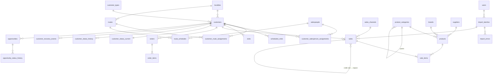

# DATA_MODEL — Districom · Inteligencia Comercial

> v0.1 · 2026-10-02 · Propuesta. Las tablas se crean por migraciones Alembic en la fase indicada (columna **Fase**).

## 1. Convenciones

- **PK**: `id BIGINT GENERATED ALWAYS AS IDENTITY`. Nunca CUIT, DNI, nombre ni código externo como PK.
- **IDs externos**: columnas `external_axum_id`, `external_store_id` (texto, nullable) con **unique parcial** `WHERE … IS NOT NULL`. Para casos ambiguos o múltiples IDs, `external_entity_mappings`.
- **Fechas de negocio**: `DATE` en zona horaria de negocio (`BUSINESS_TIMEZONE`, default `America/Argentina/Buenos_Aires`). Instantes: `TIMESTAMPTZ` (UTC).
- **Dinero**: `NUMERIC(14,2)`. Moneda en `app_settings.currency` (default `ARS`); nunca símbolo en datos.
- **Cantidades**: `NUMERIC(12,3)`.
- **Enums**: `TEXT` + `CHECK` (más fácil de migrar que `ENUM` de Postgres).
- **Auditoría estándar**: `created_at`, `updated_at` (`TIMESTAMPTZ NOT NULL DEFAULT now()`).
- **Trazabilidad**: toda fila importada lleva `import_batch_id` (FK) → responde "¿de qué importación salió este dato?".
- **Historización**: tablas de vigencia `valid_from DATE NOT NULL`, `valid_to DATE NULL` (NULL = vigente) con **exclusion constraint** (`btree_gist`) que impide solapamientos por entidad.
- Nombres en inglés, `snake_case`, tablas en plural.

## 2. ERD (resumen)

## 3. Plataforma (Fase 0)

### users
| Columna | Tipo | Notas |
|---|---|---|
| id | bigint PK | |
| email | citext UNIQUE NOT NULL | |
| password_hash | text NULL | Argon2id; NULL si identidad externa futura |
| full_name | text NOT NULL | |
| role | text NOT NULL CHECK (`admin`,`viewer`) | RBAC expandible vía `role_permissions` futura |
| active | bool NOT NULL DEFAULT true | |
| last_login_at | timestamptz | |

### user_sessions
`id`, `user_id` FK, `token_hash` (bytea UNIQUE), `created_at`, `last_seen_at`, `expires_at`, `revoked_at`, `ip`, `user_agent`. Índice `(user_id)`.

### app_settings
Parámetros comerciales y técnicos. `key text PK`, `value jsonb NOT NULL`, `description`, `updated_by` FK users, `updated_at`. Los defaults viven en código (`settings_store/defaults.py`) y la tabla solo guarda overrides; así un parámetro siempre tiene valor seguro. Cambios auditados.

### audit_events
`id`, `occurred_at`, `user_id` NULL, `event_type` (`IMPORT_STARTED`, `IMPORT_COMPLETED`, `IMPORT_FAILED`, `GOAL_CREATED`, `INCENTIVE_APPROVED`, `OPPORTUNITY_UPDATED`, `SETTING_CHANGED`, `LOGIN`, …), `entity_type`, `entity_id`, `payload jsonb` (sin PII), `request_id`. Índice `(event_type, occurred_at)`.

### source_systems
`id`, `code` UNIQUE (`AXUM`, `STORE_SYS`, `MANUAL`, `DEMO`), `name`.

## 4. Catálogos y maestros (Fase 1)

### localities
`id`, `name`, `province`, `zone` (texto, para segmentar), `normalized_name` UNIQUE.

### customer_types
`id`, `code` UNIQUE (`KIOSCO`, `ALMACEN`, `SUPERMERCADO`, `BAR`, `RESTAURANTE`, `MAYORISTA`, `AUTOSERVICIO`, `OTRO`), `name`, `sort_order`. Corrección manual permitida; el valor original del archivo se guarda en `customers.source_customer_type_raw`.

### salespeople
`id`, `external_axum_id`, `external_store_id`, `name`, `active`, `phone`, `hire_date`, timestamps.

### routes
`id`, `external_id`, `code` UNIQUE, `name`, `locality_id` FK, `active`, `description`, timestamps.

### route_schedules
Frecuencia planificada por ruta.
`id`, `route_id` FK, `weekday` smallint (1=lunes … 7=domingo), `salesperson_id` FK, `recurrence` (`WEEKLY`, `BIWEEKLY`), `valid_from`, `valid_to`.
Ruta 2×semana = 2 filas; 1×semana = 1 fila. Exclusion constraint sobre `(route_id, weekday, daterange(valid_from, valid_to))`.

### customers
| Columna | Tipo | Notas |
|---|---|---|
| id | bigint PK | |
| external_axum_id | text | unique parcial |
| external_store_id | text | unique parcial |
| code | text | código visible |
| legal_name | text | |
| trade_name | text | nombre de fantasía |
| tax_id | text | CUIT/DNI **normalizado**, no único (puede repetirse en sucursales) |
| phone, address | text | PII |
| locality_id | FK localities | |
| customer_type_id | FK customer_types | |
| source_customer_type_raw | text | valor original |
| active_in_source | bool | |
| is_generic | bool NOT NULL DEFAULT false | "Consumidor final" / mostrador. Excluido de universos (PLAN R9) |
| registered_at | date | alta en sistema fuente, si existe |
| first_purchase_date | date | derivado, mantenido por el pipeline |
| timestamps | | |

> Ruta y preventista **no** son columnas de `customers`: viven en tablas de asignación (§5).

### product_categories
`id`, `code` UNIQUE, `name`, `parent_id` FK self NULL, `sort_order`, `active`. Jerarquía de 2 niveles en V1 (categoría → subcategoría). Las métricas "categorías por cliente" usan el **nivel 1** por defecto (configurable).

### brands
`id`, `name`, `normalized_name` UNIQUE, `supplier_id` FK NULL.

### suppliers
`id`, `name`, `external_store_id`.

### products
| Columna | Notas |
|---|---|
| id, external_store_id (unique parcial), sku (UNIQUE), barcode | |
| name, category_id FK, brand_id FK, supplier_id FK | |
| presentation (texto original), volume_ml numeric NULL, package_type (`LATA`, `BOTELLA_VIDRIO`, `PET`, `BARRIL`, `CAJA`, `OTRO`) NULL | útiles para cross‑selling |
| units_per_pack int NULL | |
| active bool | |
| premium_flag bool NULL | NULL = sin clasificar; se setea manualmente o por regla configurable |
| is_returnable bool NULL | |

### sales_channels
`id`, `code` UNIQUE (`PREVENTA`, `BOCA_EXPENDIO`, `OTRO`), `name`.

## 5. Asignaciones con historia (Fase 1)

### customer_route_assignments / customer_salesperson_assignments
| Columna | Notas |
|---|---|
| id | |
| customer_id FK | |
| route_id FK / salesperson_id FK | |
| valid_from DATE NOT NULL | |
| valid_to DATE NULL | NULL = vigente |
| source | `AXUM`, `STORE_SYS`, `MANUAL` |
| import_batch_id FK NULL | |
| created_by FK users NULL | |

- Exclusion constraint: un cliente no puede tener dos asignaciones solapadas.
- `is_current` del prompt se **deriva** (`valid_to IS NULL`) en lugar de guardarse, para evitar inconsistencias.
- Cuando un import trae una asignación distinta a la vigente: se cierra la vigente (`valid_to = fecha_efectiva - 1`) y se abre una nueva. Nunca UPDATE in place.
- Vista `customer_current_assignment(customer_id, route_id, salesperson_id)`.
- Función `assignment_at(customer_id, date)` para atribución histórica.

## 6. Transacciones (Fase 1)

### sales (encabezado de comprobante)
| Columna | Tipo / Notas |
|---|---|
| id | PK |
| source_system_id | FK |
| document_type | `INVOICE`, `CREDIT_NOTE`, `DEBIT_NOTE` |
| external_document_id | text — ID oficial del documento si existe |
| invoice_number | text — formato original (ej. `A-0003-00012345`) |
| point_of_sale | text NULL |
| business_date | date NOT NULL |
| issued_at | timestamptz NULL — **solo** si la fuente trae hora (boca de expendio, PLAN R12) |
| customer_id | FK NULL — NULL solo mientras está en revisión; no entra en métricas por cliente |
| salesperson_id | FK NULL — atribución resuelta |
| route_id | FK NULL — atribución resuelta |
| attribution_source | `DOCUMENT`, `ASSIGNMENT_AT_DATE`, `UNKNOWN` |
| sales_channel_id | FK NOT NULL |
| gross_amount | numeric(14,2) — con signo |
| discount_amount | numeric(14,2) — con signo |
| net_amount | numeric(14,2) — con signo; **sin impuestos** (PLAN D4) |
| tax_amount | numeric(14,2) NULL |
| status | `VALID`, `CANCELLED` |
| original_sale_id | FK sales NULL — NC → factura original si la fuente lo informa |
| import_batch_id | FK NOT NULL |
| source_row_hash | bytea — hash de los campos de negocio, para detectar cambios en reimport |

**Unicidad (business key)**:
- `UNIQUE (source_system_id, external_document_id) WHERE external_document_id IS NOT NULL`
- `UNIQUE (source_system_id, document_type, invoice_number)` como respaldo.

**Convención de signo**: `INVOICE` y `DEBIT_NOTE` positivas; `CREDIT_NOTE` negativa. Así `SUM(net_amount)` es directamente la venta neta y no hay lógica de signo repartida en queries. Las devoluciones se modelan como `CREDIT_NOTE` (si STORE SYS tiene un documento de devolución distinto se mapea a `CREDIT_NOTE` con `return_flag=true`, columna a agregar si los datos lo requieren).

**Transacción válida**: `status = 'VALID'`. Un comprobante anulado (`CANCELLED`) no cuenta en ninguna métrica.

### sale_items
`id`, `sale_id` FK ON DELETE CASCADE, `line_number` int, `product_id` FK NULL (NULL si en revisión), `quantity` numeric (con signo igual al documento), `unit_price`, `discount_amount`, `line_net_amount` (con signo), `unit_cost` NULL.
`UNIQUE (sale_id, line_number)` → defensa de idempotencia a nivel línea.

### orders / order_items (AXUM)
`orders`: `id`, `external_axum_id` UNIQUE, `business_date`, `customer_id`, `salesperson_id`, `route_id`, `visit_id` FK NULL, `status` (`TAKEN`, `CANCELLED`), `total_amount` NULL, `import_batch_id`.
`order_items`: `id`, `order_id`, `line_number`, `product_id`, `quantity`, `unit_price` NULL. `UNIQUE (order_id, line_number)`.
Separados de `sales`. Análisis pedido → factura queda para fases posteriores.

### scheduled_visits
Clientes programados por día. Es la base de los denominadores de cumplimiento de visitas (pares cliente‑día) y de cobertura (clientes únicos); ver METRICS.md.
`id`, `business_date`, `customer_id`, `route_id`, `salesperson_id`, `source` (`AXUM` = programación exportada, `DERIVED` = generada desde `route_schedules` + asignaciones), `import_batch_id` NULL.
`UNIQUE (business_date, customer_id, route_id)`.
Si AXUM exporta programación, `DERIVED` no se genera para esas fechas. Las métricas de cumplimiento y cobertura exponen el `source` usado.

### visits
`id`, `external_axum_id` UNIQUE parcial, `business_date`, `visited_at` timestamptz NULL, `customer_id`, `route_id`, `salesperson_id`, `scheduled_visit_id` FK NULL, `scheduled` bool, `visited` bool, `outcome` (`PURCHASE`, `NO_PURCHASE`, `NOT_VISITED`, `CLOSED`, `OTHER`), `no_purchase_reason` text NULL, `had_order` bool NULL, `notes`, `import_batch_id`.
`visited = false` con `outcome = NOT_VISITED` cuando AXUM informa la no‑visita.

## 7. Importaciones y mappings (Fase 1)

### import_batches
`id`, `source_system_id`, `import_type` (`CUSTOMERS`, `PRODUCTS`, `SALES`, `VISITS`, `SCHEDULED_VISITS`, `ORDERS`, `ROUTES`, `SALESPEOPLE`), `status` (`UPLOADED`, `MAPPED`, `VALIDATED`, `IMPORTING`, `COMPLETED`, `FAILED`, `REJECTED_DUPLICATE`), `user_id`, `mapping_template_id` NULL, `started_at`, `finished_at`, `duration_ms`, `rows_read`, `rows_valid`, `rows_rejected`, `rows_inserted`, `rows_updated`, `rows_duplicate`, `rows_unchanged`, `error_count`, `warning_count`, `reprocess_of_batch_id` NULL, `notes`.

### import_files
`id`, `import_batch_id`, `original_filename` (sanitizado), `stored_path`, `size_bytes`, `mime_type`, `sha256` (índice), `sheet_name`.
Duplicado exacto: mismo `sha256` + mismo `import_type` con batch `COMPLETED` → `REJECTED_DUPLICATE`, salvo reproceso explícito por admin (queda `reprocess_of_batch_id` y auditoría).

### import_column_mappings
Plantillas: `id`, `source_system_id`, `import_type`, `name`, `mapping jsonb` (`{"customer_name": "Razón Social", …}`), `header_signature` (hash de encabezados para auto‑detección), `created_by`, timestamps.

### import_errors
`id`, `import_batch_id`, `row_number`, `column_name`, `error_code` (`MISSING_COLUMN`, `INVALID_DATE`, `INVALID_AMOUNT`, `UNKNOWN_CUSTOMER`, `UNKNOWN_PRODUCT`, `AMBIGUOUS_ID`, `DUPLICATE_ROW`, …), `severity` (`ERROR`, `WARNING`), `message`, `raw_value` (truncado; **sin** PII sensible).

### import_staging_rows
`id`, `import_batch_id`, `row_number`, `raw jsonb`, `normalized jsonb`, `status`. Se conserva N días (`staging_retention_days`, default 90) para depuración; luego se purga.

### external_entity_mappings
Resolución de identidad entre sistemas.
| Columna | Notas |
|---|---|
| id | |
| entity_type | `CUSTOMER`, `PRODUCT`, `SALESPERSON`, `ROUTE` |
| source_system_id | |
| external_id | |
| external_label | nombre tal como vino |
| entity_id | ID interno, NULL si pendiente |
| status | `AUTO_MATCHED`, `PENDING_REVIEW`, `CONFIRMED`, `REJECTED` |
| match_method | `EXACT_EXTERNAL_ID`, `EXACT_TAX_ID`, `MANUAL`, `SUGGESTED_NAME` (solo sugerencia, nunca auto) |
| decided_by, decided_at | |

`UNIQUE (entity_type, source_system_id, external_id)`. Historial de decisiones en `audit_events`.

## 8. Estado del cliente (Fase 4)

### customer_status_current
Una fila por cliente no genérico (para queries rápidas).
`customer_id` PK/FK, `health_status` (`NORMAL`, `ATTENTION`, `AT_RISK`, `DORMANT`, `LOST`, `NO_PURCHASES`), `frequency_segment` (`FREQUENT`, `REGULAR`, `OCCASIONAL`, `INSUFFICIENT_DATA`), `last_purchase_date`, `days_since_last_purchase`, `expected_interval_days` numeric, `interval_method` (`INDIVIDUAL`, `PEER_TYPE_ROUTE`, `PEER_TYPE`, `PEER_ROUTE`, `PORTFOLIO`, `DEFAULT_THRESHOLD`), `interval_observations` int, `overdue_ratio` numeric, `confidence` (`HIGH`, `MEDIUM`, `LOW`), `calculated_at`, `reference_date`, `calculation_version` (ej. `customer_status_v1`).

### customer_status_history (SCD‑2)
Mismas columnas de estado + `effective_from DATE`, `effective_to DATE NULL`. Solo se inserta fila cuando cambia `health_status` o `frequency_segment`. Exclusion constraint por cliente.

### customer_recovery_events
`id`, `customer_id`, `recovered_on` (date), `previous_status` (`DORMANT`/`LOST`), `previous_status_since`, `sale_id` FK, `amount`, `salesperson_id` (atribución de la venta), `calculation_version`. `UNIQUE (customer_id, sale_id)`.

## 9. Oportunidades, objetivos e incentivos (Fases 6–8)

### opportunities
Campos del prompt §28 más: `rule_id` + `rule_version` (reemplazan `source_rule`), `reasons jsonb` (lista estructurada `[{code, value, weight, points}]`), `dedup_key text`, `attribution_window_days`, `worked_source` (`MANUAL`, `INFERRED_VISIT`), `converted_sale_id`, `converted_amount`, `converted_quantity`, `days_to_conversion`.
Estados: `PENDING`, `COMMUNICATED`, `WORKED`, `CONVERTED`, `REJECTED`, `EXPIRED`.

**Deduplicación**: `dedup_key = type|customer_id|target_product_id|target_category_id`.
`UNIQUE (dedup_key) WHERE status IN ('PENDING','COMMUNICATED','WORKED')` → nunca dos oportunidades abiertas equivalentes. Si la regla vuelve a disparar con otro score, se **actualiza** la abierta (`score`, `reasons`, `updated_at`) y se registra en historia; no se crea otra.

### opportunity_status_history
`id`, `opportunity_id`, `from_status`, `to_status`, `changed_at`, `changed_by` NULL (sistema), `reason`, `score_at_change`.

### cross_sell_rules
`id`, `source_category_id`/`source_product_id` (uno de los dos), `target_category_id`/`target_product_id`, `weight`, `active`, `description`, `created_by`. CHECK de exactamente un source y un target.

### commercial_goals
Prompt §29 + `goal_type` CHECK (`REVENUE`, `COVERAGE`, `CONVERSION`, `RECOVERED_CUSTOMERS`, `NEW_CUSTOMERS`, `CATEGORY_PLACEMENTS`, `PRODUCT_PLACEMENTS`, `AVG_SKU`, `AVG_CATEGORIES`, `OPPORTUNITIES_CONVERTED`), `metric_id` (FK lógica al registro de métricas), `scope_filters jsonb`.

### incentives
Prompt §30. `status` (`SUGGESTED`, `APPROVED`, `ACTIVE`, `COMPLETED`, `CANCELLED`). `SUGGESTED → APPROVED` exige `approved_by` (CHECK) — nunca automático. `suggestion_inputs jsonb` (baseline, candidatos, tamaño de cartera) para explicar el target.

## 10. Reglas de deduplicación (resumen)

| Entidad | Clave |
|---|---|
| Archivo | `sha256` + `import_type` |
| Comprobante | `(source_system, external_document_id)` o `(source_system, document_type, invoice_number)` |
| Línea | `(sale_id, line_number)` |
| Visita | `external_axum_id`; si no existe: `(business_date, customer_id, salesperson_id)` |
| Programación | `(business_date, customer_id, route_id)` |
| Cliente/producto/preventista | ID externo por sistema vía `external_entity_mappings` |
| Oportunidad abierta | `dedup_key` con unique parcial |
| Recuperación | `(customer_id, sale_id)` |

Reimport de un comprobante existente: si `source_row_hash` igual → `unchanged`; si distinto → `updated` (las líneas se reemplazan dentro de la transacción) y queda registrado en el batch.

## 11. Índices iniciales

Diseñados desde las queries previstas; se revisan con `EXPLAIN ANALYZE` al implementar cada fase.

| Tabla | Índice | Query que lo usa |
|---|---|---|
| sales | `(business_date)` | todo KPI por período |
| sales | `(customer_id, business_date)` | frecuencia, cliente 360°, estados |
| sales | `(salesperson_id, business_date)`, `(route_id, business_date)` | breakdowns |
| sales | `(sales_channel_id, business_date)` | preventa vs boca |
| sale_items | `(sale_id)`, `(product_id)` | penetración, SKU por cliente |
| visits | `(business_date, route_id)`, `(customer_id, business_date)` | cumplimiento, cobertura, conversión |
| scheduled_visits | `(business_date, route_id)` | cumplimiento, cobertura |
| assignments | GiST `(customer_id, daterange)` | atribución histórica |
| opportunities | `(status, priority)`, `(customer_id)` | listados |
| customer_status_current | `(health_status)` | listas de riesgo |

## 12. Datos demo (estrategia)

Generador reproducible con seed fijo (`scripts/seed_demo_data.py --seed 42`) que **pasa por el pipeline de importación** (genera XLSX/CSV con formato AXUM/STORE SYS simulado), para probar el pipeline real además de poblar datos. Patrones inyectados y verificables (prompt §103): ruta con baja cobertura, preventista con cobertura alta y conversión baja, ruta con baja penetración de energizantes, dormidos, recuperados, mix chico, premium, categorías correlacionadas, estacionalidad semanal, pico de boca viernes 18–20 h. Cada patrón tiene un test que verifica que la métrica correspondiente lo detecta.
